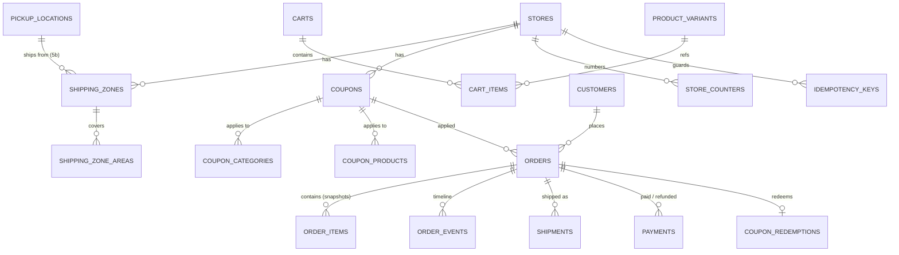
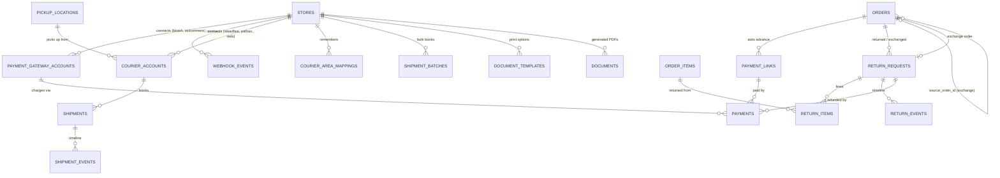

# Database Design

Status: Accepted (Phase 0). Engine: **PostgreSQL 16+**. ADR 0001. Read MULTI-TENANCY.md first.

## 1. Why PostgreSQL (not MySQL 8)
1. **Row-Level Security** — native defense-in-depth for a shared-schema SaaS; MySQL has no equivalent.
2. **Partial & expression indexes** — e.g. `UNIQUE (tenant_id, sku) WHERE deleted_at IS NULL`,
   `UNIQUE (lower(email))`; MySQL needs generated-column workarounds.
3. **`jsonb` + GIN** — theme configs, page sections, product attributes, provider payloads are queryable
   and validatable (`CHECK (jsonb_typeof(config)='object')`).
4. **Transactional DDL** — failed migrations roll back cleanly.
5. **Composite FKs, `CHECK` constraints, deferrable constraints, `timestamptz`, `citext`** all first-class.
6. Full-text search (`tsvector`) is good enough for product search until a dedicated engine is warranted.
Contract already fixes Postgres on port 5432. MySQL is not supported; no MySQL-compat code paths.

## 2. Global conventions
| Rule | Detail |
|---|---|
| PK | `id char(26)` ULID, app-generated (`HasUlids`). Sortable by creation time. |
| Tenant column | `tenant_id char(26) NOT NULL` on every tenant-owned table, FK → `tenants.id ON DELETE RESTRICT`. |
| Tenant key for composite FKs | Every tenant-owned parent table has `UNIQUE (tenant_id, id)`. Children reference `(tenant_id, parent_id) → parent(tenant_id, id)`. This makes a cross-tenant reference **impossible** at DB level. |
| Store key (D1) | One store per tenant today, but **store-scoped** tables (marked `[S]` below) also have `store_id char(26) NOT NULL` with composite FK `(tenant_id, store_id) → stores(tenant_id, id)`, and expose `UNIQUE (tenant_id, store_id, id)`; their children reference `(tenant_id, store_id, parent_id) → parent(tenant_id, store_id, id)`, so a row can't point at another store's row. Business uniques are per store (e.g. `U(store_id, sku)`). Store-scoped: store_domains, store_settings, store_themes, store_pages, store_navigation, redirects, categories, products, product_variants, product_images, product_categories, inventories, inventory_movements, customers, customer_addresses, carts, cart_items, shipping_methods, coupons, orders, order_items, order_status_history, payments, payment_gateway_accounts, shipping_orders, idempotency_keys, store_counters; Phase 5a adds pickup_locations, shipping_zones, shipping_zone_areas, coupon_categories, coupon_products, order_events, shipments, coupon_redemptions (§5.1); Phase 5b adds payment_links, webhook_events, courier_accounts, shipment_events, courier_area_mappings, shipment_batches, return_requests, return_items, return_events, document_templates, documents (§5.2); Phase 8.4 adds webhook_endpoints, webhook_secrets, webhook_deliveries (§5.4). Tenant-scoped only: tenant_users, roles, role_permissions (8.3), api_keys (8.4), media, subscriptions, subscription_items, invoices, audit_logs (nullable `store_id` column for filtering, no FK requirement). |
| Indexes | Lead with `tenant_id`. Every FK column is indexed (composite with `tenant_id`). On `[S]` tables every listed `IX(tenant_id, x…)` is implemented as `IX(tenant_id, store_id, x…)`. |
| Timestamps | `created_at`, `updated_at timestamptz NOT NULL DEFAULT now()`. |
| Soft deletes | `deleted_at timestamptz` only on: `products`, `product_variants`, `categories`, `customers`, `store_pages`, `stores`, `tenants`. Unique constraints on those are partial `WHERE deleted_at IS NULL`. Orders/payments are never deleted. |
| Money | `*_amount bigint NOT NULL` in minor units (BDT poisha) + `currency char(3)`. `CHECK (amount >= 0)` where applicable. |
| Enums | `varchar(32)` + `CHECK (col IN (...))`, mirrored by PHP backed enums. (No PG enum types — painful to alter.) |
| Strings | `varchar(n)` with explicit limits; emails `citext`. |
| JSON | `jsonb`, with `CHECK (jsonb_typeof(x) = 'object')`. |
| Booleans | `boolean NOT NULL DEFAULT false`. |
| Extensions | `citext`, `pg_trgm` (product search fuzzy), `btree_gin`. |

Notation below: **PK** primary key, **FK(t)** composite tenant FK `(tenant_id, col) → table(tenant_id, id)`,
**U** unique, **IX** index. Every tenant-owned table also implicitly has `U(tenant_id, id)` and `IX` on `tenant_id`.

## 3. ERD (core)

```mermaid
erDiagram
  TENANTS ||--|| STORES : owns
  TENANTS ||--o{ TENANT_USERS : has
  USERS ||--o{ TENANT_USERS : member
  STORES ||--o{ STORE_DOMAINS : "served at"
  STORES ||--|| STORE_SETTINGS : has
  STORES ||--o{ STORE_THEMES : has
  THEMES ||--o{ STORE_THEMES : instantiates
  STORES ||--o{ STORE_PAGES : has
  STORES ||--o{ STORE_NAVIGATION : has
  STORES ||--o{ PRODUCTS : sells
  PRODUCTS ||--o{ PRODUCT_VARIANTS : has
  PRODUCTS ||--o{ PRODUCT_IMAGES : has
  MEDIA ||--o{ PRODUCT_IMAGES : file
  PRODUCTS ||--o{ PRODUCT_CATEGORIES : in
  CATEGORIES ||--o{ PRODUCT_CATEGORIES : groups
  CATEGORIES ||--o{ CATEGORIES : parent
  PRODUCT_VARIANTS ||--|| INVENTORIES : stock
  INVENTORIES ||--o{ INVENTORY_MOVEMENTS : ledger
  STORES ||--o{ CUSTOMERS : has
  CUSTOMERS ||--o{ CUSTOMER_ADDRESSES : has
  CUSTOMERS ||--o{ CARTS : has
  CARTS ||--o{ CART_ITEMS : contains
  PRODUCT_VARIANTS ||--o{ CART_ITEMS : refs
  CUSTOMERS ||--o{ ORDERS : places
  ORDERS ||--o{ ORDER_ITEMS : contains
  PRODUCT_VARIANTS ||--o{ ORDER_ITEMS : snapshot
  ORDERS ||--o{ ORDER_STATUS_HISTORY : log
  ORDERS ||--o{ PAYMENTS : paid_by
  SHIPPING_METHODS ||--o{ ORDERS : chosen
  ORDERS ||--o{ SHIPPING_ORDERS : shipped_as
  COUPONS ||--o{ ORDERS : applied
  PLANS ||--o{ SUBSCRIPTIONS : priced
  TENANTS ||--o{ SUBSCRIPTIONS : subscribes
  SUBSCRIPTIONS ||--o{ SUBSCRIPTION_ITEMS : has
  SUBSCRIPTIONS ||--o{ INVOICES : bills
  TENANTS ||--o{ AUDIT_LOGS : records
  USERS ||--o{ AUDIT_LOGS : actor

  TENANTS { char26 id PK; string name; string status }
  STORES { char26 id PK; char26 tenant_id FK; string slug UK; string status }
  STORE_DOMAINS { char26 id PK; char26 tenant_id FK; char26 store_id FK; string hostname UK; string status }
  USERS { char26 id PK; citext email UK; string platform_role }
  TENANT_USERS { char26 id PK; char26 tenant_id FK; char26 user_id FK; string role }
  PRODUCTS { char26 id PK; char26 tenant_id FK; char26 store_id FK; string slug; string type; string status }
  PRODUCT_VARIANTS { char26 id PK; char26 tenant_id FK; char26 product_id FK; string sku; bigint price_amount }
  INVENTORIES { char26 id PK; char26 tenant_id FK; char26 variant_id FK; int on_hand; int reserved }
  ORDERS { char26 id PK; char26 tenant_id FK; char26 store_id FK; string number; string status; bigint total_amount }
  PAYMENTS { char26 id PK; char26 tenant_id FK; char26 order_id FK; string provider; string status }
```

## 4. Platform tables (no tenant_id)

### users
| col | type | notes |
|---|---|---|
| id | char(26) PK | |
| name | varchar(120) | |
| email | citext | **U** |
| phone | varchar(20) null | E.164 |
| password | varchar(255) | argon2id |
| email_verified_at, phone_verified_at | timestamptz null | |
| platform_role | varchar(16) null | `CHECK IN ('super_admin','billing','support','read_only')`; null = normal user (**amended** by PHASE-8-1 P8-2; more staff columns in its §5.1) |
| two_factor_secret, two_factor_recovery_codes | text null | encrypted cast |
| last_login_at | timestamptz null | |
| created_at, updated_at | timestamptz | |

### tenants
id PK · name varchar(160) · status varchar(32) `CHECK IN ('active','suspended','closed')` default active ·
owner_user_id char(26) FK users RESTRICT · country char(2) · default_currency char(3) default 'BDT' ·
timezone varchar(64) default 'Asia/Dhaka' · trial_ends_at timestamptz null · deleted_at · timestamps.
IX(status). IX(owner_user_id).

### plans
id PK · code varchar(40) **U** · name · price_amount bigint · currency char(3) · interval varchar(16)
`CHECK IN ('month','year')` · trial_days smallint · limits jsonb (`{"products":100,"staff":2,"custom_domain":true,...}`) ·
features jsonb · is_active boolean · sort smallint · timestamps.
As built: `limits` keys `orders_per_month`, `staff_seats`, `products`, `courier_connections`, `sms_per_month`, and from
Phase 6 `custom_domains` (Free 0, Starter 2, Growth 5; migration `2026_07_01_000300`); `custom_domain` is a **feature**
(Starter+), not a limit.

### themes (platform registry mirror)
id PK · code varchar(40) **U** (`classic`, `minimal`) · name · latest_version varchar(16) · is_active ·
preview_image_url · timestamps. Theme code/schemas live in the storefront repo; this table controls availability.

### personal_access_tokens
Laravel Sanctum default, `tokenable_id char(26)`. `expires_at` set at issue from `SANCTUM_EXPIRATION` (default 10080 min = 7 days, not sliding, D3); `sanctum:prune-expired --hours=24` daily.

## 5. Tenant-owned core tables

### tenant_users
id PK · tenant_id FK tenants · user_id FK users · role varchar(32) `CHECK IN ('owner','admin','staff','custom')` ·
role_id char(26) FK(t) roles RESTRICT (Phase 8.3) ·
status `CHECK IN ('invited','active','disabled')` · invited_by char(26) null · timestamps.
**U(tenant_id, user_id)**. IX(user_id). IX(tenant_id, role_id). Partial **U(tenant_id) WHERE role='owner'** (exactly one owner).
Phase 8.3 (ADR 0017): `role_id` is the source of truth; `role` is a denormalised kind = `roles.key ?? 'custom'`, written
in the same transaction. `staff_invitations` gains the same `role_id` (NOT NULL, FK(t) RESTRICT).

### roles · role_permissions (Phase 8.3, PHASE-8-3 §5, ADR 0017)
**roles**: id PK · tenant_id FK tenants CASCADE · key varchar(16) null `CHECK IN ('owner','admin','staff')` · name
varchar(40) · description varchar(200) null · is_system boolean · revision integer default 1 · created_by, updated_by
char(26) null FK users SET NULL · timestamps. **U(tenant_id, id)** · **U(tenant_id, key) WHERE key IS NOT NULL** ·
**U(tenant_id, lower(name))** · `CHECK (is_system = (key IS NOT NULL))`. Three system rows per tenant (seeded at
registration and by backfill `2026_11_01_000300`); their permissions are code (`SystemRole`), not rows.
**role_permissions**: tenant_id · role_id · permission varchar(48) `CHECK (permission ~ '^[a-z]+\.[a-z_]+$')` ·
created_at. **PK(tenant_id, role_id, permission)**; FK (tenant_id, role_id) → roles(tenant_id, id) CASCADE. Custom
roles only; keys are `App\Domain\Tenancy\Authorization\Permission` values (unknown keys ignored on read).

### stores
id PK · tenant_id · name varchar(160) · slug varchar(63) · status `CHECK IN ('draft','active','suspended')` ·
country char(2) · currency char(3) · business_category varchar(64) null · logo_media_id, favicon_media_id FK(t) media null ·
published_at timestamptz null · deleted_at · timestamps.
**U(slug) WHERE deleted_at IS NULL** (global — slug is a subdomain). **U(tenant_id)** — exactly one store per tenant
(D1, revised). **U(tenant_id, id)** (composite FK target). `store_id` columns on store-scoped tables are kept so multi-store
can be enabled later by dropping `U(tenant_id)`.
`CHECK (slug ~ '^[a-z0-9](?:[a-z0-9-]{1,61}[a-z0-9])$')`.

### store_domains
Phase 1 built a minimal table (id, tenant_id, store_id FK(t) CASCADE, hostname **U**, type, status, is_primary,
verification_token, verified_at, timestamps; RLS forced since 5b-1). **Phase 6** (PHASE-6-CONTRACT §3.1, migration
`2026_07_01_000100_extend_store_domains`, forward-only) brings it to:

id PK · tenant_id · store_id FK(t) stores CASCADE · hostname varchar(253) (lowercase ASCII/punycode, no trailing dot;
CHECK `hostname = lower(hostname)`) · display_hostname varchar(253) null (Unicode, informational) · type
`CHECK IN ('platform','custom')` · is_primary boolean · status `CHECK IN ('pending_verification','verification_failed','verified','ssl_provisioning','active','expired','suspended')` ·
verification_token varchar(64) (52-char base32; CHECK `type = 'platform' OR verification_token IS NOT NULL`) ·
verification_started_at, verified_at, activated_at, status_changed_at, last_checked_at, next_check_at, first_failed_at
timestamptz null · check_attempts int default 0 · failure_code varchar(48) null · failure_message varchar(255) null ·
last_check jsonb null (per-record DNS observations, resolver outcome; no secrets) · provider varchar(16) null
`CHECK IN ('cloudflare','fake')` · provider_hostname_id varchar(64) null (Cloudflare custom hostname id) ·
provider_status, ssl_status varchar(32) null (raw provider values) · created_by FK users nullOnDelete · timestamps
(timestamptz). CHECK `type = 'custom' OR status = 'active'`; CHECK `NOT is_primary OR status = 'active'`.
**U(hostname)** (global — one host maps to one store). Partial **U(store_id) WHERE is_primary**. `U(tenant_id, id)`,
`U(tenant_id, store_id, id)`. Partial U(provider_hostname_id) WHERE not null. `IX(next_check_at) WHERE next_check_at
IS NOT NULL` (platform scheduler, read only via `pgsql_admin`; deliberate exception to tenant-led indexes).
`IX(tenant_id, store_id, type)`. Pre-tenant lookups: `sp_resolve_host` (storefront, `active` only),
`sp_domain_claim_state` (add/reclaim), `sp_domain_allowed` (`ask` endpoint). The verification method is always TXT
(ownership) + CNAME/flattened (routing); Cloudflare's own DCV is HTTP and not stored. No soft deletes.

### store_settings (1:1 store)
id PK · tenant_id · store_id FK(t) **U** · contact_email citext null · contact_phone · address jsonb ·
social_links jsonb · seo_title varchar(70) · seo_description varchar(160) · og_image_media_id null ·
checkout jsonb (`guest_checkout`, `cod_enabled`, `min_order_amount`) · tax jsonb (`inclusive`, `rate_bps`) ·
locale varchar(10) default 'en' · timestamps.

### store_themes
id PK · tenant_id · store_id FK(t) · theme_code varchar(40) FK themes(code) · theme_version varchar(16) ·
draft_config jsonb · published_config jsonb null · published_at timestamptz null · is_active boolean · timestamps.
**U(store_id, theme_code)**. Partial **U(store_id) WHERE is_active**. CHECK jsonb object.

### store_pages
id PK · tenant_id · store_id FK(t) · slug varchar(120) · title varchar(160) · type
`CHECK IN ('custom','about','contact','policy','faq')` · sections jsonb (same section schema as theme) ·
body_html text null (sanitized server-side) · seo jsonb · status `CHECK IN ('draft','published')` · deleted_at · timestamps.
**U(store_id, slug) WHERE deleted_at IS NULL**.

### store_navigation
id PK · tenant_id · store_id FK(t) · location `CHECK IN ('header','footer')` · items jsonb
(`[{label, type:'url'|'page'|'category'|'product', ref, children:[]}]`, max depth 2) · timestamps.
**U(store_id, location)**.

### media
id PK · tenant_id · disk varchar(16) · path varchar(255) · mime varchar(64) · size_bytes int · width, height int null ·
alt varchar(255) null · checksum char(64) · uploaded_by char(26) · timestamps. **U(path)**. IX(tenant_id, created_at).

> **Phase 4 (binding detail in PHASE-4-CONTRACT §2):** catalog tables below are refined there: triple store FKs
> `(tenant_id, store_id, parent_id)`, `products.description` is RichTextDoc jsonb (no HTML), `tags` jsonb, options as
> `products.options` + `product_variants.option1..3`, case-insensitive SKU unique per store, `inventories.committed`
> (was `reserved`), ledger reasons `initial|received|correction|damaged|lost|returned|import|other`, customers without
> password/addresses (Phase 5), new `customer_notes`, `data_imports`, `data_import_rows`, `data_exports`.

### categories [S]
id PK · tenant_id · store_id · parent_id FK(t) categories null SET NULL · name varchar(120) · slug varchar(140) ·
description text null · image_media_id null · position int · is_visible boolean · seo jsonb · deleted_at · timestamps.
**U(store_id, slug) WHERE deleted_at IS NULL**. IX(tenant_id, parent_id, position).

### products [S]
id PK · tenant_id · store_id · name varchar(200) · slug varchar(220) · type `CHECK IN ('simple','variable')` ·
status `CHECK IN ('draft','active','archived')` · description_html text (sanitized) · short_description varchar(500) ·
brand varchar(120) null · tags text[] default '{}' · options jsonb (`[{name:'Size', values:['S','M']}]`) ·
seo jsonb · search tsvector GENERATED · published_at · deleted_at · timestamps.
**U(store_id, slug) WHERE deleted_at IS NULL**. IX(tenant_id, status, created_at). GIN(search). GIN(tags).
Price lives on variants; a simple product has exactly one variant (`is_default`).

### product_variants [S]
id PK · tenant_id · store_id · product_id FK(t) products CASCADE · sku varchar(64) null · barcode varchar(64) null ·
option_values jsonb (`{"Size":"M"}`) · price_amount bigint · compare_at_amount bigint null ·
cost_amount bigint null · currency char(3) · weight_grams int null · is_default boolean · position int ·
track_inventory boolean default true · allow_backorder boolean default false · deleted_at · timestamps.
**U(store_id, sku) WHERE sku IS NOT NULL AND deleted_at IS NULL**. IX(tenant_id, product_id).
CHECK(price_amount >= 0).

### product_images
id PK · tenant_id · product_id FK(t) CASCADE · variant_id FK(t) null · media_id FK(t) · position int · timestamps.
IX(tenant_id, product_id, position).

### product_categories (pivot)
tenant_id · product_id FK(t) CASCADE · category_id FK(t) CASCADE · position int. **PK(tenant_id, product_id, category_id)**.
IX(tenant_id, category_id, position).

### inventories (1:1 variant, single location until Phase 8 multi-location)
id PK · tenant_id · variant_id FK(t) **U** · on_hand int · reserved int default 0 · low_stock_threshold int null · timestamps.
CHECK(reserved >= 0). CHECK(on_hand >= 0 OR backorder allowed — enforced in app). Stock changes use
`UPDATE ... SET reserved = reserved + :q WHERE id=:id AND on_hand - reserved >= :q` (atomic, no race).

### inventory_movements (append-only ledger)
id PK · tenant_id · variant_id FK(t) · delta int · reason `CHECK IN ('manual','order_reserved','order_released','order_fulfilled','return','import','adjustment','pos_sale','transfer')` ·
reference_type varchar(32) null · reference_id char(26) null · actor_user_id null · note varchar(255) · created_at.
IX(tenant_id, variant_id, created_at).

### customers [S]
id PK · tenant_id · store_id · name varchar(120) · email citext null · phone varchar(20) null · password varchar(255) null
(null = guest) · accepts_marketing boolean · notes text · tags text[] · orders_count int · total_spent_amount bigint ·
risk_flags jsonb (fake-order guard later) · last_order_at · deleted_at · timestamps.
**U(store_id, email) WHERE email IS NOT NULL AND deleted_at IS NULL**; **U(store_id, phone) WHERE phone IS NOT NULL AND deleted_at IS NULL**.
Customers are per-store identities, never shared across stores or tenants.

### customer_addresses
id PK · tenant_id · customer_id FK(t) CASCADE · name · phone · line1 · line2 · area varchar(120) · city varchar(80) ·
district varchar(80) · postal_code varchar(10) · country char(2) · is_default boolean · timestamps.

> **Phase 5a (as built):** the planned `carts`, `cart_items`, `shipping_methods`, `coupons`, `orders`, `order_items`,
> `order_status_history`, `payments`, `shipping_orders` and `idempotency_keys` entries below are superseded by §5.1
> (migrations `2026_05_01_*`, PHASE-5-CONTRACT §2). `shipping_methods` became `shipping_zones`; `order_status_history`
> became `order_events`; `shipping_orders` became `shipments` (5b widens it). Kept below as the Phase 0 design record.
> The Phase 0 `payment_gateway_accounts` and `webhook_events` entries are likewise superseded by §5.2 (Phase 5b, as built).

### carts
id PK · tenant_id · store_id FK(t) · customer_id FK(t) null · token_hash char(64) (sha256 of opaque cart token) ·
currency char(3) · coupon_code varchar(40) null · status `CHECK IN ('active','converted','abandoned')` ·
expires_at timestamptz · timestamps. **U(token_hash)**. IX(tenant_id, status, updated_at).

### cart_items
id PK · tenant_id · cart_id FK(t) CASCADE · variant_id FK(t) · quantity int CHECK(1..999) · timestamps.
**U(cart_id, variant_id)**. Prices are never stored on cart items; always recomputed server-side.

### shipping_methods
id PK · tenant_id · store_id FK(t) · name varchar(80) · type `CHECK IN ('flat','free_over','zone')` ·
rate_amount bigint · currency char(3) · rules jsonb (zones: `inside_dhaka`/`outside_dhaka`, threshold) ·
courier_provider varchar(32) null · is_active · position · timestamps.

### coupons (Phase 5, needed by checkout)
id PK · tenant_id · code varchar(40) · type `CHECK IN ('percent','fixed','free_shipping')` · value int
(bps for percent, minor units for fixed) · min_subtotal_amount bigint null · usage_limit int null ·
usage_per_customer int null · used_count int · starts_at, ends_at · is_active · timestamps.
**U(store_id, upper(code))**.

### orders [S]
id PK · tenant_id · store_id FK(t) · number varchar(20) (per-store sequence, e.g. `1001`) · customer_id FK(t) null ·
status `CHECK IN ('pending_payment','pending','confirmed','processing','shipped','delivered','cancelled','returned','failed')` ·
payment_status `CHECK IN ('unpaid','authorized','paid','partially_refunded','refunded','failed')` ·
fulfillment_status `CHECK IN ('unfulfilled','partial','fulfilled')` · payment_method varchar(32) (`cod`,`bkash`,`sslcommerz`) ·
currency char(3) · subtotal_amount, discount_amount, shipping_amount, tax_amount, total_amount bigint ·
coupon_id FK(t) null · coupon_code varchar(40) null · shipping_method_id FK(t) null ·
customer_snapshot jsonb (name/email/phone) · shipping_address jsonb · billing_address jsonb null ·
notes text · source `CHECK IN ('storefront','pos','manual','inbox','api')` · ip inet · user_agent varchar(255) ·
idempotency_key varchar(64) · placed_at, cancelled_at timestamptz · timestamps.
**U(store_id, number)**. **U(store_id, idempotency_key)**. IX(tenant_id, status, placed_at DESC).
IX(tenant_id, customer_id). CHECK(total_amount = subtotal_amount - discount_amount + shipping_amount + tax_amount).
Order numbers from `store_counters(tenant_id, store_id, key, value)` row updated `... RETURNING value` in the order transaction.

### order_items
id PK · tenant_id · order_id FK(t) CASCADE · product_id FK(t) null SET NULL · variant_id FK(t) null SET NULL ·
product_name varchar(200) · variant_title varchar(120) · sku varchar(64) · unit_price_amount bigint · quantity int ·
discount_amount bigint · total_amount bigint · timestamps. IX(tenant_id, order_id). Snapshots so deletes never break history.

### order_status_history
id PK · tenant_id · order_id FK(t) · from_status, to_status varchar(32) · actor_type `CHECK IN ('user','customer','system','webhook')` ·
actor_id char(26) null · note varchar(500) · created_at. IX(tenant_id, order_id, created_at).

### payments
id PK · tenant_id · order_id FK(t) · provider varchar(32) (`cod`,`bkash`,`sslcommerz`,`nagad`) · type
`CHECK IN ('charge','refund')` · status `CHECK IN ('initiated','pending','authorized','succeeded','failed','cancelled','refunded')` ·
amount bigint CHECK(>0) · currency char(3) · provider_reference varchar(128) null · provider_payment_id varchar(128) null ·
idempotency_key varchar(64) · raw_request jsonb · raw_response jsonb (secrets stripped) · verified_at timestamptz null ·
failure_code varchar(64) · parent_payment_id FK(t) null (refund → charge) · timestamps.
**U(provider, provider_payment_id) WHERE provider_payment_id IS NOT NULL**. **U(tenant_id, idempotency_key)**. IX(tenant_id, order_id).

### payment_gateway_accounts (merchant credentials)
id PK · tenant_id · provider · mode `CHECK IN ('sandbox','live')` · credentials text (encrypted cast, never returned by API) ·
is_active · timestamps. **U(store_id, provider)**.

### shipping_orders (courier consignments)
id PK · tenant_id · order_id FK(t) · provider `CHECK IN ('pathao','steadfast','redx','manual')` · consignment_id varchar(64) ·
tracking_code varchar(64) · status `CHECK IN ('created','pending_pickup','picked_up','in_transit','delivered','returned','cancelled','failed')` ·
cod_amount bigint · delivery_fee_amount bigint · raw_response jsonb · last_synced_at · timestamps.
**U(provider, consignment_id)**. IX(tenant_id, order_id). IX(tenant_id, status).

### webhook_events (inbound, platform-level but tenant-tagged)
id PK · tenant_id null (resolved after verification) · provider · event_id varchar(128) · signature_valid boolean ·
payload jsonb · processed_at · error text · created_at. **U(provider, event_id)** — idempotent processing.

### idempotency_keys
id PK · tenant_id · key varchar(64) · scope varchar(64) (route) · request_hash char(64) · response_status smallint ·
response_body jsonb · locked_until timestamptz · created_at. **U(store_id, scope, key)** (store_id nullable for tenant-level routes; then **U(tenant_id, scope, key) WHERE store_id IS NULL**). Rows purged after 24 h.

### redirects (SEO)
id PK · tenant_id · store_id FK(t) · from_path varchar(512) · to_path varchar(512) · code smallint CHECK IN (301,302) · timestamps.
**U(store_id, from_path)**.

### subscriptions
**Phase 7 (PHASE-7-CONTRACT §5.1, migration `2026_08_01_000100`)** adds `billing_interval` (`month`|`year`),
`scheduled_plan_id`/`scheduled_interval`, `past_due_at`, `grace_ends_at`, `domain_grace_ends_at`, `ended_at`,
`ended_reason` (`unpaid`|`cancelled`), `cancelled_at`, `plan_changed_at`, `notices jsonb`; timestamps become
`timestamptz`; discovery indexes `IX(status, current_period_end)`, `IX(status, trial_ends_at)`. `plans` gains
`price_yearly_amount`. The design below (provider columns) is superseded where it differs.
id PK · tenant_id · plan_id FK plans · status `CHECK IN ('trialing','active','past_due','cancelled','expired')` ·
current_period_start, current_period_end, trial_ends_at, cancelled_at timestamptz · cancel_at_period_end boolean ·
provider varchar(32) · provider_subscription_id varchar(128) null · timestamps.
Partial **U(tenant_id) WHERE status IN ('trialing','active','past_due')**.

### subscription_items
**Not built** (no add-ons in Phase 7; PHASE-7-CONTRACT §5.1).
id PK · tenant_id · subscription_id FK(t) · type `CHECK IN ('plan','addon')` · code varchar(40) · quantity int ·
unit_amount bigint · currency char(3) · timestamps.

### invoices (SaaS billing)
**Superseded by `billing_invoices` + `billing_payments` (Phase 7, §5.3 below).**
id PK · tenant_id · subscription_id FK(t) null · number varchar(24) **U** (global `SP-2026-000123`) · status
`CHECK IN ('draft','open','paid','void','uncollectible')` · subtotal_amount, tax_amount, total_amount bigint · currency ·
due_at, paid_at · provider_payment_id null · lines jsonb · pdf_path null · timestamps. IX(tenant_id, created_at DESC).

### audit_logs (append-only; app role has INSERT/SELECT only)
id PK · tenant_id null (null = platform action) · store_id null · actor_type `CHECK IN ('user','platform_admin','system','api_key')` ·
actor_id char(26) null · action varchar(64) (`product.updated`, `domain.verified`, `staff.role_changed`) ·
subject_type varchar(64) · subject_id char(26) · changes jsonb (before/after, secrets redacted) · ip inet ·
user_agent varchar(255) · request_id varchar(64) · created_at. IX(tenant_id, created_at DESC). IX(tenant_id, subject_type, subject_id).
Partitioned by month (`PARTITION BY RANGE (created_at)`) from Phase 9.

## 5.1 Phase 5a commerce tables (as built)
Source: `apps/api/database/migrations/2026_05_01_000100` … `002100`; binding detail in PHASE-5-CONTRACT §2.
Notation as Phase 4: every table has `tenant_id char(26) NOT NULL` FK tenants **CASCADE** (so 5b RLS needs no schema
change) and `store_id`; **FK(s)** = `(tenant_id, store_id) → stores(tenant_id, id)` CASCADE; **FK3(t)** = triple FK
`(tenant_id, store_id, col) → t(tenant_id, store_id, id)`. Parents expose `U(tenant_id, id)` and
`U(tenant_id, store_id, id)`. Timestamps are `timestamptz`. Money is `bigint` paisa. Enum and range **CHECKs are
Postgres-only** (the app validates on both drivers); partial unique indexes are created on Postgres **and** sqlite.
Phase 5b alters `orders`, `payments`, `shipments`, `order_items`, `order_events` and `store_settings`: see §5.2.



### Changes to existing tables
- **stores** (000100): + `published_at timestamptz null`. Backfill: `active` stores get `published_at = updated_at`.
- **store_settings** (000200): + `cod_enabled boolean default true` · `free_delivery_over_amount bigint null`
  CHECK `NULL OR BETWEEN 100 AND 1000000000` · `order_prefix varchar(6) null` CHECK `NULL OR ~ '^[A-Z]{1,6}$'` ·
  `notify_new_order_email boolean default true` · `customer_sms jsonb default
  '{"order_placed":true,"order_confirmed":false,"order_shipped":true,"order_cancelled":true}'` ·
  `sms_language varchar(2) default 'bn'` CHECK IN (`bn`,`en`).
- **customers** (001900): + `delivered_orders_count int default 0`, `returned_orders_count int default 0` (written
  only by `OrderService`, P5-22).
- **inventory_movements** (002000): reason CHECK widened to `initial, received, correction, damaged, lost, returned,
  import, other, order_shipped, order_returned` (Postgres; sqlite has no CHECK). `reference_type` has no CHECK and takes
  `order` as is. Committing stock writes **no** ledger row (P5-5).
- **plans** (002100, data only): re-runs the idempotent `PlanSeeder` to add `limits.sms_per_month` (Free 200,
  Starter 2 000, Growth null = unlimited; P5-26/Q33). No schema change.

### store_counters [S]
tenant_id · store_id FK(s) · key varchar(32) · value bigint · timestamps. **PK(store_id, key)**. No `id`. Written only
by `StoreCounter::next($key)` (`INSERT … ON CONFLICT DO UPDATE SET value = value + 1 RETURNING value` inside the order
transaction, so a rolled-back checkout leaves no gap). Key `orders` starts at 1001.

### pickup_locations [S]
id PK · tenant_id · store_id FK(s) · name varchar(60) · contact_name varchar(80) null · contact_phone varchar(13) null ·
district_code varchar(32) · thana_code varchar(48) · address_line varchar(255) · is_default boolean default false ·
timestamps. U(tenant_id, id). U(tenant_id, store_id, id). Partial **U(store_id) WHERE is_default**. Max 10 per store
(app rule).

### shipping_zones [S]
id PK · tenant_id · store_id FK(s) · name varchar(60) · kind varchar(16) `CHECK IN ('custom','fallback')` ·
charge_amount bigint CHECK `BETWEEN 0 AND 1000000` · min_days smallint CHECK `BETWEEN 0 AND 30` · max_days smallint
CHECK `max_days >= min_days AND max_days <= 30` · is_active boolean default true (CHECK `kind <> 'fallback' OR
is_active`) · position smallint default 0 · pickup_location_id FK3(pickup_locations) null **RESTRICT** (5b courier
routing) · timestamps. U(tenant_id, id). U(tenant_id, store_id, id). Partial **U(store_id) WHERE kind = 'fallback'**
(exactly one "Outside Dhaka" fallback). IX(tenant_id, store_id, position).
Defaults (P5-8, `shipping:provision-defaults`, DemoSeeder): "Inside Dhaka" ৳ 70, 1–2 days = the **50** Dhaka
Metropolitan Police thanas of the geo dataset (as built; Figma says "41 thanas"), fallback "Outside Dhaka" ৳ 130,
2–4 days.

### shipping_zone_areas [S]
tenant_id · store_id · zone_id FK3(shipping_zones) CASCADE · district_code varchar(32) · thana_code varchar(48)
default `''` (`''` = whole district). **PK(zone_id, district_code, thana_code)**. **U(store_id, district_code,
thana_code)** (an area is in at most one zone; a violation maps to 422 `validation_failed` on `zones.N.areas.M`, not
409). IX(tenant_id, store_id, district_code). Resolution: active zone with the thana → active zone with the whole
district → fallback.

### coupons [S]
id PK · tenant_id · store_id FK(s) · code varchar(32) (CHECK `code = upper(code)`) · type varchar(16)
`CHECK IN ('percentage','fixed','free_shipping')` · percent_bps int null CHECK `BETWEEN 1 AND 10000` · amount bigint
null CHECK `BETWEEN 1 AND 1000000000` · max_discount_amount bigint null CHECK `>= 1` · applies_to varchar(16) default
`'all'` `CHECK IN ('all','categories','products')` · min_subtotal_amount bigint null CHECK `>= 0` · usage_limit int null
CHECK `>= 1` · usage_per_customer int null CHECK `>= 1` · first_order_only boolean default false · starts_at
timestamptz · ends_at timestamptz null CHECK `ends_at IS NULL OR ends_at > starts_at` · status varchar(16) default
`'draft'` `CHECK IN ('draft','active','disabled')` (`expired`, `used_up` are derived) · used_count int default 0
CHECK `>= 0` · revision int default 1 · created_by FK users null SET NULL · timestamps.
Shape CHECKs: `percentage` ⇒ percent_bps NOT NULL, amount NULL; `fixed` ⇒ amount NOT NULL, percent_bps and
max_discount_amount NULL; `free_shipping` ⇒ all three NULL and `applies_to = 'all'`.
U(tenant_id, id). U(tenant_id, store_id, id). **U(store_id, code)** (stored uppercase, so case-insensitive).
IX(tenant_id, store_id, status, created_at). Hard delete only while never redeemed (else 409 `coupon_in_use`).

### coupon_categories / coupon_products (pivots) [S]
tenant_id · store_id · coupon_id FK3(coupons) CASCADE · category_id FK3(categories) CASCADE (resp. product_id
FK3(products) CASCADE). **PK(coupon_id, category_id)** / **PK(coupon_id, product_id)**. IX(tenant_id, store_id,
category_id) / IX(tenant_id, store_id, product_id).

### carts [S]
id PK · tenant_id · store_id FK(s) · token_hash char(64) **U** (sha256 of the 43-char opaque token; the raw token is
never stored) · status varchar(16) default `'active'` `CHECK IN ('active','converted','abandoned')` · coupon_code
varchar(32) null · currency char(3) · last_activity_at timestamptz · converted_order_id char(26) null (soft ref) · ip
varchar(45) null · timestamps. U(tenant_id, id). U(tenant_id, store_id, id). IX(tenant_id, store_id, status,
last_activity_at). No `customer_id` (guest only, P5-2). `carts:prune` daily: active > 30 days → abandoned; abandoned and
converted > 90 days deleted.

### cart_items [S]
id PK · tenant_id · store_id · cart_id FK3(carts) CASCADE · variant_id FK3(product_variants) CASCADE · quantity smallint
CHECK `BETWEEN 1 AND 99` · timestamps. U(tenant_id, id). **U(cart_id, variant_id)**. IX(tenant_id, store_id, cart_id).
No prices; ≤ 50 lines per cart (app rule).

### orders [S]
id PK · tenant_id · store_id FK(s) · number varchar(24) (`{prefix}-{sequence}`, e.g. `GS-1042`) · sequence bigint ·
status varchar(24) `CHECK IN ('pending_payment','pending','confirmed','ready_to_ship','shipped','delivered','returned','cancelled')`
(`pending_payment` reserved for 5b) · payment_status varchar(24) default `'unpaid'`
`CHECK IN ('unpaid','partially_paid','paid','partially_refunded','refunded')` · payment_method varchar(24)
`CHECK IN ('cod','bkash','sslcommerz')` · created_via varchar(16) `CHECK IN ('storefront','dashboard')` · channel
varchar(16) `CHECK IN ('website','facebook','instagram','whatsapp','phone','walk_in','landing_page','other')` ·
customer_id FK3(customers) null **NO ACTION** · customer_name varchar(120) · customer_phone varchar(13) ·
customer_email varchar(254) null · shipping_address jsonb (codes + name snapshots, PHASE-5 §2.1) · district_code
varchar(32) · currency char(3) · subtotal_amount, discount_amount, shipping_amount, shipping_discount_amount,
tax_amount (always 0 in 5a), total_amount, paid_amount, refunded_amount bigint default 0 (all CHECK `>= 0`) ·
coupon_id FK3(coupons) null NO ACTION · coupon_code varchar(32) null · shipping_zone_id char(26) null (soft ref) ·
shipping_zone_name varchar(60) · delivery_min_days, delivery_max_days smallint null · shipping_overridden boolean
default false · customer_note varchar(500) null · tags jsonb default `'[]'` · revision int default 1 ·
idempotency_key varchar(64) null · confirmation_token_hash char(64) null · confirmation_expires_at timestamptz null ·
cancel_reason varchar(32) null `CHECK IN ('customer_request','fake_order','unreachable','out_of_stock','duplicate','other')` ·
placed_at timestamptz · confirmed_at, shipped_at, delivered_at, returned_at, cancelled_at timestamptz null · created_by
FK users null SET NULL (manual orders) · ip varchar(45) null · user_agent varchar(255) null · timestamps. **No soft
delete.**
CHECK `total_amount = subtotal_amount - discount_amount + shipping_amount + tax_amount`; CHECK `discount_amount <=
subtotal_amount`; CHECK `refunded_amount <= paid_amount`.
U(tenant_id, id). U(tenant_id, store_id, id). **U(store_id, number)**. **U(store_id, sequence)**. Partial
**U(store_id, idempotency_key) WHERE idempotency_key IS NOT NULL**. Partial **U(confirmation_token_hash) WHERE NOT
NULL**. IX(tenant_id, store_id, status, placed_at). IX(tenant_id, store_id, placed_at). IX(tenant_id, store_id,
customer_id). IX(tenant_id, store_id, customer_phone). Postgres: `GIN(customer_name gin_trgm_ops)` (creates
`pg_trgm` if missing).

### order_items [S]
id PK · tenant_id · store_id · order_id FK3(orders) CASCADE · product_id char(26) null, variant_id char(26) null
(**soft refs**, indexed, no FK, P5-31) · product_name varchar(200) · variant_title varchar(130) · option_values jsonb
default `'[]'` · sku varchar(64) null · image_media_id char(26) null (soft ref) · unit_price_amount bigint ·
compare_at_amount bigint null · unit_cost_amount bigint null (never exposed to staff or storefront) · subtotal_amount
bigint · discount_amount bigint default 0 · total_amount bigint · quantity smallint CHECK `BETWEEN 1 AND 99` · tracked
boolean (inventory tracked at placement) · restocked_quantity smallint default 0 CHECK `BETWEEN 0 AND quantity` ·
position smallint default 0 · timestamps. CHECK `total_amount = subtotal_amount - discount_amount`; money columns
CHECK `>= 0`. U(tenant_id, id). IX(tenant_id, store_id, order_id). IX(tenant_id, store_id, variant_id).
IX(tenant_id, store_id, product_id). Σ `discount_amount` over items = `orders.discount_amount` (largest remainder,
P5-12).

### order_events (append-only timeline) [S]
id PK · tenant_id · store_id · order_id FK3(orders) CASCADE · type varchar(24)
`CHECK IN ('placed','status_changed','note','edited','payment','refund','shipment','notification','coupon_released')` ·
from_status, to_status varchar(24) null · actor_type varchar(16) `CHECK IN ('user','customer','system')` ·
actor_user_id FK users null SET NULL · body varchar(1000) null · meta jsonb default `'{}'` · created_at timestamptz
default now(). **No `updated_at`**; the model refuses updates and deletes (like `inventory_movements`).
IX(tenant_id, store_id, order_id, created_at). `edited` events list field names, never values.
**SMS dedupe (as built):** `type = 'notification'` rows with `meta.channel = 'sms'` and `meta.event` are the record
that an order SMS was sent or skipped; `SendOrderSms` checks them under the order row lock, so a job retry sends at
most one SMS per (order, event). (The contract draft said an `sms_messages` lookup.)

### shipments [S]
id PK · tenant_id · store_id · order_id FK3(orders) CASCADE · provider varchar(16) default `'manual'`
`CHECK IN ('manual','steadfast','pathao','redx')` · carrier_name varchar(60) null · tracking_code varchar(64) null ·
tracking_url varchar(500) null (https only, app rule) · status varchar(24) `CHECK IN ('shipped','delivered','returned','cancelled')`
(5b widens with provider statuses) · cod_amount bigint default 0 CHECK `>= 0` · shipped_at, delivered_at, returned_at
timestamptz null · created_by FK users null SET NULL · timestamps. U(tenant_id, id). U(tenant_id, store_id, id).
Partial **U(order_id) WHERE status <> 'cancelled'** (one live shipment per order).

### payments [S]
id PK · tenant_id · store_id · order_id FK3(orders) **NO ACTION** · provider varchar(16)
`CHECK IN ('cod','manual','bkash','sslcommerz')` · type varchar(8) `CHECK IN ('charge','refund')` · status varchar(16)
`CHECK IN ('pending','succeeded','failed','cancelled')` · amount bigint CHECK `> 0` · currency char(3) · method
varchar(24) null `CHECK IN ('cash','bkash_personal','nagad_personal','bank','other')` (manual refunds) · reference
varchar(64) null (merchant-typed TrxID) · note varchar(255) null · parent_payment_id FK3(payments) null NO ACTION ·
idempotency_key varchar(64) null · provider_payment_id varchar(128) null · raw jsonb null (5b, secrets stripped) ·
verified_at timestamptz null · actor_user_id FK users null SET NULL · timestamps. U(tenant_id, id). U(tenant_id,
store_id, id). Partial **U(store_id, idempotency_key) WHERE idempotency_key IS NOT NULL**. IX(tenant_id, store_id,
order_id). 5a rows: one COD `charge` per order (pending → succeeded on delivery, cancelled on cancel/return) and manual
`refund` records.

### coupon_redemptions [S]
id PK · tenant_id · store_id · coupon_id FK3(coupons) NO ACTION · order_id FK3(orders) CASCADE, **U(order_id)** ·
customer_phone varchar(13) · discount_amount bigint CHECK `>= 0` (incl. shipping discount) · status varchar(16) default
`'active'` `CHECK IN ('active','released')` · timestamps. IX(tenant_id, store_id, coupon_id, customer_phone, status).
Released (and `coupons.used_count − 1`) on cancel; kept on return.

### idempotency_keys [S]
id PK · tenant_id · store_id FK(s) · scope varchar(64) (`storefront.checkout`, `orders.create`, `orders.refund`) · key
varchar(64) · request_hash char(64) · status varchar(16) `CHECK IN ('processing','completed')` · response_status
smallint null · response_body text null (**encrypted** cast) · locked_until timestamptz · created_at timestamptz ·
expires_at timestamptz (24 h). No `updated_at`. **U(store_id, scope, key)**. IX(expires_at). `idempotency:prune`
hourly. Store-level only in 5a (no tenant-level rows yet).

## 5.2 Phase 5b tables (as built)
Source: `apps/api/database/migrations/2026_06_01_000100` … `001800`; binding detail in PHASE-5B-CONTRACT §2–§3,
ADR 0012 (RLS). Notation and conventions as §5.1 (tenant_id FK tenants CASCADE, FK(s), FK3, `U(tenant_id, id)`,
bigint paisa, Postgres-only CHECKs, partial uniques on both drivers). Contract rows `001900` (`store_counters` key
`returns`) and `002000` (plans) need no migration: the counter key is created on first use, and `courier_connections`
/ `bulk_courier_booking` already existed in `PlanSeeder`.



### Row-level security (5b-1, migrations 000100, 000110)
- **Forced RLS on every table with `tenant_id`** (52 tables after 5b-3; the single list is
  `App\Domain\Tenancy\Database\RlsTables::TENANT`). Each gets `ENABLE` + `FORCE ROW LEVEL SECURITY` and policy
  `tenant_isolation FOR ALL TO storeplix_app USING (tenant_id = app_current_tenant()::bpchar) WITH CHECK (same)`. The
  GUC is cast to `bpchar` so the `char(26)` column keeps its `(tenant_id, …)` indexes. GUC unset → no rows, inserts
  rejected. 000100 enables the 40 pre-5b tables; **every 5b table enables RLS in its own create migration**
  (`RlsPolicies::enable`) and is listed in `RlsTables::TENANT` in the same change. `RlsCoverageTest` and the `api-rls`
  CI catalogue step fail on any `tenant_id` table without a forced policy.
- **Special policies** (instead of `tenant_isolation`):
  - `tenant_users` (split by 000110, QA 5b-1 F-L2): SELECT `tenant_id = current tenant OR user_id = app_current_user()`;
    INSERT / UPDATE / DELETE only in the current tenant.
  - `roles`, `role_permissions` (Phase 8.3): SELECT `tenant_id = current tenant OR tenant_id IN (SELECT tenant_id FROM
    tenant_users WHERE user_id = app_current_user())` (`/auth/me` lists every membership's permissions without a tenant
    context); INSERT / UPDATE / DELETE only in the current tenant. Listed in `RlsTables::SPECIAL`.
  - `audit_logs`: SELECT current tenant; INSERT `tenant_id IS NULL OR current tenant`. The app role has no
    UPDATE/DELETE grant (append-only).
  - `sms_messages`: INSERT as `audit_logs`; SELECT **and** UPDATE `current tenant OR (tenant_id IS NULL AND no tenant
    set)`. SELECT matches UPDATE because Postgres applies SELECT policies to an UPDATE's `WHERE` (OTP status updates).
- **Helper functions:** `app_current_tenant()`, `app_current_user()` (GUCs `app.tenant_id`, `app.user_id`; `''` =
  unset), `STABLE`.
- **SECURITY DEFINER functions** (owned by the migrating role `storeplix_owner`, `SET search_path = public, pg_temp`,
  `REVOKE ALL FROM PUBLIC`, `GRANT EXECUTE TO storeplix_app`), ids only:
  | Function | Returns | Used by |
  |---|---|---|
  | `sp_resolve_host(p_host text)` | `(tenant_id, store_id)` of an `active` domain of a non-suspended store | storefront host resolution |
  | `sp_invitation_by_token(p_hash text)` | `(invitation_id, tenant_id)` | invitation show/accept |
  | `sp_store_slug_taken(p_slug text)` | `boolean` | global slug uniqueness (P5B-8) |
  | `sp_payment_owner(p_payment text)` | `(tenant_id, store_id)` | signed payment-return URLs |
  | `sp_route_key_owner(p_provider text, p_key text)` | `(tenant_id, store_id, account_id)` from `payment_gateway_accounts` **or** `courier_accounts` where `route_key` and `provider` match | public webhook paths. Created by 000200 (gateways only), replaced by 000700 (gateways ∪ couriers) |
- Rollback of 000100 drops the policies but **keeps** the functions (QA 5b-1 F-L6): a running app with `TENANCY_RLS=true`
  still calls them. `database/sql/rls-emergency-off.sql` lists exactly `RlsTables::TENANT`.
- Roles (created outside migrations, `infrastructure/docker/postgres/initdb/01-roles.sql`): `storeplix_owner`
  (schema owner, BYPASSRLS, runs migrations as `--database=pgsql_owner`), `storeplix_app` (NOBYPASSRLS, DML; web and
  queue workers), `storeplix_admin` (BYPASSRLS, DML; console, scheduler discovery, `withoutTenancy()`).

### Changes to existing tables
- **payments** (000300): + `purpose varchar(16) default 'order'` CHECK IN (`order`,`advance`,`link`,`exchange`,`test`) ·
  `gateway_account_id char(26) null` FK3(payment_gateway_accounts) NO ACTION · `payment_link_id char(26) null`
  FK3(payment_links) (added by 000500) · `provider_trx_id varchar(64) null` · `refunded_amount bigint default 0` CHECK
  `>= 0 AND <= amount` · `expires_at timestamptz null` · `failure_code varchar(48) null` · `attempt smallint default 1`
  CHECK `>= 1` · `return_request_id char(26) null` FK3(return_requests) (FK added by 001200; whichever of 000300 / 001200
  runs first adds the column). **`order_id` becomes nullable** with CHECK `purpose = 'test' OR order_id IS NOT NULL`
  (gateway test charges have no order). `method` CHECK + `gateway`. Partial **U(store_id, provider, provider_trx_id)
  WHERE provider_trx_id IS NOT NULL AND type = 'charge'** (one gateway transaction pays one charge); partial
  **U(order_id) WHERE type = 'charge' AND status = 'pending' AND provider IN ('bkash','sslcommerz')** (one open online
  attempt per order). IX(tenant_id, status, expires_at). IX(tenant_id, store_id, gateway_account_id). IX(tenant_id,
  store_id, return_request_id). `raw` holds provider responses scrubbed by `PayloadScrubber`.
- **orders** (000400): + `payment_expires_at timestamptz null` (30-min hold of `pending_payment`, which is now in use) ·
  `return_status varchar(24) default 'none'` CHECK IN (`none`,`requested`,`partially_returned`,`returned`) ·
  `source_order_id char(26) null` FK3(orders) NO ACTION (exchange orders) · `invoice_printed_at`, `label_printed_at
  timestamptz null`. `cancel_reason` CHECK + `payment_timeout`, `payment_link_expired`. Partial
  `IX(tenant_id, status, payment_expires_at) WHERE status = 'pending_payment'`. IX(tenant_id, store_id,
  invoice_printed_at). IX(tenant_id, store_id, label_printed_at).
- **order_items** (000400): + **U(tenant_id, store_id, id)** so `return_items` can use FK3.
- **shipments** (000800): + `courier_account_id char(26) null` FK3(courier_accounts) NO ACTION · `consignment_id
  varchar(64) null` · `provider_status varchar(48) null` · `attempts smallint default 0` · `weight_grams int null` CHECK
  `BETWEEN 1 AND 100000` · `delivery_fee_amount`, `cod_charge_amount`, `cod_collected_amount bigint null` (CHECK `>= 0`) ·
  `cod_overridden boolean default false` · `last_event_at`, `last_synced_at`, `booked_at`, `picked_up_at`,
  `cancelled_at`, `settled_at timestamptz null` · `last_location varchar(120) null` · `failure_reason varchar(255) null` ·
  `problem varchar(24) null` CHECK IN (`delivery_failed`,`on_hold`,`returning`,`unknown`) · `idempotency_key
  varchar(64) null` · `raw jsonb null` (scrubbed) · `batch_id char(26) null` (soft ref to `shipment_batches`: composite
  FKs can't `SET NULL`). `status` CHECK widened to `booking, booked, picked_up, in_transit, out_for_delivery, on_hold,
  delivery_failed, delivered, partially_delivered, returning, returned, cancelled, booking_failed, shipped` (`shipped`
  stays for 5a manual shipments). The 5a `U(order_id) WHERE status <> 'cancelled'` is replaced by
  **U(order_id) WHERE status NOT IN ('cancelled','booking_failed')**; partial **U(store_id, provider, consignment_id)
  WHERE consignment_id IS NOT NULL**; partial **U(store_id, idempotency_key) WHERE idempotency_key IS NOT NULL**.
  IX(tenant_id, store_id, status, booked_at). IX(tenant_id, provider, last_synced_at).
- **store_settings** (001700): + `cod_advance varchar(16) default 'none'` CHECK IN (`none`,`delivery_charge`) ·
  `tax_display varchar(16) default 'none'` CHECK IN (`none`,`included`) · `tax_rate_bps int default 0` CHECK `BETWEEN 0
  AND 2500` · `tax_bin varchar(16) null` (format checked by the app) · `invoice_footer varchar(300) null`.
  `customer_sms` backfilled with `payment_link: true`, `order_updated: true` (existing keys keep their values).
- **order_events** (001800): `type` CHECK + `payment_link`, `items_edited`, `return`, `document` (Postgres only; the
  down migration re-adds the narrow CHECK `NOT VALID` so history survives).
- **store_counters**: new key `returns` (RT-n per store, from 1). No migration.

### payment_gateway_accounts [S] (000200, 5b-2)
id PK · tenant_id · store_id FK(s) CASCADE · provider varchar(16) `CHECK IN ('bkash','sslcommerz')` · mode varchar(8)
`CHECK IN ('sandbox','live')` · status varchar(16) `CHECK IN ('connected','error','disconnected')` · credentials text
(encrypted JSON via the dedicated `IntegrationCredentials` encrypter, never `APP_KEY`; never returned or logged) ·
credentials_hint varchar(16) null · enabled boolean default false (CHECK `status = 'connected' OR NOT enabled`) ·
is_default boolean default false · route_key char(32) **U** (global; webhook path key) · verified_at,
last_checked_at timestamptz null · last_error_code varchar(48) null · connected_by FK users null SET NULL ·
**connected_at timestamptz null** (not in the contract table; backs `PaymentGatewayAccount.connected_at` in
types/openapi) · revision int default 1 · timestamps. U(tenant_id, id). U(tenant_id, store_id, id).
**U(store_id, provider)**. Partial **U(store_id) WHERE is_default**.

### payment_links [S] (000500, 5b-2)
id PK · tenant_id · store_id FK(s) · order_id FK3(orders) CASCADE · token_hash char(64) **U** (sha256 of the 12-char
token) · token_encrypted text (Copy link / Resend; the raw token is never stored in plain text) · amount_kind
varchar(16) `CHECK IN ('delivery_charge','percent','full','custom')` · percent_bps int null CHECK `BETWEEN 1 AND
10000` · amount bigint CHECK `> 0` · provider varchar(16) `CHECK IN ('bkash','sslcommerz')` · status varchar(16)
default `'active'` `CHECK IN ('active','paid','expired','cancelled')` · expires_at timestamptz · cancel_if_unpaid
boolean · sent_via jsonb default `'[]'` · paid_at, cancelled_at timestamptz null · created_by FK users null SET NULL ·
timestamps. U(tenant_id, id). U(tenant_id, store_id, id). Partial **U(order_id) WHERE status = 'active'** (one active
link per order). IX(tenant_id, status, expires_at). IX(tenant_id, store_id, order_id).
`percent` amount = `intdiv(due × percent_bps, 10 000)` (floored to the paisa; see OPEN-QUESTIONS Q64).

### webhook_events [S] (000600, 5b-2; reused by 5b-3)
id PK · tenant_id · store_id FK(s) CASCADE · provider varchar(16) `CHECK IN ('bkash','sslcommerz','steadfast','pathao',
'redx')` · account_id char(26) (soft ref to a gateway or courier account) · event_id varchar(128) · event_type
varchar(64) null · payload jsonb (scrubbed) · status varchar(16) default `'received'` `CHECK IN ('received','processed',
'ignored','failed')` · attempts smallint default 0 · error_code varchar(48) null · received_at timestamptz ·
processed_at timestamptz null. No `created_at`/`updated_at`. U(tenant_id, id). **U(tenant_id, provider, event_id)**
(replays are no-ops, S24). IX(tenant_id, provider, received_at). The tenant is resolved **before** the insert
(`sp_route_key_owner`), so `tenant_id` is NOT NULL (the Phase 0 sketch had it nullable). Retention 90 days
(`webhooks:prune`).

### courier_accounts [S] (000700, 5b-3)
id PK · tenant_id · store_id FK(s) CASCADE · provider varchar(16) `CHECK IN ('steadfast','pathao','redx')` · mode
varchar(8) `CHECK IN ('sandbox','live')` · status varchar(16) `CHECK IN ('connected','error','disconnected')` ·
credentials text (IntegrationCredentials) · credentials_hint varchar(16) null · webhook_secret_hash char(64) null ·
webhook_secret_encrypted text null (Pathao compares the plain value) · route_key char(32) **U** · settings jsonb default
`'{}'` (booking rules, P5B-32) · pickup_location_id char(26) null FK3(pickup_locations) **RESTRICT** · is_default
boolean default false · last_synced_at, last_webhook_at, last_checked_at timestamptz null · last_error_code varchar(48)
null · connected_by FK users null SET NULL · connected_at timestamptz null (like gateways; not in the contract table) ·
revision int default 1 · timestamps. U(tenant_id, id). U(tenant_id, store_id, id). **U(store_id, provider)**. Partial
**U(store_id) WHERE is_default**. IX(tenant_id, store_id, status).

### shipment_events [S] (000900, 5b-3; append-only)
id PK · tenant_id · store_id FK(s) CASCADE · shipment_id FK3(shipments) CASCADE · status varchar(24) · provider_status
varchar(48) null · description varchar(255) null · location varchar(120) null · source varchar(8) `CHECK IN
('webhook','poll','user','system')` · occurred_at timestamptz · created_at timestamptz default now(). No `updated_at`.
U(tenant_id, id). IX(tenant_id, store_id, shipment_id, occurred_at). Partial **U(shipment_id, provider_status,
occurred_at) WHERE provider_status IS NOT NULL** (a webhook and a poll of the same courier event write one row).
The storefront `/track` exposes only `status` + time, never description/location (rider data).

### courier_area_mappings [S] (001000, 5b-3)
tenant_id · store_id FK(s) CASCADE · provider varchar(16) `CHECK IN ('steadfast','pathao','redx')` · district_code
varchar(32) · thana_code varchar(48) default `''` (`''` = whole district) · provider_city_id, provider_zone_id,
provider_area_id varchar(32) null · label varchar(160) · timestamps. No `id`. **PK(store_id, provider, district_code,
thana_code)**. IX(tenant_id, store_id, provider).

### shipment_batches [S] (001100, 5b-3)
id PK · tenant_id · store_id FK(s) CASCADE · provider varchar(16) `CHECK IN ('steadfast','pathao','redx')` · status
varchar(16) default `'queued'` `CHECK IN ('queued','running','completed','failed')` · total, booked, skipped, failed
smallint default 0 (CHECK `>= 0`) · results jsonb default `'[]'` (`[{order_id, shipment_id?, status, reason?}]`) ·
created_by FK users null SET NULL · started_at, finished_at timestamptz null · timestamps. U(tenant_id, id).
U(tenant_id, store_id, id). IX(tenant_id, store_id, created_at).

### return_requests [S] (001200, 5b-5)
id PK · tenant_id · store_id FK(s) CASCADE · order_id FK3(orders) NO ACTION · number varchar(24) (`RT-n`) · sequence
bigint · type varchar(16) `CHECK IN ('return','exchange')` · status varchar(16) `CHECK IN ('requested','approved',
'received','refunded','exchanged','rejected','closed')` · reason varchar(24) `CHECK IN ('wrong_size','damaged',
'wrong_item','changed_mind','refused_at_door','other')` · source varchar(16) default `'merchant'` `CHECK IN
('merchant','courier')` · customer_note varchar(500) null · pickup_tracking_code varchar(64) null · checks jsonb
default `'{}'` (served in a fixed key order) · requested_amount, refunded_amount bigint default 0 (CHECK `>= 0`) ·
exchange_order_id char(26) null FK3(orders) NO ACTION · reject_reason varchar(255) null · approved_at, received_at,
closed_at timestamptz null · created_by FK users null SET NULL · revision int default 1 · timestamps. U(tenant_id, id).
U(tenant_id, store_id, id). **U(store_id, number)**. **U(store_id, sequence)**. IX(tenant_id, store_id, status,
created_at). IX(tenant_id, store_id, order_id). Adds FK `payments.return_request_id` → FK3(return_requests).

### return_items [S] (001300, 5b-5)
id PK · tenant_id · store_id · return_request_id FK3(return_requests) CASCADE · order_item_id FK3(order_items) NO
ACTION · quantity smallint CHECK `BETWEEN 1 AND 99` · exchange_variant_id char(26) null (soft ref) ·
exchange_variant_title varchar(130) null · restocked_quantity smallint default 0 CHECK `BETWEEN 0 AND quantity` ·
amount bigint CHECK `>= 0` (= floor(line total × quantity / line quantity)) · timestamps. U(tenant_id, id).
IX(tenant_id, store_id, return_request_id). IX(tenant_id, store_id, order_item_id).

### return_events [S] (001400, 5b-5; append-only like order_events)
id PK · tenant_id · store_id · return_request_id FK3(return_requests) CASCADE · type varchar(24) `CHECK IN ('created',
'status_changed','note','refund','restock')` · from_status, to_status varchar(16) null · actor_type varchar(16) `CHECK
IN ('user','customer','system')` · actor_user_id FK users null SET NULL · body varchar(1000) null · meta jsonb default
`'{}'` · created_at timestamptz default now(). No `updated_at`, no `U(tenant_id, id)` (nothing references it).
IX(tenant_id, store_id, return_request_id, created_at).

### document_templates [S] (001500, 5b-4)
id PK · tenant_id · store_id FK(s) CASCADE · kind varchar(24) `CHECK IN ('invoice_a4','receipt_80mm',
'invoice_a5_two_up','packing_slip','label_4x6')` · config jsonb (validated JSON options; no merchant HTML) · revision
int default 1 · updated_by FK users null SET NULL · timestamps. U(tenant_id, id). **U(store_id, kind)**. Defaults apply
when no row exists.

### documents [S] (001600, 5b-4)
id PK · tenant_id · store_id FK(s) CASCADE · kind varchar(24) (same CHECK as templates) · order_ids jsonb (≤ 100
ULIDs) · language varchar(2) default `'en'` `CHECK IN ('en','bn')` · status varchar(16) default `'queued'` `CHECK IN
('queued','rendering','ready','failed','expired')` · pages smallint null · file_path varchar(255) null (private disk,
tenant prefix) · bytes int null · error_code varchar(48) null · expires_at timestamptz null (24 h) · created_by FK users
null SET NULL · timestamps. U(tenant_id, id). IX(tenant_id, store_id, created_at). IX(status, expires_at)
(`documents:prune`; deliberately not tenant-led, it is a platform sweep run on `pgsql_admin`).

## 5.3 Phase 7 billing tables (PHASE-7-CONTRACT §5, migrations `2026_08_01_*`)
### platform_counters (platform, no tenant_id, no RLS)
key varchar(64) PK (`billing_invoice:{YYYY}`) · value bigint · updated_at. Written only by `InvoiceNumberAllocator`
(row locked `FOR UPDATE` in the issuing transaction → gapless numbers). `storeplix_app` SELECT/INSERT/UPDATE.

### billing_invoices (RLS forced)
id PK · tenant_id · subscription_id FK(t) · number varchar(20) **U** (`SP-2026-000123`) · kind `CHECK IN
('new','upgrade','renewal')` · status `CHECK IN ('open','paid','void')` · plan_id FK plans RESTRICT · interval ·
currency char(3) `= 'BDT'` · subtotal_amount, tax_amount, total_amount bigint (`total > 0`, `subtotal + tax = total`,
VAT-inclusive) · tax_rate_bps · credit_amount · lines jsonb · bill_to jsonb (snapshot) · period_start, period_end
null · issued_at, due_at · paid_at, voided_at null · void_reason `CHECK IN ('superseded','expired','unpaid','cancelled',
'manual')` · paid_late bool · paid_payment_id null · reminders jsonb · pdf_path null · created_by FK users SET NULL ·
idempotency_key null · timestamps. U(tenant_id, id). **Partial U(tenant_id) WHERE status = 'open'** (one open invoice).
U(tenant_id, idempotency_key) partial. Partial U(subscription_id, period_start) WHERE kind = 'renewal' AND status <>
'void'. IX(tenant_id, issued_at DESC). IX(status, due_at) (platform sweep on `pgsql_admin`).

### billing_payments (RLS forced)
id PK · tenant_id · invoice_id FK(t) · provider `CHECK IN ('bkash','sslcommerz','manual')` · status `CHECK IN
('pending','succeeded','failed','cancelled')` · amount bigint > 0 · currency · provider_payment_id, provider_trx_id
null · failure_code null · is_duplicate bool · raw jsonb (scrubbed, hidden) · expires_at · verified_at null ·
initiated_by FK users SET NULL · idempotency_key null · reference null (manual) · timestamps. U(tenant_id, id).
Partial **U(provider, provider_trx_id)** (global). U(tenant_id, idempotency_key) partial. IX(tenant_id, invoice_id).
IX(status, created_at) (platform reconcile).

Definer function `sp_billing_payment_owner(p_payment text)` → `tenant_id` (billing return URL and SSLCommerz billing
IPN, B22/B23). Report indexes (`000700`, only if missing): orders `(tenant_id, store_id, placed_at)` and
`(tenant_id, store_id, delivered_at) WHERE delivered_at IS NOT NULL`; shipments `(tenant_id, store_id, booked_at)
WHERE booked_at IS NOT NULL`; return_requests `(tenant_id, store_id, created_at)`. `store_domains.failure_code` gains
`plan_limit`.

## 5.4 Phase 8.4 developer tables (PHASE-8-4-CONTRACT §5, ADR 0018, migrations `2026_12_01_*`)
All four tables have RLS forced in their create migration and are listed in `RlsTables::TENANT` and
`database/sql/rls-emergency-off.sql`. Plan gate `api_webhooks` (Growth); on downgrade nothing is deleted (P84-13).

### api_keys (tenant; `000100`)
id PK · tenant_id · name varchar(60) · prefix varchar(12) (`sp_live_` + 4) · last_four char(4) · key_hash char(64)
**U** (sha256 hex of the plain key; the plain key is never stored) · scopes jsonb `CHECK (jsonb_typeof(scopes) =
'array')` (normalized `ApiScope` values, implied reads included) · include_costs boolean default false ·
created_by_user_id FK users SET NULL null · last_used_at timestamptz null (written at most once a minute, no
`updated_at` bump) · revoked_at timestamptz null · revoked_by_user_id FK users SET NULL null · timestamps.
U(tenant_id, id). IX(tenant_id, revoked_at). At most 10 non-revoked rows per tenant (app rule, P84-14).
Definer function **`sp_api_key_owner(p_hash text)`** → `(tenant_id, key_id)` for a non-revoked key only (pre-tenant
lookup by the `apikey` middleware, MULTI-TENANCY §RLS definer functions).

### webhook_endpoints [S] (`000200`)
id PK · tenant_id · store_id · url varchar(2048) · description varchar(120) null · events jsonb (array of
`WebhookEventType`) · is_active boolean default true · disabled_reason varchar(24) null `CHECK IN ('manual','failing')`
· failing_since timestamptz null · last_delivery_at timestamptz null · last_status smallint null · timestamps.
U(tenant_id, store_id, id). IX(tenant_id, store_id, is_active). At most 5 per store (app rule). Hard delete.

### webhook_secrets [S] (`000200`)
id PK · tenant_id · store_id **U** (one signing secret per store) · secret_encrypted text (IntegrationCredentials
encrypter, never plaintext) · last_four char(4) · previous_secret_encrypted text null · previous_expires_at timestamptz
null (rotation overlap, 24 h) · rotated_at timestamptz null · timestamps. Created lazily on the first endpoint or the
first GET.

### webhook_deliveries [S] (`000200`)
id PK · tenant_id · store_id · endpoint_id FK (tenant_id, store_id, endpoint_id) → webhook_endpoints CASCADE ·
event_id char(26) (same across resends) · event_type varchar(40) · subject_type varchar(24) · subject_id char(26) null
· subject_label varchar(40) null (e.g. order number) · payload jsonb (the signed body, ≤ 256 KB) · status varchar(12)
`CHECK IN ('pending','retrying','succeeded','failed')` · attempts smallint (≤ 7) · next_attempt_at, last_attempt_at
timestamptz null · response_status smallint null · response_body_excerpt varchar(1024) null (control chars scrubbed) ·
error_code varchar(32) null (`timeout`, `connection_failed`, `url_not_allowed`, `http_error`, `plan`,
`endpoint_disabled`) · duration_ms int null · timestamps. IX(tenant_id, store_id, created_at DESC).
IX(status, next_attempt_at) (`webhooks:dispatch-due` safety net; deliberately not tenant-led, a platform sweep on
`pgsql_admin`). IX(endpoint_id, created_at). Pruned after 30 days (`webhooks:prune-deliveries`).

### Changes to existing tables (`000300`)
Actor CHECKs on `order_events`, `inventory_movements` (and any other actor-typed table an external route writes) gain
`'api_key'` (`actor_id` = key id, shown as "API: <key name>"). `audit_logs.actor_type = 'api_key'` already exists.
No row change for system roles: `developers.manage` is code-defined in `SystemRole` (owner, admin).

## 6. Later-phase tables (Figma-only modules) — brief
All tenant-owned, same conventions. Designed now so core tables don't need breaking changes.

| Module (Figma section) | Tables | Phase |
|---|---|---|
| Staff & roles (89:26676) | `roles`, `role_permissions`, `tenant_users.role_id`, `staff_invitations.role_id` — **specified in 8.3 (§5 tenant_users, PHASE-8-3 §5)** | 8.3 |
| Developer API keys & webhooks (144:40725) | `api_keys`, `webhook_endpoints`, `webhook_secrets`, `webhook_deliveries` — **specified in 8.4 (§5.4, PHASE-8-4 §5, ADR 0018)** | 8.4 |
| Coupons/campaigns (61:12479 Marketing) | `coupons`, `coupon_redemptions` (built in Phase 5a, §5.1); `campaigns(tenant_id, channel sms/email, audience jsonb, status, scheduled_at)`; `campaign_recipients` | 5 / 8 |
| POS (26:2147, page 22:1736) | `pos_registers(tenant_id, name, location_id)`, `pos_sessions(register_id, opened_by, opening_cash_amount, closing_cash_amount, status)`; POS sales are `orders` with `source='pos'` | 8+ |
| Inbox (141:48129) | `conversations(tenant_id, channel fb/whatsapp/web, external_thread_id, customer_id, status, assigned_user_id)`, `messages(conversation_id, direction, body, attachments jsonb, external_id)`; draft order → `orders.source='inbox'` | 8+ |
| Automations (140:30335) | `automations(tenant_id, trigger, conditions jsonb, actions jsonb, is_active)`, `automation_runs(automation_id, subject_id, status, log)` | 8+ |
| Expenses (144:41613) | `expense_categories(tenant_id, name)`, `expenses(tenant_id, category_id, amount, currency, spent_at, note, receipt_media_id)` | 8 |
| Suppliers / purchasing / transfers (26:2146 Inventory) | `locations(tenant_id, name, type)`; `inventories` gains `location_id` (U(variant_id, location_id)); `suppliers`, `purchase_orders`, `purchase_order_items(received_qty)`, `stock_transfers`, `stock_transfer_items` | 8+ |
| Invoice & label templates (44:16156) | `document_templates`, `documents` — **built in 5b-4 (§5.2)** | 5 ✅ |
| Fake-order guard (41:12365) | `customers.risk_flags`, `order_risk_checks(order_id, provider, score, result jsonb)` | 8 |
| Integrations (32:5329–5331) | Payments and couriers built in 5b as `payment_gateway_accounts` + `courier_accounts` (§5.2). Other integrations (marketing, messaging, AI): `integrations(tenant_id, provider, credentials enc, settings jsonb, status)` | 5 ✅ / 8 |

## 7. Migration & operations rules
- One migration per table/change; forward-only after merge; zero-downtime pattern (add nullable → backfill job → constrain).
- Composite FK pattern in migrations: `$table->unique(['tenant_id','id']);` on parent; child
  `$table->foreign(['tenant_id','product_id'])->references(['tenant_id','id'])->on('products')`.
- Seed data idempotent (`updateOrCreate`), dev seed per AGENT-CONTRACTS.md.
- Backups: PITR (WAL archiving) daily base backup, 14-day retention; monthly restore drill (Phase 9).
- RLS (MULTI-TENANCY §9, ADR 0012; on since 5b-1, §5.2) policies use `tenant_id` only; `store_id` isolation is
  app-level + composite FKs. Every new table with `tenant_id` enables forced RLS in its own create migration and is
  added to `RlsTables::TENANT` in the same change; migrations run as `storeplix_owner` (`--database=pgsql_owner`).
- Tenant export/deletion: all tenant data reachable via `tenant_id`; hard delete job deletes in FK order after 30-day grace.
