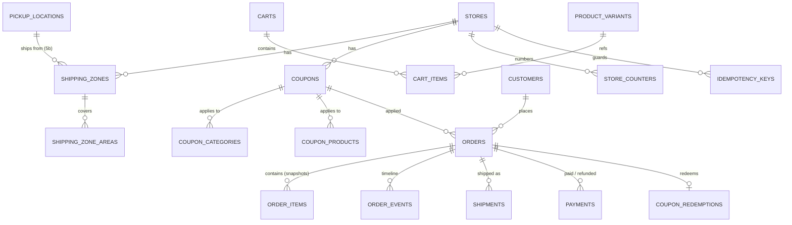
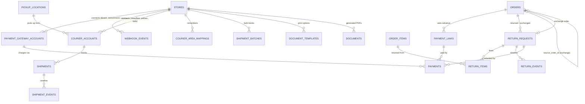

# Database Design

Status: Accepted (Phase 0). Engine: **PostgreSQL 16+**. ADR 0001. Read MULTI-TENANCY.md first.

## 1. Why PostgreSQL (not MySQL 8)
1. **Row-Level Security** — native defense-in-depth for a shared-schema SaaS; MySQL has no equivalent.
2. **Partial & expression indexes** — e.g. `UNIQUE (tenant_id, sku) WHERE deleted_at IS NULL`,
   `UNIQUE (lower(email))`; MySQL needs generated-column workarounds.
3. **`jsonb` + GIN** — theme configs, page sections, product attributes, provider payloads are queryable
   and validatable (`CHECK (jsonb_typeof(config)='object')`).
4. **Transactional DDL** — failed migrations roll back cleanly.
5. **Composite FKs, `CHECK` constraints, deferrable constraints, `timestamptz`, `citext`** all first-class.
6. Full-text search (`tsvector`) is good enough for product search until a dedicated engine is warranted.
Contract already fixes Postgres on port 5432. MySQL is not supported; no MySQL-compat code paths.

## 2. Global conventions
| Rule | Detail |
|---|---|
| PK | `id char(26)` ULID, app-generated (`HasUlids`). Sortable by creation time. |
| Tenant column | `tenant_id char(26) NOT NULL` on every tenant-owned table, FK → `tenants.id ON DELETE RESTRICT`. |
| Tenant key for composite FKs | Every tenant-owned parent table has `UNIQUE (tenant_id, id)`. Children reference `(tenant_id, parent_id) → parent(tenant_id, id)`. This makes a cross-tenant reference **impossible** at DB level. |
| Store key (D1) | One store per tenant today, but **store-scoped** tables (marked `[S]` below) also have `store_id char(26) NOT NULL` with composite FK `(tenant_id, store_id) → stores(tenant_id, id)`, and expose `UNIQUE (tenant_id, store_id, id)`; their children reference `(tenant_id, store_id, parent_id) → parent(tenant_id, store_id, id)`, so a row can't point at another store's row. Business uniques are per store (e.g. `U(store_id, sku)`). Store-scoped: store_domains, store_settings, store_themes, store_pages, store_navigation, redirects, categories, products, product_variants, product_images, product_categories, inventories, inventory_movements, customers, customer_addresses, carts, cart_items, shipping_methods, coupons, orders, order_items, order_status_history, payments, payment_gateway_accounts, shipping_orders, idempotency_keys, store_counters; Phase 5a adds pickup_locations, shipping_zones, shipping_zone_areas, coupon_categories, coupon_products, order_events, shipments, coupon_redemptions (§5.1); Phase 5b adds payment_links, webhook_events, courier_accounts, shipment_events, courier_area_mappings, shipment_batches, return_requests, return_items, return_events, document_templates, documents (§5.2); Phase 8.4 adds webhook_endpoints, webhook_secrets, webhook_deliveries (§5.4); later phases list theirs in §5.5–§5.10 (Phase 8.8c adds locations). Tenant-scoped only: tenant_users, roles, role_permissions (8.3), api_keys (8.4), media, subscriptions, subscription_items, invoices, audit_logs (nullable `store_id` column for filtering, no FK requirement). |
| Indexes | Lead with `tenant_id`. Every FK column is indexed (composite with `tenant_id`). On `[S]` tables every listed `IX(tenant_id, x…)` is implemented as `IX(tenant_id, store_id, x…)`. |
| Timestamps | `created_at`, `updated_at timestamptz NOT NULL DEFAULT now()`. |
| Soft deletes | `deleted_at timestamptz` only on: `products`, `product_variants`, `categories`, `customers`, `store_pages`, `stores`, `tenants`. Unique constraints on those are partial `WHERE deleted_at IS NULL`. Orders/payments are never deleted. |
| Money | `*_amount bigint NOT NULL` in minor units (BDT poisha) + `currency char(3)`. `CHECK (amount >= 0)` where applicable. |
| Enums | `varchar(32)` + `CHECK (col IN (...))`, mirrored by PHP backed enums. (No PG enum types — painful to alter.) |
| Strings | `varchar(n)` with explicit limits; emails `citext`. |
| JSON | `jsonb`, with `CHECK (jsonb_typeof(x) = 'object')`. |
| Booleans | `boolean NOT NULL DEFAULT false`. |
| Extensions | `citext`, `pg_trgm` (product search fuzzy), `btree_gin`. |

Notation below: **PK** primary key, **FK(t)** composite tenant FK `(tenant_id, col) → table(tenant_id, id)`,
**U** unique, **IX** index. Every tenant-owned table also implicitly has `U(tenant_id, id)` and `IX` on `tenant_id`.

## 3. ERD (core)

```mermaid
erDiagram
  TENANTS ||--|| STORES : owns
  TENANTS ||--o{ TENANT_USERS : has
  USERS ||--o{ TENANT_USERS : member
  STORES ||--o{ STORE_DOMAINS : "served at"
  STORES ||--|| STORE_SETTINGS : has
  STORES ||--o{ STORE_THEMES : has
  THEMES ||--o{ STORE_THEMES : instantiates
  STORES ||--o{ STORE_PAGES : has
  STORES ||--o{ STORE_NAVIGATION : has
  STORES ||--o{ PRODUCTS : sells
  PRODUCTS ||--o{ PRODUCT_VARIANTS : has
  PRODUCTS ||--o{ PRODUCT_IMAGES : has
  MEDIA ||--o{ PRODUCT_IMAGES : file
  PRODUCTS ||--o{ PRODUCT_CATEGORIES : in
  CATEGORIES ||--o{ PRODUCT_CATEGORIES : groups
  CATEGORIES ||--o{ CATEGORIES : parent
  PRODUCT_VARIANTS ||--o{ INVENTORIES : "stock per location (8.8c)"
  LOCATIONS ||--o{ INVENTORIES : holds
  INVENTORIES ||--o{ INVENTORY_MOVEMENTS : ledger
  STORES ||--o{ CUSTOMERS : has
  CUSTOMERS ||--o{ CUSTOMER_ADDRESSES : has
  CUSTOMERS ||--o{ CARTS : has
  CARTS ||--o{ CART_ITEMS : contains
  PRODUCT_VARIANTS ||--o{ CART_ITEMS : refs
  CUSTOMERS ||--o{ ORDERS : places
  ORDERS ||--o{ ORDER_ITEMS : contains
  PRODUCT_VARIANTS ||--o{ ORDER_ITEMS : snapshot
  ORDERS ||--o{ ORDER_STATUS_HISTORY : log
  ORDERS ||--o{ PAYMENTS : paid_by
  SHIPPING_METHODS ||--o{ ORDERS : chosen
  ORDERS ||--o{ SHIPPING_ORDERS : shipped_as
  COUPONS ||--o{ ORDERS : applied
  PLANS ||--o{ SUBSCRIPTIONS : priced
  TENANTS ||--o{ SUBSCRIPTIONS : subscribes
  SUBSCRIPTIONS ||--o{ SUBSCRIPTION_ITEMS : has
  SUBSCRIPTIONS ||--o{ INVOICES : bills
  TENANTS ||--o{ AUDIT_LOGS : records
  USERS ||--o{ AUDIT_LOGS : actor

  TENANTS { char26 id PK; string name; string status }
  STORES { char26 id PK; char26 tenant_id FK; string slug UK; string status }
  STORE_DOMAINS { char26 id PK; char26 tenant_id FK; char26 store_id FK; string hostname UK; string status }
  USERS { char26 id PK; citext email UK; string platform_role }
  TENANT_USERS { char26 id PK; char26 tenant_id FK; char26 user_id FK; string role }
  PRODUCTS { char26 id PK; char26 tenant_id FK; char26 store_id FK; string slug; string type; string status }
  PRODUCT_VARIANTS { char26 id PK; char26 tenant_id FK; char26 product_id FK; string sku; bigint price_amount }
  INVENTORIES { char26 id PK; char26 tenant_id FK; char26 variant_id FK; char26 location_id FK; int on_hand; int committed }
  ORDERS { char26 id PK; char26 tenant_id FK; char26 store_id FK; string number; string status; bigint total_amount }
  PAYMENTS { char26 id PK; char26 tenant_id FK; char26 order_id FK; string provider; string status }
```

## 4. Platform tables (no tenant_id)

### users
| col | type | notes |
|---|---|---|
| id | char(26) PK | |
| name | varchar(120) | |
| email | citext | **U** |
| phone | varchar(20) null | E.164 |
| password | varchar(255) | argon2id |
| email_verified_at, phone_verified_at | timestamptz null | |
| platform_role | varchar(16) null | `CHECK IN ('super_admin','billing','support','read_only')`; null = normal user (**amended** by PHASE-8-1 P8-2; more staff columns in its §5.1) |
| two_factor_secret, two_factor_recovery_codes | text null | encrypted cast |
| last_login_at | timestamptz null | |
| created_at, updated_at | timestamptz | |

### tenants
id PK · name varchar(160) · status varchar(32) `CHECK IN ('active','suspended','closed')` default active ·
owner_user_id char(26) FK users RESTRICT · country char(2) · default_currency char(3) default 'BDT' ·
timezone varchar(64) default 'Asia/Dhaka' · trial_ends_at timestamptz null · deleted_at · timestamps.
IX(status). IX(owner_user_id).

### plans
id PK · code varchar(40) **U** · name · price_amount bigint · currency char(3) · interval varchar(16)
`CHECK IN ('month','year')` · trial_days smallint · limits jsonb (`{"products":100,"staff":2,"custom_domain":true,...}`) ·
features jsonb · is_active boolean · sort smallint · timestamps.
As built: `limits` keys `orders_per_month`, `staff_seats`, `products`, `courier_connections`, `sms_per_month`, and from
Phase 6 `custom_domains` (Free 0, Starter 2, Growth 5; migration `2026_07_01_000300`); `custom_domain` is a **feature**
(Starter+), not a limit.

### themes (platform registry mirror)
id PK · code varchar(40) **U** (`classic`, `minimal`) · name · latest_version varchar(16) · is_active ·
preview_image_url · timestamps. Theme code/schemas live in the storefront repo; this table controls availability.

### personal_access_tokens
Laravel Sanctum default, `tokenable_id char(26)`. `expires_at` set at issue from `SANCTUM_EXPIRATION` (default 10080 min = 7 days, not sliding, D3); `sanctum:prune-expired --hours=24` daily.

### platform_settings (platform, no tenant_id, no RLS; PHASE-8-1 amendment A1, Q231)
key varchar(64) PK · value jsonb · updated_by char(26) FK users null **SET NULL** · updated_at timestamptz. No
`created_at`, no soft deletes. Listed in `RlsTables::PLATFORM` and treated like the other platform tables: written only
from the super-admin surface (`PATCH /admin/settings/security`, `manage_settings`), read through the cached
`PlatformSettings` service (cache key is platform-wide, **not** tenant-prefixed; busted on write). Known keys:
`staff_two_factor_required` (`true` / `false`). A missing row means "use the environment default"
(`ADMIN_TWO_FACTOR_REQUIRED`, else false only when `APP_ENV=local`); the API reports that as `source: "default"`.

## 5. Tenant-owned core tables

### tenant_users
id PK · tenant_id FK tenants · user_id FK users · role varchar(32) `CHECK IN ('owner','admin','staff','custom')` ·
role_id char(26) FK(t) roles RESTRICT (Phase 8.3) ·
status `CHECK IN ('invited','active','disabled')` · invited_by char(26) null · timestamps.
**U(tenant_id, user_id)**. IX(user_id). IX(tenant_id, role_id). Partial **U(tenant_id) WHERE role='owner'** (exactly one owner).
Phase 8.3 (ADR 0017): `role_id` is the source of truth; `role` is a denormalised kind = `roles.key ?? 'custom'`, written
in the same transaction. `staff_invitations` gains the same `role_id` (NOT NULL, FK(t) RESTRICT).

### roles · role_permissions (Phase 8.3, PHASE-8-3 §5, ADR 0017)
**roles**: id PK · tenant_id FK tenants CASCADE · key varchar(16) null `CHECK IN ('owner','admin','staff')` · name
varchar(40) · description varchar(200) null · is_system boolean · revision integer default 1 · created_by, updated_by
char(26) null FK users SET NULL · timestamps. **U(tenant_id, id)** · **U(tenant_id, key) WHERE key IS NOT NULL** ·
**U(tenant_id, lower(name))** · `CHECK (is_system = (key IS NOT NULL))`. Three system rows per tenant (seeded at
registration and by backfill `2026_11_01_000300`); their permissions are code (`SystemRole`), not rows.
**role_permissions**: tenant_id · role_id · permission varchar(48) `CHECK (permission ~ '^[a-z]+\.[a-z_]+$')` ·
created_at. **PK(tenant_id, role_id, permission)**; FK (tenant_id, role_id) → roles(tenant_id, id) CASCADE. Custom
roles only; keys are `App\Domain\Tenancy\Authorization\Permission` values (unknown keys ignored on read).

### stores
id PK · tenant_id · name varchar(160) · slug varchar(63) · status `CHECK IN ('draft','active','suspended')` ·
country char(2) · currency char(3) · business_category varchar(64) null · logo_media_id, favicon_media_id FK(t) media null ·
published_at timestamptz null · deleted_at · timestamps.
**U(slug) WHERE deleted_at IS NULL** (global — slug is a subdomain). **U(tenant_id)** — exactly one store per tenant
(D1, revised). **U(tenant_id, id)** (composite FK target). `store_id` columns on store-scoped tables are kept so multi-store
can be enabled later by dropping `U(tenant_id)`.
`CHECK (slug ~ '^[a-z0-9](?:[a-z0-9-]{1,61}[a-z0-9])$')`.

### store_domains
Phase 1 built a minimal table (id, tenant_id, store_id FK(t) CASCADE, hostname **U**, type, status, is_primary,
verification_token, verified_at, timestamps; RLS forced since 5b-1). **Phase 6** (PHASE-6-CONTRACT §3.1, migration
`2026_07_01_000100_extend_store_domains`, forward-only) brings it to:

id PK · tenant_id · store_id FK(t) stores CASCADE · hostname varchar(253) (lowercase ASCII/punycode, no trailing dot;
CHECK `hostname = lower(hostname)`) · display_hostname varchar(253) null (Unicode, informational) · type
`CHECK IN ('platform','custom')` · is_primary boolean · status `CHECK IN ('pending_verification','verification_failed','verified','ssl_provisioning','active','expired','suspended')` ·
verification_token varchar(64) (52-char base32; CHECK `type = 'platform' OR verification_token IS NOT NULL`) ·
verification_started_at, verified_at, activated_at, status_changed_at, last_checked_at, next_check_at, first_failed_at
timestamptz null · check_attempts int default 0 · failure_code varchar(48) null · failure_message varchar(255) null ·
last_check jsonb null (per-record DNS observations, resolver outcome; no secrets) · provider varchar(16) null
`CHECK IN ('cloudflare','fake')` · provider_hostname_id varchar(64) null (Cloudflare custom hostname id) ·
provider_status, ssl_status varchar(32) null (raw provider values) · created_by FK users nullOnDelete · timestamps
(timestamptz). CHECK `type = 'custom' OR status = 'active'`; CHECK `NOT is_primary OR status = 'active'`.
**U(hostname)** (global — one host maps to one store). Partial **U(store_id) WHERE is_primary**. `U(tenant_id, id)`,
`U(tenant_id, store_id, id)`. Partial U(provider_hostname_id) WHERE not null. `IX(next_check_at) WHERE next_check_at
IS NOT NULL` (platform scheduler, read only via `pgsql_admin`; deliberate exception to tenant-led indexes).
`IX(tenant_id, store_id, type)`. Pre-tenant lookups: `sp_resolve_host` (storefront, `active` only),
`sp_domain_claim_state` (add/reclaim), `sp_domain_allowed` (`ask` endpoint). The verification method is always TXT
(ownership) + CNAME/flattened (routing); Cloudflare's own DCV is HTTP and not stored. No soft deletes.

### store_settings (1:1 store)
id PK · tenant_id · store_id FK(t) **U** · contact_email citext null · contact_phone · address jsonb ·
social_links jsonb · seo_title varchar(70) · seo_description varchar(160) · og_image_media_id null ·
checkout jsonb (`guest_checkout`, `cod_enabled`, `min_order_amount`) · tax jsonb (`inclusive`, `rate_bps`) ·
locale varchar(10) default 'en' · timestamps.

### store_themes
id PK · tenant_id · store_id FK(t) · theme_code varchar(40) FK themes(code) · theme_version varchar(16) ·
draft_config jsonb · published_config jsonb null · published_at timestamptz null · is_active boolean · timestamps.
**U(store_id, theme_code)**. Partial **U(store_id) WHERE is_active**. CHECK jsonb object.

### store_pages
id PK · tenant_id · store_id FK(t) · slug varchar(120) · title varchar(160) · type
`CHECK IN ('custom','about','contact','policy','faq')` · sections jsonb (same section schema as theme) ·
body_html text null (sanitized server-side) · seo jsonb · status `CHECK IN ('draft','published')` · deleted_at · timestamps.
**U(store_id, slug) WHERE deleted_at IS NULL**.

### store_navigation
id PK · tenant_id · store_id FK(t) · location `CHECK IN ('header','footer')` · items jsonb
(`[{label, type:'url'|'page'|'category'|'product', ref, children:[]}]`, max depth 2) · timestamps.
**U(store_id, location)**.

### media
id PK · tenant_id · disk varchar(16) · path varchar(255) · mime varchar(64) · size_bytes int · width, height int null ·
alt varchar(255) null · checksum char(64) · uploaded_by char(26) · timestamps. **U(path)**. IX(tenant_id, created_at).

> **Phase 4 (binding detail in PHASE-4-CONTRACT §2):** catalog tables below are refined there: triple store FKs
> `(tenant_id, store_id, parent_id)`, `products.description` is RichTextDoc jsonb (no HTML), `tags` jsonb, options as
> `products.options` + `product_variants.option1..3`, case-insensitive SKU unique per store, `inventories.committed`
> (was `reserved`), ledger reasons `initial|received|correction|damaged|lost|returned|import|other`, customers without
> password/addresses (Phase 5), new `customer_notes`, `data_imports`, `data_import_rows`, `data_exports`.

### categories [S]
id PK · tenant_id · store_id · parent_id FK(t) categories null SET NULL · name varchar(120) · slug varchar(140) ·
description text null · image_media_id null · position int · is_visible boolean · seo jsonb · deleted_at · timestamps.
**U(store_id, slug) WHERE deleted_at IS NULL**. IX(tenant_id, parent_id, position).

### products [S]
id PK · tenant_id · store_id · name varchar(200) · slug varchar(220) · type `CHECK IN ('simple','variable')` ·
status `CHECK IN ('draft','active','archived')` · description_html text (sanitized) · short_description varchar(500) ·
brand varchar(120) null · tags text[] default '{}' · options jsonb (`[{name:'Size', values:['S','M']}]`) ·
seo jsonb · search tsvector GENERATED · published_at · deleted_at · timestamps.
**U(store_id, slug) WHERE deleted_at IS NULL**. IX(tenant_id, status, created_at). GIN(search). GIN(tags).
Price lives on variants; a simple product has exactly one variant (`is_default`).

### product_variants [S]
id PK · tenant_id · store_id · product_id FK(t) products CASCADE · sku varchar(64) null · barcode varchar(64) null ·
option_values jsonb (`{"Size":"M"}`) · price_amount bigint · compare_at_amount bigint null ·
cost_amount bigint null · currency char(3) · weight_grams int null · is_default boolean · position int ·
track_inventory boolean default true · allow_backorder boolean default false · deleted_at · timestamps.
**U(store_id, sku) WHERE sku IS NOT NULL AND deleted_at IS NULL**. IX(tenant_id, product_id).
CHECK(price_amount >= 0).

### product_images
id PK · tenant_id · product_id FK(t) CASCADE · variant_id FK(t) null · media_id FK(t) · position int · timestamps.
IX(tenant_id, product_id, position).

### product_categories (pivot)
tenant_id · product_id FK(t) CASCADE · category_id FK(t) CASCADE · position int. **PK(tenant_id, product_id, category_id)**.
IX(tenant_id, category_id, position).

### inventories [S] (one row per variant **per location** since Phase 8.8c; §5.10)
id PK · tenant_id · store_id · variant_id FK3(product_variants) CASCADE · location_id FK3(locations) **RESTRICT** (8.8c) ·
on_hand int default 0 · committed int default 0 · low_stock_threshold int null · timestamps.
CHECK(committed >= 0); CHECK(low_stock_threshold NULL OR 0–100000); CHECK(on_hand >= 0) (Postgres, added in 8.8c; the
app already guaranteed it). Until 8.8c: **U(variant_id)**. From 8.8c: **U(tenant_id, store_id, variant_id,
location_id)**, U(tenant_id, store_id, id), IX(tenant_id, store_id, location_id, on_hand). A missing row reads as 0 and
is created lazily on the first positive delta at that location. Rows change only through `InventoryService` (P4-12):
commit/release/ship/restock under `SELECT … FOR UPDATE` in `(variant_id, location_id)` order; "available" =
`on_hand − committed`; committing stock writes no ledger row (P5-5).

### inventory_movements [S] (append-only ledger; no `updated_at`, model refuses update/delete)
id PK · tenant_id · store_id · variant_id FK3 CASCADE · location_id FK3(locations) (8.8c, NOT NULL) · delta int
CHECK(delta <> 0) · on_hand_after int · reason varchar(32) `CHECK IN ('initial','received','correction','damaged','lost',
'returned','import','other','order_shipped','order_returned','transfer_out','transfer_in','count')` (the last three
from 8.8c; Postgres only) · note varchar(255) null · reference_type varchar(32) null (no CHECK: `import`, `order`,
`return`, `purchase_order` (8.8b), `stock_transfer`, `stock_count` (8.8c)) · reference_id char(26) null ·
actor_user_id FK users null SET NULL (actor may also be an API key since 8.4, §5.4) · created_at.
IX(tenant_id, store_id, variant_id, created_at), IX(tenant_id, store_id, created_at), IX(tenant_id, store_id,
location_id, created_at) (8.8c).

### customers [S]
id PK · tenant_id · store_id · name varchar(120) · email citext null · phone varchar(20) null · password varchar(255) null
(null = guest) · accepts_marketing boolean · notes text · tags text[] · orders_count int · total_spent_amount bigint ·
last_order_at · deleted_at · timestamps.
**U(store_id, email) WHERE email IS NOT NULL AND deleted_at IS NULL**; **U(store_id, phone) WHERE phone IS NOT NULL AND deleted_at IS NULL**.
Customers are per-store identities, never shared across stores or tenants. (The early `risk_flags jsonb` sketch was
never built: the risk tier is computed from the own-shop counters, PHASE-8-8 §3 / §5.8.)

### customer_addresses
id PK · tenant_id · customer_id FK(t) CASCADE · name · phone · line1 · line2 · area varchar(120) · city varchar(80) ·
district varchar(80) · postal_code varchar(10) · country char(2) · is_default boolean · timestamps.

> **Phase 5a (as built):** the planned `carts`, `cart_items`, `shipping_methods`, `coupons`, `orders`, `order_items`,
> `order_status_history`, `payments`, `shipping_orders` and `idempotency_keys` entries below are superseded by §5.1
> (migrations `2026_05_01_*`, PHASE-5-CONTRACT §2). `shipping_methods` became `shipping_zones`; `order_status_history`
> became `order_events`; `shipping_orders` became `shipments` (5b widens it). Kept below as the Phase 0 design record.
> The Phase 0 `payment_gateway_accounts` and `webhook_events` entries are likewise superseded by §5.2 (Phase 5b, as built).

### carts
id PK · tenant_id · store_id FK(t) · customer_id FK(t) null · token_hash char(64) (sha256 of opaque cart token) ·
currency char(3) · coupon_code varchar(40) null · status `CHECK IN ('active','converted','abandoned')` ·
expires_at timestamptz · timestamps. **U(token_hash)**. IX(tenant_id, status, updated_at).

### cart_items
id PK · tenant_id · cart_id FK(t) CASCADE · variant_id FK(t) · quantity int CHECK(1..999) · timestamps.
**U(cart_id, variant_id)**. Prices are never stored on cart items; always recomputed server-side.

### shipping_methods
id PK · tenant_id · store_id FK(t) · name varchar(80) · type `CHECK IN ('flat','free_over','zone')` ·
rate_amount bigint · currency char(3) · rules jsonb (zones: `inside_dhaka`/`outside_dhaka`, threshold) ·
courier_provider varchar(32) null · is_active · position · timestamps.

### coupons (Phase 5, needed by checkout)
id PK · tenant_id · code varchar(40) · type `CHECK IN ('percent','fixed','free_shipping')` · value int
(bps for percent, minor units for fixed) · min_subtotal_amount bigint null · usage_limit int null ·
usage_per_customer int null · used_count int · starts_at, ends_at · is_active · timestamps.
**U(store_id, upper(code))**.

### orders [S]
id PK · tenant_id · store_id FK(t) · number varchar(20) (per-store sequence, e.g. `1001`) · customer_id FK(t) null ·
status `CHECK IN ('pending_payment','pending','confirmed','processing','shipped','delivered','cancelled','returned','failed')` ·
payment_status `CHECK IN ('unpaid','authorized','paid','partially_refunded','refunded','failed')` ·
fulfillment_status `CHECK IN ('unfulfilled','partial','fulfilled')` · payment_method varchar(32) (`cod`,`bkash`,`sslcommerz`) ·
currency char(3) · subtotal_amount, discount_amount, shipping_amount, tax_amount, total_amount bigint ·
coupon_id FK(t) null · coupon_code varchar(40) null · shipping_method_id FK(t) null ·
customer_snapshot jsonb (name/email/phone) · shipping_address jsonb · billing_address jsonb null ·
notes text · source `CHECK IN ('storefront','pos','manual','inbox','api')` · ip inet · user_agent varchar(255) ·
idempotency_key varchar(64) · placed_at, cancelled_at timestamptz · timestamps.
**U(store_id, number)**. **U(store_id, idempotency_key)**. IX(tenant_id, status, placed_at DESC).
IX(tenant_id, customer_id). CHECK(total_amount = subtotal_amount - discount_amount + shipping_amount + tax_amount).
Order numbers from `store_counters(tenant_id, store_id, key, value)` row updated `... RETURNING value` in the order transaction.

### order_items
id PK · tenant_id · order_id FK(t) CASCADE · product_id FK(t) null SET NULL · variant_id FK(t) null SET NULL ·
product_name varchar(200) · variant_title varchar(120) · sku varchar(64) · unit_price_amount bigint · quantity int ·
discount_amount bigint · total_amount bigint · timestamps. IX(tenant_id, order_id). Snapshots so deletes never break history.

### order_status_history
id PK · tenant_id · order_id FK(t) · from_status, to_status varchar(32) · actor_type `CHECK IN ('user','customer','system','webhook')` ·
actor_id char(26) null · note varchar(500) · created_at. IX(tenant_id, order_id, created_at).

### payments
id PK · tenant_id · order_id FK(t) · provider varchar(32) (`cod`,`bkash`,`sslcommerz`,`nagad`) · type
`CHECK IN ('charge','refund')` · status `CHECK IN ('initiated','pending','authorized','succeeded','failed','cancelled','refunded')` ·
amount bigint CHECK(>0) · currency char(3) · provider_reference varchar(128) null · provider_payment_id varchar(128) null ·
idempotency_key varchar(64) · raw_request jsonb · raw_response jsonb (secrets stripped) · verified_at timestamptz null ·
failure_code varchar(64) · parent_payment_id FK(t) null (refund → charge) · timestamps.
**U(provider, provider_payment_id) WHERE provider_payment_id IS NOT NULL**. **U(tenant_id, idempotency_key)**. IX(tenant_id, order_id).

### payment_gateway_accounts (merchant credentials)
id PK · tenant_id · provider · mode `CHECK IN ('sandbox','live')` · credentials text (encrypted cast, never returned by API) ·
is_active · timestamps. **U(store_id, provider)**.

### shipping_orders (courier consignments)
id PK · tenant_id · order_id FK(t) · provider `CHECK IN ('pathao','steadfast','redx','manual')` · consignment_id varchar(64) ·
tracking_code varchar(64) · status `CHECK IN ('created','pending_pickup','picked_up','in_transit','delivered','returned','cancelled','failed')` ·
cod_amount bigint · delivery_fee_amount bigint · raw_response jsonb · last_synced_at · timestamps.
**U(provider, consignment_id)**. IX(tenant_id, order_id). IX(tenant_id, status).

### webhook_events (inbound, platform-level but tenant-tagged)
id PK · tenant_id null (resolved after verification) · provider · event_id varchar(128) · signature_valid boolean ·
payload jsonb · processed_at · error text · created_at. **U(provider, event_id)** — idempotent processing.

### idempotency_keys
id PK · tenant_id · key varchar(64) · scope varchar(64) (route) · request_hash char(64) · response_status smallint ·
response_body jsonb · locked_until timestamptz · created_at. **U(store_id, scope, key)** (store_id nullable for tenant-level routes; then **U(tenant_id, scope, key) WHERE store_id IS NULL**). Rows purged after 24 h.

### redirects (SEO)
id PK · tenant_id · store_id FK(t) · from_path varchar(512) · to_path varchar(512) · code smallint CHECK IN (301,302) · timestamps.
**U(store_id, from_path)**.

### subscriptions
**Phase 7 (PHASE-7-CONTRACT §5.1, migration `2026_08_01_000100`)** adds `billing_interval` (`month`|`year`),
`scheduled_plan_id`/`scheduled_interval`, `past_due_at`, `grace_ends_at`, `domain_grace_ends_at`, `ended_at`,
`ended_reason` (`unpaid`|`cancelled`), `cancelled_at`, `plan_changed_at`, `notices jsonb`; timestamps become
`timestamptz`; discovery indexes `IX(status, current_period_end)`, `IX(status, trial_ends_at)`. `plans` gains
`price_yearly_amount`. The design below (provider columns) is superseded where it differs.
id PK · tenant_id · plan_id FK plans · status `CHECK IN ('trialing','active','past_due','cancelled','expired')` ·
current_period_start, current_period_end, trial_ends_at, cancelled_at timestamptz · cancel_at_period_end boolean ·
provider varchar(32) · provider_subscription_id varchar(128) null · timestamps.
Partial **U(tenant_id) WHERE status IN ('trialing','active','past_due')**.

### subscription_items
**Not built** (no add-ons in Phase 7; PHASE-7-CONTRACT §5.1).
id PK · tenant_id · subscription_id FK(t) · type `CHECK IN ('plan','addon')` · code varchar(40) · quantity int ·
unit_amount bigint · currency char(3) · timestamps.

### invoices (SaaS billing)
**Superseded by `billing_invoices` + `billing_payments` (Phase 7, §5.3 below).**
id PK · tenant_id · subscription_id FK(t) null · number varchar(24) **U** (global `SP-2026-000123`) · status
`CHECK IN ('draft','open','paid','void','uncollectible')` · subtotal_amount, tax_amount, total_amount bigint · currency ·
due_at, paid_at · provider_payment_id null · lines jsonb · pdf_path null · timestamps. IX(tenant_id, created_at DESC).

### audit_logs (append-only; app role has INSERT/SELECT only)
id PK · tenant_id null (null = platform action) · store_id null · actor_type `CHECK IN ('user','platform_admin','system','api_key','automation')` (`automation` Phase 8.6) ·
actor_id char(26) null · action varchar(64) (`product.updated`, `domain.verified`, `staff.role_changed`) ·
subject_type varchar(64) · subject_id char(26) · changes jsonb (before/after, secrets redacted) · ip inet ·
user_agent varchar(255) · request_id varchar(64) · created_at. IX(tenant_id, created_at DESC). IX(tenant_id, subject_type, subject_id).
Partitioned by month (`PARTITION BY RANGE (created_at)`) from Phase 9.

## 5.1 Phase 5a commerce tables (as built)
Source: `apps/api/database/migrations/2026_05_01_000100` … `002100`; binding detail in PHASE-5-CONTRACT §2.
Notation as Phase 4: every table has `tenant_id char(26) NOT NULL` FK tenants **CASCADE** (so 5b RLS needs no schema
change) and `store_id`; **FK(s)** = `(tenant_id, store_id) → stores(tenant_id, id)` CASCADE; **FK3(t)** = triple FK
`(tenant_id, store_id, col) → t(tenant_id, store_id, id)`. Parents expose `U(tenant_id, id)` and
`U(tenant_id, store_id, id)`. Timestamps are `timestamptz`. Money is `bigint` paisa. Enum and range **CHECKs are
Postgres-only** (the app validates on both drivers); partial unique indexes are created on Postgres **and** sqlite.
Phase 5b alters `orders`, `payments`, `shipments`, `order_items`, `order_events` and `store_settings`: see §5.2.



### Changes to existing tables
- **stores** (000100): + `published_at timestamptz null`. Backfill: `active` stores get `published_at = updated_at`.
- **store_settings** (000200): + `cod_enabled boolean default true` · `free_delivery_over_amount bigint null`
  CHECK `NULL OR BETWEEN 100 AND 1000000000` · `order_prefix varchar(6) null` CHECK `NULL OR ~ '^[A-Z]{1,6}$'` ·
  `notify_new_order_email boolean default true` · `customer_sms jsonb default
  '{"order_placed":true,"order_confirmed":false,"order_shipped":true,"order_cancelled":true}'` ·
  `sms_language varchar(2) default 'bn'` CHECK IN (`bn`,`en`).
- **customers** (001900): + `delivered_orders_count int default 0`, `returned_orders_count int default 0` (written
  only by `OrderService`, P5-22).
- **inventory_movements** (002000): reason CHECK widened to `initial, received, correction, damaged, lost, returned,
  import, other, order_shipped, order_returned` (Postgres; sqlite has no CHECK). `reference_type` has no CHECK and takes
  `order` as is. Committing stock writes **no** ledger row (P5-5).
- **plans** (002100, data only): re-runs the idempotent `PlanSeeder` to add `limits.sms_per_month` (Free 200,
  Starter 2 000, Growth null = unlimited; P5-26/Q33). No schema change.

### store_counters [S]
tenant_id · store_id FK(s) · key varchar(32) · value bigint · timestamps. **PK(store_id, key)**. No `id`. Written only
by `StoreCounter::next($key)` (`INSERT … ON CONFLICT DO UPDATE SET value = value + 1 RETURNING value` inside the order
transaction, so a rolled-back checkout leaves no gap). Key `orders` starts at 1001.

### pickup_locations [S]
id PK · tenant_id · store_id FK(s) · name varchar(60) · contact_name varchar(80) null · contact_phone varchar(13) null ·
district_code varchar(32) · thana_code varchar(48) · address_line varchar(255) · is_default boolean default false ·
timestamps. U(tenant_id, id). U(tenant_id, store_id, id). Partial **U(store_id) WHERE is_default**. Max 10 per store
(app rule).

### shipping_zones [S]
id PK · tenant_id · store_id FK(s) · name varchar(60) · kind varchar(16) `CHECK IN ('custom','fallback')` ·
charge_amount bigint CHECK `BETWEEN 0 AND 1000000` · min_days smallint CHECK `BETWEEN 0 AND 30` · max_days smallint
CHECK `max_days >= min_days AND max_days <= 30` · is_active boolean default true (CHECK `kind <> 'fallback' OR
is_active`) · position smallint default 0 · pickup_location_id FK3(pickup_locations) null **RESTRICT** (5b courier
routing) · timestamps. U(tenant_id, id). U(tenant_id, store_id, id). Partial **U(store_id) WHERE kind = 'fallback'**
(exactly one "Outside Dhaka" fallback). IX(tenant_id, store_id, position).
Defaults (P5-8, `shipping:provision-defaults`, DemoSeeder): "Inside Dhaka" ৳ 70, 1–2 days = the **50** Dhaka
Metropolitan Police thanas of the geo dataset (as built; Figma says "41 thanas"), fallback "Outside Dhaka" ৳ 130,
2–4 days.

### shipping_zone_areas [S]
tenant_id · store_id · zone_id FK3(shipping_zones) CASCADE · district_code varchar(32) · thana_code varchar(48)
default `''` (`''` = whole district). **PK(zone_id, district_code, thana_code)**. **U(store_id, district_code,
thana_code)** (an area is in at most one zone; a violation maps to 422 `validation_failed` on `zones.N.areas.M`, not
409). IX(tenant_id, store_id, district_code). Resolution: active zone with the thana → active zone with the whole
district → fallback.

### coupons [S]
id PK · tenant_id · store_id FK(s) · code varchar(32) (CHECK `code = upper(code)`) · type varchar(16)
`CHECK IN ('percentage','fixed','free_shipping')` · percent_bps int null CHECK `BETWEEN 1 AND 10000` · amount bigint
null CHECK `BETWEEN 1 AND 1000000000` · max_discount_amount bigint null CHECK `>= 1` · applies_to varchar(16) default
`'all'` `CHECK IN ('all','categories','products')` · min_subtotal_amount bigint null CHECK `>= 0` · usage_limit int null
CHECK `>= 1` · usage_per_customer int null CHECK `>= 1` · first_order_only boolean default false · starts_at
timestamptz · ends_at timestamptz null CHECK `ends_at IS NULL OR ends_at > starts_at` · status varchar(16) default
`'draft'` `CHECK IN ('draft','active','disabled')` (`expired`, `used_up` are derived) · used_count int default 0
CHECK `>= 0` · revision int default 1 · created_by FK users null SET NULL · timestamps.
Shape CHECKs: `percentage` ⇒ percent_bps NOT NULL, amount NULL; `fixed` ⇒ amount NOT NULL, percent_bps and
max_discount_amount NULL; `free_shipping` ⇒ all three NULL and `applies_to = 'all'`.
U(tenant_id, id). U(tenant_id, store_id, id). **U(store_id, code)** (stored uppercase, so case-insensitive).
IX(tenant_id, store_id, status, created_at). Hard delete only while never redeemed (else 409 `coupon_in_use`).

### coupon_categories / coupon_products (pivots) [S]
tenant_id · store_id · coupon_id FK3(coupons) CASCADE · category_id FK3(categories) CASCADE (resp. product_id
FK3(products) CASCADE). **PK(coupon_id, category_id)** / **PK(coupon_id, product_id)**. IX(tenant_id, store_id,
category_id) / IX(tenant_id, store_id, product_id).

### carts [S]
id PK · tenant_id · store_id FK(s) · token_hash char(64) **U** (sha256 of the 43-char opaque token; the raw token is
never stored) · status varchar(16) default `'active'` `CHECK IN ('active','converted','abandoned')` · coupon_code
varchar(32) null · currency char(3) · last_activity_at timestamptz · converted_order_id char(26) null (soft ref) · ip
varchar(45) null · timestamps. U(tenant_id, id). U(tenant_id, store_id, id). IX(tenant_id, store_id, status,
last_activity_at). No `customer_id` (guest only, P5-2). `carts:prune` daily: active > 30 days → abandoned; abandoned and
converted > 90 days deleted. Phase 8.6 adds the checkout contact and `recovery_detected_at` columns (§5.6).

### cart_items [S]
id PK · tenant_id · store_id · cart_id FK3(carts) CASCADE · variant_id FK3(product_variants) CASCADE · quantity smallint
CHECK `BETWEEN 1 AND 99` · timestamps. U(tenant_id, id). **U(cart_id, variant_id)**. IX(tenant_id, store_id, cart_id).
No prices; ≤ 50 lines per cart (app rule).

### orders [S]
id PK · tenant_id · store_id FK(s) · number varchar(24) (`{prefix}-{sequence}`, e.g. `GS-1042`) · sequence bigint ·
status varchar(24) `CHECK IN ('pending_payment','pending','confirmed','ready_to_ship','shipped','delivered','returned','cancelled')`
(`pending_payment` reserved for 5b) · payment_status varchar(24) default `'unpaid'`
`CHECK IN ('unpaid','partially_paid','paid','partially_refunded','refunded')` · payment_method varchar(24)
`CHECK IN ('cod','bkash','sslcommerz')` · created_via varchar(16) `CHECK IN ('storefront','dashboard')` · channel
varchar(16) `CHECK IN ('website','facebook','instagram','whatsapp','phone','walk_in','landing_page','other')` ·
customer_id FK3(customers) null **NO ACTION** · customer_name varchar(120) · customer_phone varchar(13) ·
customer_email varchar(254) null · shipping_address jsonb (codes + name snapshots, PHASE-5 §2.1) · district_code
varchar(32) · currency char(3) · subtotal_amount, discount_amount, shipping_amount, shipping_discount_amount,
tax_amount (always 0 in 5a), total_amount, paid_amount, refunded_amount bigint default 0 (all CHECK `>= 0`) ·
coupon_id FK3(coupons) null NO ACTION · coupon_code varchar(32) null · shipping_zone_id char(26) null (soft ref) ·
shipping_zone_name varchar(60) · delivery_min_days, delivery_max_days smallint null · shipping_overridden boolean
default false · customer_note varchar(500) null · tags jsonb default `'[]'` · revision int default 1 ·
idempotency_key varchar(64) null · confirmation_token_hash char(64) null · confirmation_expires_at timestamptz null ·
cancel_reason varchar(32) null `CHECK IN ('customer_request','fake_order','unreachable','out_of_stock','duplicate','other')`
(5b adds `payment_timeout`, `payment_link_expired`, §5.2) ·
placed_at timestamptz · confirmed_at, shipped_at, delivered_at, returned_at, cancelled_at timestamptz null · created_by
FK users null SET NULL (manual orders) · ip varchar(45) null · user_agent varchar(255) null · timestamps. **No soft
delete.**
CHECK `total_amount = subtotal_amount - discount_amount + shipping_amount + tax_amount`; CHECK `discount_amount <=
subtotal_amount`; CHECK `refunded_amount <= paid_amount`.
U(tenant_id, id). U(tenant_id, store_id, id). **U(store_id, number)**. **U(store_id, sequence)**. Partial
**U(store_id, idempotency_key) WHERE idempotency_key IS NOT NULL**. Partial **U(confirmation_token_hash) WHERE NOT
NULL**. IX(tenant_id, store_id, status, placed_at). IX(tenant_id, store_id, placed_at). IX(tenant_id, store_id,
customer_id). IX(tenant_id, store_id, customer_phone). Postgres: `GIN(customer_name gin_trgm_ops)` (creates
`pg_trgm` if missing).

### order_items [S]
id PK · tenant_id · store_id · order_id FK3(orders) CASCADE · product_id char(26) null, variant_id char(26) null
(**soft refs**, indexed, no FK, P5-31) · product_name varchar(200) · variant_title varchar(130) · option_values jsonb
default `'[]'` · sku varchar(64) null · image_media_id char(26) null (soft ref) · unit_price_amount bigint ·
compare_at_amount bigint null · unit_cost_amount bigint null (never exposed to staff or storefront) · subtotal_amount
bigint · discount_amount bigint default 0 · total_amount bigint · quantity smallint CHECK `BETWEEN 1 AND 99` · tracked
boolean (inventory tracked at placement) · restocked_quantity smallint default 0 CHECK `BETWEEN 0 AND quantity` ·
position smallint default 0 · timestamps. CHECK `total_amount = subtotal_amount - discount_amount`; money columns
CHECK `>= 0`. U(tenant_id, id). IX(tenant_id, store_id, order_id). IX(tenant_id, store_id, variant_id).
IX(tenant_id, store_id, product_id). Σ `discount_amount` over items = `orders.discount_amount` (largest remainder,
P5-12).

### order_events (append-only timeline) [S]
id PK · tenant_id · store_id · order_id FK3(orders) CASCADE · type varchar(24)
`CHECK IN ('placed','status_changed','note','edited','payment','refund','shipment','notification','coupon_released')` ·
from_status, to_status varchar(24) null · actor_type varchar(16) `CHECK IN ('user','customer','system')` ·
actor_user_id FK users null SET NULL · body varchar(1000) null · meta jsonb default `'{}'` · created_at timestamptz
default now(). **No `updated_at`**; the model refuses updates and deletes (like `inventory_movements`).
IX(tenant_id, store_id, order_id, created_at). `edited` events list field names, never values.
**SMS dedupe (as built):** `type = 'notification'` rows with `meta.channel = 'sms'` and `meta.event` are the record
that an order SMS was sent or skipped; `SendOrderSms` checks them under the order row lock, so a job retry sends at
most one SMS per (order, event). (The contract draft said an `sms_messages` lookup.)

### shipments [S]
id PK · tenant_id · store_id · order_id FK3(orders) CASCADE · provider varchar(16) default `'manual'`
`CHECK IN ('manual','steadfast','pathao','redx')` · carrier_name varchar(60) null · tracking_code varchar(64) null ·
tracking_url varchar(500) null (https only, app rule) · status varchar(24) `CHECK IN ('shipped','delivered','returned','cancelled')`
(5b widens with provider statuses) · cod_amount bigint default 0 CHECK `>= 0` · shipped_at, delivered_at, returned_at
timestamptz null · created_by FK users null SET NULL · timestamps. U(tenant_id, id). U(tenant_id, store_id, id).
Partial **U(order_id) WHERE status <> 'cancelled'** (one live shipment per order).

### payments [S]
id PK · tenant_id · store_id · order_id FK3(orders) **NO ACTION** · provider varchar(16)
`CHECK IN ('cod','manual','bkash','sslcommerz')` · type varchar(8) `CHECK IN ('charge','refund')` · status varchar(16)
`CHECK IN ('pending','succeeded','failed','cancelled')` · amount bigint CHECK `> 0` · currency char(3) · method
varchar(24) null `CHECK IN ('cash','bkash_personal','nagad_personal','bank','other')` (manual refunds) · reference
varchar(64) null (merchant-typed TrxID) · note varchar(255) null · parent_payment_id FK3(payments) null NO ACTION ·
idempotency_key varchar(64) null · provider_payment_id varchar(128) null · raw jsonb null (5b, secrets stripped) ·
verified_at timestamptz null · actor_user_id FK users null SET NULL · timestamps. U(tenant_id, id). U(tenant_id,
store_id, id). Partial **U(store_id, idempotency_key) WHERE idempotency_key IS NOT NULL**. IX(tenant_id, store_id,
order_id). 5a rows: one COD `charge` per order (pending → succeeded on delivery, cancelled on cancel/return) and manual
`refund` records.

### coupon_redemptions [S]
id PK · tenant_id · store_id · coupon_id FK3(coupons) NO ACTION · order_id FK3(orders) CASCADE, **U(order_id)** ·
customer_phone varchar(13) · discount_amount bigint CHECK `>= 0` (incl. shipping discount) · status varchar(16) default
`'active'` `CHECK IN ('active','released')` · timestamps. IX(tenant_id, store_id, coupon_id, customer_phone, status).
Released (and `coupons.used_count − 1`) on cancel; kept on return.

### idempotency_keys [S]
id PK · tenant_id · store_id FK(s) · scope varchar(64) (`storefront.checkout`, `orders.create`, `orders.refund`) · key
varchar(64) · request_hash char(64) · status varchar(16) `CHECK IN ('processing','completed')` · response_status
smallint null · response_body text null (**encrypted** cast) · locked_until timestamptz · created_at timestamptz ·
expires_at timestamptz (24 h). No `updated_at`. **U(store_id, scope, key)**. IX(expires_at). `idempotency:prune`
hourly. Store-level only in 5a (no tenant-level rows yet).

## 5.2 Phase 5b tables (as built)
Source: `apps/api/database/migrations/2026_06_01_000100` … `001800`; binding detail in PHASE-5B-CONTRACT §2–§3,
ADR 0012 (RLS). Notation and conventions as §5.1 (tenant_id FK tenants CASCADE, FK(s), FK3, `U(tenant_id, id)`,
bigint paisa, Postgres-only CHECKs, partial uniques on both drivers). Contract rows `001900` (`store_counters` key
`returns`) and `002000` (plans) need no migration: the counter key is created on first use, and `courier_connections`
/ `bulk_courier_booking` already existed in `PlanSeeder`.



### Row-level security (5b-1, migrations 000100, 000110)
- **Forced RLS on every table with `tenant_id`** (52 tables after 5b-3; the single list is
  `App\Domain\Tenancy\Database\RlsTables::TENANT`). Each gets `ENABLE` + `FORCE ROW LEVEL SECURITY` and policy
  `tenant_isolation FOR ALL TO storeplix_app USING (tenant_id = app_current_tenant()::bpchar) WITH CHECK (same)`. The
  GUC is cast to `bpchar` so the `char(26)` column keeps its `(tenant_id, …)` indexes. GUC unset → no rows, inserts
  rejected. 000100 enables the 40 pre-5b tables; **every 5b table enables RLS in its own create migration**
  (`RlsPolicies::enable`) and is listed in `RlsTables::TENANT` in the same change. `RlsCoverageTest` and the `api-rls`
  CI catalogue step fail on any `tenant_id` table without a forced policy.
- **Special policies** (instead of `tenant_isolation`):
  - `tenant_users` (split by 000110, QA 5b-1 F-L2): SELECT `tenant_id = current tenant OR user_id = app_current_user()`;
    INSERT / UPDATE / DELETE only in the current tenant.
  - `roles`, `role_permissions` (Phase 8.3): SELECT `tenant_id = current tenant OR tenant_id IN (SELECT tenant_id FROM
    tenant_users WHERE user_id = app_current_user())` (`/auth/me` lists every membership's permissions without a tenant
    context); INSERT / UPDATE / DELETE only in the current tenant. Listed in `RlsTables::SPECIAL`.
  - `audit_logs`: SELECT current tenant; INSERT `tenant_id IS NULL OR current tenant`. The app role has no
    UPDATE/DELETE grant (append-only).
  - `sms_messages`: INSERT as `audit_logs`; SELECT **and** UPDATE `current tenant OR (tenant_id IS NULL AND no tenant
    set)`. SELECT matches UPDATE because Postgres applies SELECT policies to an UPDATE's `WHERE` (OTP status updates).
- **Helper functions:** `app_current_tenant()`, `app_current_user()` (GUCs `app.tenant_id`, `app.user_id`; `''` =
  unset), `STABLE`.
- **SECURITY DEFINER functions** (owned by the migrating role `storeplix_owner`, `SET search_path = public, pg_temp`,
  `REVOKE ALL FROM PUBLIC`, `GRANT EXECUTE TO storeplix_app`), ids only:
  | Function | Returns | Used by |
  |---|---|---|
  | `sp_resolve_host(p_host text)` | `(tenant_id, store_id)` of an `active` domain of a non-suspended store | storefront host resolution |
  | `sp_invitation_by_token(p_hash text)` | `(invitation_id, tenant_id)` | invitation show/accept |
  | `sp_store_slug_taken(p_slug text)` | `boolean` | global slug uniqueness (P5B-8) |
  | `sp_payment_owner(p_payment text)` | `(tenant_id, store_id)` | signed payment-return URLs |
  | `sp_route_key_owner(p_provider text, p_key text)` | `(tenant_id, store_id, account_id)` from `payment_gateway_accounts` **or** `courier_accounts` where `route_key` and `provider` match | public webhook paths. Created by 000200 (gateways only), replaced by 000700 (gateways ∪ couriers) |
- Rollback of 000100 drops the policies but **keeps** the functions (QA 5b-1 F-L6): a running app with `TENANCY_RLS=true`
  still calls them. `database/sql/rls-emergency-off.sql` lists exactly `RlsTables::TENANT`.
- Roles (created outside migrations, `infrastructure/docker/postgres/initdb/01-roles.sql`): `storeplix_owner`
  (schema owner, BYPASSRLS, runs migrations as `--database=pgsql_owner`), `storeplix_app` (NOBYPASSRLS, DML; web and
  queue workers), `storeplix_admin` (BYPASSRLS, DML; console, scheduler discovery, `withoutTenancy()`).

### Changes to existing tables
- **payments** (000300): + `purpose varchar(16) default 'order'` CHECK IN (`order`,`advance`,`link`,`exchange`,`test`) ·
  `gateway_account_id char(26) null` FK3(payment_gateway_accounts) NO ACTION · `payment_link_id char(26) null`
  FK3(payment_links) (added by 000500) · `provider_trx_id varchar(64) null` · `refunded_amount bigint default 0` CHECK
  `>= 0 AND <= amount` · `expires_at timestamptz null` · `failure_code varchar(48) null` · `attempt smallint default 1`
  CHECK `>= 1` · `return_request_id char(26) null` FK3(return_requests) (FK added by 001200; whichever of 000300 / 001200
  runs first adds the column). **`order_id` becomes nullable** with CHECK `purpose = 'test' OR order_id IS NOT NULL`
  (gateway test charges have no order). `method` CHECK + `gateway`. Partial **U(store_id, provider, provider_trx_id)
  WHERE provider_trx_id IS NOT NULL AND type = 'charge'** (one gateway transaction pays one charge); partial
  **U(order_id) WHERE type = 'charge' AND status = 'pending' AND provider IN ('bkash','sslcommerz')** (one open online
  attempt per order). IX(tenant_id, status, expires_at). IX(tenant_id, store_id, gateway_account_id). IX(tenant_id,
  store_id, return_request_id). `raw` holds provider responses scrubbed by `PayloadScrubber`.
- **orders** (000400): + `payment_expires_at timestamptz null` (30-min hold of `pending_payment`, which is now in use) ·
  `return_status varchar(24) default 'none'` CHECK IN (`none`,`requested`,`partially_returned`,`returned`) ·
  `source_order_id char(26) null` FK3(orders) NO ACTION (exchange orders) · `invoice_printed_at`, `label_printed_at
  timestamptz null`. `cancel_reason` CHECK + `payment_timeout`, `payment_link_expired`. Partial
  `IX(tenant_id, status, payment_expires_at) WHERE status = 'pending_payment'`. IX(tenant_id, store_id,
  invoice_printed_at). IX(tenant_id, store_id, label_printed_at).
- **order_items** (000400): + **U(tenant_id, store_id, id)** so `return_items` can use FK3.
- **shipments** (000800): + `courier_account_id char(26) null` FK3(courier_accounts) NO ACTION · `consignment_id
  varchar(64) null` · `provider_status varchar(48) null` · `attempts smallint default 0` · `weight_grams int null` CHECK
  `BETWEEN 1 AND 100000` · `delivery_fee_amount`, `cod_charge_amount`, `cod_collected_amount bigint null` (CHECK `>= 0`) ·
  `cod_overridden boolean default false` · `last_event_at`, `last_synced_at`, `booked_at`, `picked_up_at`,
  `cancelled_at`, `settled_at timestamptz null` · `last_location varchar(120) null` · `failure_reason varchar(255) null` ·
  `problem varchar(24) null` CHECK IN (`delivery_failed`,`on_hold`,`returning`,`unknown`) · `idempotency_key
  varchar(64) null` · `raw jsonb null` (scrubbed) · `batch_id char(26) null` (soft ref to `shipment_batches`: composite
  FKs can't `SET NULL`). `status` CHECK widened to `booking, booked, picked_up, in_transit, out_for_delivery, on_hold,
  delivery_failed, delivered, partially_delivered, returning, returned, cancelled, booking_failed, shipped` (`shipped`
  stays for 5a manual shipments). The 5a `U(order_id) WHERE status <> 'cancelled'` is replaced by
  **U(order_id) WHERE status NOT IN ('cancelled','booking_failed')**; partial **U(store_id, provider, consignment_id)
  WHERE consignment_id IS NOT NULL**; partial **U(store_id, idempotency_key) WHERE idempotency_key IS NOT NULL**.
  IX(tenant_id, store_id, status, booked_at). IX(tenant_id, provider, last_synced_at).
- **store_settings** (001700): + `cod_advance varchar(16) default 'none'` CHECK IN (`none`,`delivery_charge`) ·
  `tax_display varchar(16) default 'none'` CHECK IN (`none`,`included`) · `tax_rate_bps int default 0` CHECK `BETWEEN 0
  AND 2500` · `tax_bin varchar(16) null` (format checked by the app) · `invoice_footer varchar(300) null`.
  `customer_sms` backfilled with `payment_link: true`, `order_updated: true` (existing keys keep their values).
- **order_events** (001800): `type` CHECK + `payment_link`, `items_edited`, `return`, `document` (Postgres only; the
  down migration re-adds the narrow CHECK `NOT VALID` so history survives).
- **store_counters**: new key `returns` (RT-n per store, from 1). No migration.

### payment_gateway_accounts [S] (000200, 5b-2)
id PK · tenant_id · store_id FK(s) CASCADE · provider varchar(16) `CHECK IN ('bkash','sslcommerz')` · mode varchar(8)
`CHECK IN ('sandbox','live')` · status varchar(16) `CHECK IN ('connected','error','disconnected')` · credentials text
(encrypted JSON via the dedicated `IntegrationCredentials` encrypter, never `APP_KEY`; never returned or logged) ·
credentials_hint varchar(16) null · enabled boolean default false (CHECK `status = 'connected' OR NOT enabled`) ·
is_default boolean default false · route_key char(32) **U** (global; webhook path key) · verified_at,
last_checked_at timestamptz null · last_error_code varchar(48) null · connected_by FK users null SET NULL ·
**connected_at timestamptz null** (not in the contract table; backs `PaymentGatewayAccount.connected_at` in
types/openapi) · revision int default 1 · timestamps. U(tenant_id, id). U(tenant_id, store_id, id).
**U(store_id, provider)**. Partial **U(store_id) WHERE is_default**.

### payment_links [S] (000500, 5b-2)
id PK · tenant_id · store_id FK(s) · order_id FK3(orders) CASCADE · token_hash char(64) **U** (sha256 of the 12-char
token) · token_encrypted text (Copy link / Resend; the raw token is never stored in plain text) · amount_kind
varchar(16) `CHECK IN ('delivery_charge','percent','full','custom')` · percent_bps int null CHECK `BETWEEN 1 AND
10000` · amount bigint CHECK `> 0` · provider varchar(16) `CHECK IN ('bkash','sslcommerz')` · status varchar(16)
default `'active'` `CHECK IN ('active','paid','expired','cancelled')` · expires_at timestamptz · cancel_if_unpaid
boolean · sent_via jsonb default `'[]'` · paid_at, cancelled_at timestamptz null · created_by FK users null SET NULL ·
timestamps. U(tenant_id, id). U(tenant_id, store_id, id). Partial **U(order_id) WHERE status = 'active'** (one active
link per order). IX(tenant_id, status, expires_at). IX(tenant_id, store_id, order_id).
`percent` amount = `intdiv(due × percent_bps, 10 000)` (floored to the paisa; see OPEN-QUESTIONS Q64).

### webhook_events [S] (000600, 5b-2; reused by 5b-3)
id PK · tenant_id · store_id FK(s) CASCADE · provider varchar(16) `CHECK IN ('bkash','sslcommerz','steadfast','pathao',
'redx')` · account_id char(26) (soft ref to a gateway or courier account) · event_id varchar(128) · event_type
varchar(64) null · payload jsonb (scrubbed) · status varchar(16) default `'received'` `CHECK IN ('received','processed',
'ignored','failed')` · attempts smallint default 0 · error_code varchar(48) null · received_at timestamptz ·
processed_at timestamptz null. No `created_at`/`updated_at`. U(tenant_id, id). **U(tenant_id, provider, event_id)**
(replays are no-ops, S24). IX(tenant_id, provider, received_at). The tenant is resolved **before** the insert
(`sp_route_key_owner`), so `tenant_id` is NOT NULL (the Phase 0 sketch had it nullable). Retention 90 days
(`webhooks:prune`).

### courier_accounts [S] (000700, 5b-3)
id PK · tenant_id · store_id FK(s) CASCADE · provider varchar(16) `CHECK IN ('steadfast','pathao','redx')` · mode
varchar(8) `CHECK IN ('sandbox','live')` · status varchar(16) `CHECK IN ('connected','error','disconnected')` ·
credentials text (IntegrationCredentials) · credentials_hint varchar(16) null · webhook_secret_hash char(64) null ·
webhook_secret_encrypted text null (Pathao compares the plain value) · route_key char(32) **U** · settings jsonb default
`'{}'` (booking rules, P5B-32) · pickup_location_id char(26) null FK3(pickup_locations) **RESTRICT** · is_default
boolean default false · last_synced_at, last_webhook_at, last_checked_at timestamptz null · last_error_code varchar(48)
null · connected_by FK users null SET NULL · connected_at timestamptz null (like gateways; not in the contract table) ·
revision int default 1 · timestamps. U(tenant_id, id). U(tenant_id, store_id, id). **U(store_id, provider)**. Partial
**U(store_id) WHERE is_default**. IX(tenant_id, store_id, status).

### shipment_events [S] (000900, 5b-3; append-only)
id PK · tenant_id · store_id FK(s) CASCADE · shipment_id FK3(shipments) CASCADE · status varchar(24) · provider_status
varchar(48) null · description varchar(255) null · location varchar(120) null · source varchar(8) `CHECK IN
('webhook','poll','user','system')` · occurred_at timestamptz · created_at timestamptz default now(). No `updated_at`.
U(tenant_id, id). IX(tenant_id, store_id, shipment_id, occurred_at). Partial **U(shipment_id, provider_status,
occurred_at) WHERE provider_status IS NOT NULL** (a webhook and a poll of the same courier event write one row).
The storefront `/track` exposes only `status` + time, never description/location (rider data).

### courier_area_mappings [S] (001000, 5b-3)
tenant_id · store_id FK(s) CASCADE · provider varchar(16) `CHECK IN ('steadfast','pathao','redx')` · district_code
varchar(32) · thana_code varchar(48) default `''` (`''` = whole district) · provider_city_id, provider_zone_id,
provider_area_id varchar(32) null · label varchar(160) · timestamps. No `id`. **PK(store_id, provider, district_code,
thana_code)**. IX(tenant_id, store_id, provider).

### shipment_batches [S] (001100, 5b-3)
id PK · tenant_id · store_id FK(s) CASCADE · provider varchar(16) `CHECK IN ('steadfast','pathao','redx')` · status
varchar(16) default `'queued'` `CHECK IN ('queued','running','completed','failed')` · total, booked, skipped, failed
smallint default 0 (CHECK `>= 0`) · results jsonb default `'[]'` (`[{order_id, shipment_id?, status, reason?}]`) ·
created_by FK users null SET NULL · started_at, finished_at timestamptz null · timestamps. U(tenant_id, id).
U(tenant_id, store_id, id). IX(tenant_id, store_id, created_at).

### return_requests [S] (001200, 5b-5)
id PK · tenant_id · store_id FK(s) CASCADE · order_id FK3(orders) NO ACTION · number varchar(24) (`RT-n`) · sequence
bigint · type varchar(16) `CHECK IN ('return','exchange')` · status varchar(16) `CHECK IN ('requested','approved',
'received','refunded','exchanged','rejected','closed')` · reason varchar(24) `CHECK IN ('wrong_size','damaged',
'wrong_item','changed_mind','refused_at_door','other')` · source varchar(16) default `'merchant'` `CHECK IN
('merchant','courier')` · customer_note varchar(500) null · pickup_tracking_code varchar(64) null · checks jsonb
default `'{}'` (served in a fixed key order) · requested_amount, refunded_amount bigint default 0 (CHECK `>= 0`) ·
exchange_order_id char(26) null FK3(orders) NO ACTION · reject_reason varchar(255) null · approved_at, received_at,
closed_at timestamptz null · created_by FK users null SET NULL · revision int default 1 · timestamps. U(tenant_id, id).
U(tenant_id, store_id, id). **U(store_id, number)**. **U(store_id, sequence)**. IX(tenant_id, store_id, status,
created_at). IX(tenant_id, store_id, order_id). Adds FK `payments.return_request_id` → FK3(return_requests).

### return_items [S] (001300, 5b-5)
id PK · tenant_id · store_id · return_request_id FK3(return_requests) CASCADE · order_item_id FK3(order_items) NO
ACTION · quantity smallint CHECK `BETWEEN 1 AND 99` · exchange_variant_id char(26) null (soft ref) ·
exchange_variant_title varchar(130) null · restocked_quantity smallint default 0 CHECK `BETWEEN 0 AND quantity` ·
amount bigint CHECK `>= 0` (= floor(line total × quantity / line quantity)) · timestamps. U(tenant_id, id).
IX(tenant_id, store_id, return_request_id). IX(tenant_id, store_id, order_item_id).

### return_events [S] (001400, 5b-5; append-only like order_events)
id PK · tenant_id · store_id · return_request_id FK3(return_requests) CASCADE · type varchar(24) `CHECK IN ('created',
'status_changed','note','refund','restock')` · from_status, to_status varchar(16) null · actor_type varchar(16) `CHECK
IN ('user','customer','system')` · actor_user_id FK users null SET NULL · body varchar(1000) null · meta jsonb default
`'{}'` · created_at timestamptz default now(). No `updated_at`, no `U(tenant_id, id)` (nothing references it).
IX(tenant_id, store_id, return_request_id, created_at).

### document_templates [S] (001500, 5b-4)
id PK · tenant_id · store_id FK(s) CASCADE · kind varchar(24) `CHECK IN ('invoice_a4','receipt_80mm',
'invoice_a5_two_up','packing_slip','label_4x6')` · config jsonb (validated JSON options; no merchant HTML) · revision
int default 1 · updated_by FK users null SET NULL · timestamps. U(tenant_id, id). **U(store_id, kind)**. Defaults apply
when no row exists.

### documents [S] (001600, 5b-4)
id PK · tenant_id · store_id FK(s) CASCADE · kind varchar(24) (same CHECK as templates) · order_ids jsonb (≤ 100
ULIDs) · language varchar(2) default `'en'` `CHECK IN ('en','bn')` · status varchar(16) default `'queued'` `CHECK IN
('queued','rendering','ready','failed','expired')` · pages smallint null · file_path varchar(255) null (private disk,
tenant prefix) · bytes int null · error_code varchar(48) null · expires_at timestamptz null (24 h) · created_by FK users
null SET NULL · timestamps. U(tenant_id, id). IX(tenant_id, store_id, created_at). IX(status, expires_at)
(`documents:prune`; deliberately not tenant-led, it is a platform sweep run on `pgsql_admin`).

## 5.3 Phase 7 billing tables (PHASE-7-CONTRACT §5, migrations `2026_08_01_*`)
### platform_counters (platform, no tenant_id, no RLS)
key varchar(64) PK (`billing_invoice:{YYYY}`) · value bigint · updated_at. Written only by `InvoiceNumberAllocator`
(row locked `FOR UPDATE` in the issuing transaction → gapless numbers). `storeplix_app` SELECT/INSERT/UPDATE.

### billing_invoices (RLS forced)
id PK · tenant_id · subscription_id FK(t) · number varchar(20) **U** (`SP-2026-000123`) · kind `CHECK IN
('new','upgrade','renewal')` · status `CHECK IN ('open','paid','void')` · plan_id FK plans RESTRICT · interval ·
currency char(3) `= 'BDT'` · subtotal_amount, tax_amount, total_amount bigint (`total > 0`, `subtotal + tax = total`,
VAT-inclusive) · tax_rate_bps · credit_amount · lines jsonb · bill_to jsonb (snapshot) · period_start, period_end
null · issued_at, due_at · paid_at, voided_at null · void_reason `CHECK IN ('superseded','expired','unpaid','cancelled',
'manual')` · paid_late bool · paid_payment_id null · reminders jsonb · pdf_path null · created_by FK users SET NULL ·
idempotency_key null · timestamps. U(tenant_id, id). **Partial U(tenant_id) WHERE status = 'open'** (one open invoice).
U(tenant_id, idempotency_key) partial. Partial U(subscription_id, period_start) WHERE kind = 'renewal' AND status <>
'void'. IX(tenant_id, issued_at DESC). IX(status, due_at) (platform sweep on `pgsql_admin`).

### billing_payments (RLS forced)
id PK · tenant_id · invoice_id FK(t) · provider `CHECK IN ('bkash','sslcommerz','manual')` · status `CHECK IN
('pending','succeeded','failed','cancelled')` · amount bigint > 0 · currency · provider_payment_id, provider_trx_id
null · failure_code null · is_duplicate bool · raw jsonb (scrubbed, hidden) · expires_at · verified_at null ·
initiated_by FK users SET NULL · idempotency_key null · reference null (manual) · timestamps. U(tenant_id, id).
Partial **U(provider, provider_trx_id)** (global). U(tenant_id, idempotency_key) partial. IX(tenant_id, invoice_id).
IX(status, created_at) (platform reconcile).

Definer function `sp_billing_payment_owner(p_payment text)` → `tenant_id` (billing return URL and SSLCommerz billing
IPN, B22/B23). Report indexes (`000700`, only if missing): orders `(tenant_id, store_id, placed_at)` and
`(tenant_id, store_id, delivered_at) WHERE delivered_at IS NOT NULL`; shipments `(tenant_id, store_id, booked_at)
WHERE booked_at IS NOT NULL`; return_requests `(tenant_id, store_id, created_at)`. `store_domains.failure_code` gains
`plan_limit`.

## 5.4 Phase 8.4 developer tables (PHASE-8-4-CONTRACT §5, ADR 0018, migrations `2026_12_01_*`)
All four tables have RLS forced in their create migration and are listed in `RlsTables::TENANT` and
`database/sql/rls-emergency-off.sql`. Plan gate `api_webhooks` (Growth); on downgrade nothing is deleted (P84-13).

### api_keys (tenant; `000100`)
id PK · tenant_id · name varchar(60) · prefix varchar(12) (`sp_live_` + 4) · last_four char(4) · key_hash char(64)
**U** (sha256 hex of the plain key; the plain key is never stored) · scopes jsonb `CHECK (jsonb_typeof(scopes) =
'array')` (normalized `ApiScope` values, implied reads included) · include_costs boolean default false ·
created_by_user_id FK users SET NULL null · last_used_at timestamptz null (written at most once a minute, no
`updated_at` bump) · revoked_at timestamptz null · revoked_by_user_id FK users SET NULL null · timestamps.
U(tenant_id, id). IX(tenant_id, revoked_at). At most 10 non-revoked rows per tenant (app rule, P84-14).
Definer function **`sp_api_key_owner(p_hash text)`** → `(tenant_id, key_id)` for a non-revoked key only (pre-tenant
lookup by the `apikey` middleware, MULTI-TENANCY §RLS definer functions).

### webhook_endpoints [S] (`000200`)
id PK · tenant_id · store_id · url varchar(2048) · description varchar(120) null · events jsonb (array of
`WebhookEventType`) · is_active boolean default true · disabled_reason varchar(24) null `CHECK IN ('manual','failing')`
· failing_since timestamptz null · last_delivery_at timestamptz null · last_status smallint null · timestamps.
U(tenant_id, store_id, id). IX(tenant_id, store_id, is_active). At most 5 per store (app rule). Hard delete.

### webhook_secrets [S] (`000200`)
id PK · tenant_id · store_id **U** (one signing secret per store) · secret_encrypted text (IntegrationCredentials
encrypter, never plaintext) · last_four char(4) · previous_secret_encrypted text null · previous_expires_at timestamptz
null (rotation overlap, 24 h) · rotated_at timestamptz null · timestamps. Created lazily on the first endpoint or the
first GET.

### webhook_deliveries [S] (`000200`)
id PK · tenant_id · store_id · endpoint_id FK (tenant_id, store_id, endpoint_id) → webhook_endpoints CASCADE ·
event_id char(26) (same across resends) · event_type varchar(40) · subject_type varchar(24) · subject_id char(26) null
· subject_label varchar(40) null (e.g. order number) · payload jsonb (the signed body, ≤ 256 KB) · status varchar(12)
`CHECK IN ('pending','retrying','succeeded','failed')` · attempts smallint (≤ 7) · next_attempt_at, last_attempt_at
timestamptz null · response_status smallint null · response_body_excerpt varchar(1024) null (control chars scrubbed) ·
error_code varchar(32) null (`timeout`, `connection_failed`, `url_not_allowed`, `http_error`, `plan`,
`endpoint_disabled`) · duration_ms int null · timestamps. IX(tenant_id, store_id, created_at DESC).
IX(status, next_attempt_at) (`webhooks:dispatch-due` safety net; deliberately not tenant-led, a platform sweep on
`pgsql_admin`). IX(endpoint_id, created_at). Pruned after 30 days (`webhooks:prune-deliveries`).

### Changes to existing tables (`000300`)
Actor CHECKs on `order_events`, `inventory_movements` (and any other actor-typed table an external route writes) gain
`'api_key'` (`actor_id` = key id, shown as "API: <key name>"). `audit_logs.actor_type = 'api_key'` already exists.
No row change for system roles: `developers.manage` is code-defined in `SystemRole` (owner, admin).

## 5.5 Phase 8.5 marketing tables (PHASE-8-5-CONTRACT §7, ADR 0019, migrations `2026_12_02_*`)
All four tables are store-scoped `[S]` (`BelongsToStore`, composite FK `(tenant_id, store_id) → stores`), have RLS
forced in their create migration and are listed in `RlsTables::TENANT` and `database/sql/rls-emergency-off.sql`.
Plan limits `campaign_sms_per_month` (parts) / `campaign_emails_per_month`; on downgrade nothing is deleted (P85-13/14).

### campaigns [S] (`000100`)
id PK · tenant_id · store_id · name varchar(80) · channel varchar(8) `CHECK IN ('sms','email')` · language char(2)
`CHECK IN ('bn','en')` · status varchar(12) `CHECK IN ('draft','scheduled','sending','sent','cancelled','failed')` ·
audience jsonb (`AudienceDefinition`, §3.2 of the contract) · body text · subject varchar(150) null (email only) ·
coupon_id FK (tenant_id, store_id, coupon_id) → coupons SET NULL null · product_id FK (t, s) → products SET NULL null ·
scheduled_at, started_at, completed_at, cancelled_at timestamptz null · failure_reason varchar(24) null (`limit`,
`plan`, `store_unavailable`, `no_recipients`) · recipients_count, sent_count, failed_count, skipped_count,
unsubscribed_count int default 0 · parts_sent int default 0 · created_by FK users SET NULL null · revision int ·
timestamps. U(tenant_id, store_id, id). IX(tenant_id, store_id, status, scheduled_at) (`campaigns:dispatch-due`),
IX(tenant_id, store_id, created_at DESC). Hard delete for `draft` only. ≤ 50 non-terminal rows per store, ≤ 3 `sending`
(app rules, P85-27). State changes by conditional UPDATE (`WHERE status = …`), never read-then-write.

### campaign_recipients [S] (`000100`)
id PK · tenant_id · store_id · campaign_id FK (t, s) → campaigns CASCADE · customer_id FK (t, s) → customers SET NULL
null · channel varchar(8) · address varchar(254) (normalized: `8801XXXXXXXXX` or lower-cased email) · status
varchar(10) `CHECK IN ('queued','sending','sent','failed','skipped','unknown')` · skip_reason varchar(24) null
(`opted_out`, `customer_deleted`, `address_changed`, `not_eligible`, `cancelled`, `plan`, `store_unavailable`) ·
error_code varchar(24) null (`provider_error`, `invalid_address`) · parts smallint default 0 · unsubscribe_code_hash
char(64) **U** (sha256 hex of the 10-char base62 code; the plain code is never stored) · provider_message_id
varchar(128) null · sent_at, unsubscribed_at timestamptz null · created_at, updated_at. U(campaign_id, address),
U(campaign_id, customer_id). IX(campaign_id, status). IX(tenant_id, store_id, customer_id, sent_at DESC) (attribution).
The rendered text is not stored (only `parts`). Pruned after 13 months (`campaigns:prune-recipients`, daily); campaign
rows and counters are kept. Test sends (P85-26) write no recipient row; §7 adds no table for test codes, so the API
recognizes a test code by its own means (PHASE-8-5 §9.1).

### campaign_conversions [S] (`000100`)
id PK · tenant_id · store_id · campaign_id FK (t, s) → campaigns CASCADE · recipient_id FK → campaign_recipients SET
NULL null · order_id FK (t, s) → orders CASCADE **U** (one campaign per order, latest send within 7 days wins, P85-21) ·
placed_at timestamptz · created_at. IX(tenant_id, store_id, campaign_id), IX(tenant_id, store_id, placed_at). Revenue is
read at query time from `orders.total_amount` of non-cancelled orders (never copied).

### marketing_suppressions [S] (`000200`)
id PK · tenant_id · store_id · channel varchar(8) `CHECK IN ('sms','email')` · address varchar(254) (normalized as
above) · source varchar(12) `CHECK IN ('link','merchant','import')` (`import` reserved, not written in 8.5) ·
campaign_id FK → campaigns SET NULL null (the campaign whose link was used) · created_by FK users SET NULL null
(merchant source) · created_at. **U(store_id, channel, address)** — the source of truth for opt-out (P85-4); it is keyed by
address, not by customer, so it survives customer delete/re-create, CSV import and merges. IX(tenant_id, store_id,
created_at). Kept forever. A `link` row is removed only by the customer ("Subscribe again"); a `merchant` row only by
the merchant (P85-5).

### Changes to existing tables (`000300`)
`plans.limits` gains `campaign_sms_per_month` (Free 0 / Starter 1 000 / Growth 5 000) and `campaign_emails_per_month`
(0 / 5 000 / 20 000) for existing plans; `PlanSeeder` updated. `sms_messages.purpose` gains the value `campaign`
(template `campaign:{campaign id}`, no body; no CHECK exists, documentation only) — order-SMS usage (`sms_per_month`,
P5-26) keeps counting only order purposes. `customers.accepts_marketing` is unchanged as a column; it is set `false` by
an unsubscribe and is no longer enough on its own to message someone (eligibility P85-3).

## 5.6 Phase 8.6 automation tables (PHASE-8-6-CONTRACT §4.4, ADR 0020, migrations `2026_12_03_*`)
Replaces the §6 "Automations" sketch. All four new tables are store-scoped `[S]` (`BelongsToStore`, composite FK
`(tenant_id, store_id) → stores`), have RLS forced in their create migration and are listed in `RlsTables::TENANT` and
`database/sql/rls-emergency-off.sql`. Plan feature `sms_automation` (Starter, Growth); on downgrade nothing is deleted
(P86-17). Message steps share the 8.5 allowances `campaign_sms_per_month` / `campaign_emails_per_month` (P86-8).

### automations [S] (`000100`)
id PK · tenant_id · store_id · recipe varchar(24) `CHECK IN ('checkout_recovery','thank_you','vip_tag','return_flag',
'low_stock')` · name varchar(80) · status varchar(8) `CHECK IN ('draft','on','off')` · settings jsonb (validated by the
recipe schema; unknown keys → 422; PHASE-8-6 §3, §11.1 C1–C2) · last_run_at timestamptz null · created_by FK users SET
NULL null · revision int · timestamps. **U(store_id, recipe)** (one automation per recipe, P86-1). U(tenant_id, store_id,
id). IX(tenant_id, store_id, status). Hard delete only for a `draft` that never ran.

### automation_runs [S] (`000100`)
id PK · tenant_id · store_id · automation_id FK (t, s) → automations CASCADE · trigger varchar(24) · dedupe_key
varchar(120) · subject_type varchar(16) `CHECK IN ('order','cart','return','inventory')` · subject_id char(26) (soft ref;
the subject may be pruned) · customer_id FK (t, s) → customers SET NULL null · contact_address varchar(254) null
(normalized phone/email for exit matching and messages; masked in every response) · status varchar(10)
`CHECK IN ('running','waiting','completed','skipped','stopped','failed')` · outcome_reason varchar(32) null · outcome_detail
jsonb null (per-condition results) · next_step smallint default 0 · resume_at timestamptz null · recovery_code_hash
char(64) null **U** (sha256 of the 10-char base62 `/r/{code}`; plain code never stored) · window_ends_at timestamptz null
· context jsonb (trigger-time snapshot so the log survives cart pruning) · started_at, finished_at timestamptz ·
timestamps. **U(automation_id, dedupe_key)** (inserted `ON CONFLICT DO NOTHING`, P86-4). IX(tenant_id, store_id,
created_at DESC). IX(tenant_id, store_id, automation_id, created_at DESC). Partial IX(resume_at) `WHERE status =
'waiting'` (`automations:resume-due`). Partial IX(store_id, contact_address) `WHERE status IN ('running','waiting')`
(exit on order). State changes by conditional UPDATE. Pruned after 90 days (`automations:prune-runs`).

### automation_run_steps [S] (`000100`)
id PK · tenant_id · store_id · run_id FK (t, s) → automation_runs CASCADE · step_index smallint · action varchar(16)
`CHECK IN ('send_message','add_tag','notify_team')` · status varchar(8) `CHECK IN ('sending','done','skipped','failed',
'unknown')` · reason varchar(32) null · channel varchar(8) null · address varchar(254) null (normalized) · parts smallint
default 0 · unsubscribe_code_hash char(64) null **U** · provider_message_id varchar(128) null · detail jsonb null ·
executed_at timestamptz · timestamps. **U(run_id, step_index)** (at-most-once, P86-5). IX(tenant_id, store_id, channel,
address, executed_at DESC) (frequency cap P86-10). IX(tenant_id, store_id, executed_at) (allowance
`CampaignAllowance::used`). `wait` never writes a row. `sending` > 15 min → `unknown` (`automations:reap-stuck`), never
retried. The rendered text is not stored. Pruned with its run.

### automation_conversions [S] (`000100`)
id PK · tenant_id · store_id · automation_id FK (t, s) → automations CASCADE · run_id FK → automation_runs SET NULL null ·
step_id FK → automation_run_steps SET NULL null · order_id FK (t, s) → orders CASCADE **U** (one per order, last sent
step wins, P86-15) · placed_at timestamptz · created_at. IX(tenant_id, store_id, placed_at). Kept 13 months (runs and
steps are pruned earlier, hence SET NULL). Revenue is read at query time from non-cancelled `orders.total_amount`.

### Changes to existing tables (`000200`)
`carts` gains contact_phone varchar(13) null (`8801XXXXXXXXX`) · contact_name varchar(80) null · contact_email
varchar(254) null (lower-cased) · contact_captured_at timestamptz null · recovery_detected_at timestamptz null; partial
IX(store_id, last_activity_at) `WHERE status = 'active' AND contact_phone IS NOT NULL AND recovery_detected_at IS
NULL` (`automations:detect-abandoned`, marked once by conditional UPDATE). The contact is deleted with the cart
(`carts:prune`) and never returned by a storefront endpoint. `sms_messages.purpose` gains `automation` (documentation
only, no CHECK). `audit_logs.actor_type` gains `automation` (`actor_id` = automation id) and the action catalogue gains
`automation.created|updated|enabled|disabled|deleted|test_sent`; per-action effects (tags, messages, notifications)
are recorded only in the run log.

## 5.7 Phase 8.7 expense tables (PHASE-8-7-CONTRACT §4, ADR 0021, migrations `2026_12_04_*`)
Replaces the §6 "Expenses" sketch: **no `expense_categories` table** (six code-defined categories, Q167) and
`spent_on date` instead of `spent_at` (expenses are day-granular, store-local). Both tables are store-scoped `[S]`, have
RLS forced in their create migration and are listed in `RlsTables::TENANT` (71 after Phase 8.7) and
`database/sql/rls-emergency-off.sql`. No plan gate. Permission `expenses.manage`.

### expense_recurrences [S] (`000100`, created first)
id PK · tenant_id · store_id · day_of_month smallint `CHECK BETWEEN 1 AND 31` · next_on date · status varchar(8)
`CHECK IN ('active','stopped')` · stopped_at timestamptz null · created_by FK users SET NULL null · timestamps.
U(tenant_id, store_id, id). Partial IX(next_on) `WHERE status = 'active'` (`expenses:repeat`). IX(tenant_id, store_id,
status). A day the month doesn't have becomes the month's last day.

### expenses [S] (`000100`)
id PK · tenant_id · store_id · category varchar(16) `CHECK IN ('ads','packaging','salaries','rent_bills','courier',
'other')` · paid_from varchar(8) `CHECK IN ('cash','bank','card','bkash','nagad','other')` · amount bigint `CHECK (amount
> 0 AND amount <= 1000000000)` · currency char(3) (store currency at write time) · spent_on date (store-local;
2020-01-01 … today) · note varchar(200) null · receipt_media_id char(26) null **U**, FK (tenant_id, receipt_media_id) →
media(tenant_id, id) RESTRICT · recurrence_id char(26) null, FK (tenant_id, store_id, recurrence_id) →
expense_recurrences (tenant_id, store_id, id) `ON DELETE SET NULL (recurrence_id)` (raw statement on Postgres) ·
created_by FK users SET NULL null (null = generated occurrence) · updated_by FK users SET NULL null · timestamps.
IX(tenant_id, store_id, spent_on DESC, id DESC) (list). IX(tenant_id, store_id, spent_on, category) INCLUDE (amount)
(reports). Partial **U(recurrence_id, spent_on)** `WHERE recurrence_id IS NOT NULL` (generator idempotency). Hard
delete with an audit snapshot (Q181); kept while the store exists.

### Changes to existing tables
`media.purpose` gains `expense_receipt` (documentation only, no CHECK): `disk` = the private disk, path
`tenants/{tenant}/media/{id}/original.{jpg|png|webp|pdf}`, images re-encoded by `ProcessMedia` with no variants, PDFs
`ready` at upload, `width`/`height` 0 for PDFs. Never returned by the generic `/media` routes. Unattached receipts are
deleted after 24 h (`expenses:prune-receipts`: row first guarded by NOT EXISTS, object after commit). `audit_logs`
action catalogue gains `expense.created|updated|deleted|exported|recurrence_started|recurrence_stopped|repeated`
(`repeated` with actor type `system`). Store currency lock (P87-18) needs no column: `EXISTS` on orders/expenses.

## 5.8 Phase 8.8a fake-order guard tables (PHASE-8-8-CONTRACT §4, ADR 0022, migrations `2026_12_05_*`)
Replaces the §6 "Fake-order guard" sketch: no `customers.risk_flags` (tiers are computed from own-shop counters, P88-3)
and no per-courier `provider`/`score` on checks (own-shop data only, P88-1). All five tables are store-scoped `[S]`,
have RLS forced in their create migration and are listed in `RlsTables::TENANT` (76 after Phase 8.8a) and
`database/sql/rls-emergency-off.sql`. Plan feature `fake_order_guard`; permission `fraud.manage`. Phones are stored in
`Phone::bdMsisdn` form (`8801XXXXXXXXX`, varchar(13)).

### fraud_guard_settings [S] (`000100`)
id PK · tenant_id · store_id · enabled bool (true) · hold_enabled bool (true) · hold_below smallint `CHECK 1–100` (60) ·
advance_enabled bool (true) · advance_below smallint `CHECK 1–100` (75) · advance_expiry_minutes int `CHECK IN (120,
360, 1440, 2880)` (1440) · advance_cancel_if_unpaid bool (true) · otp_enabled bool (true) · block_returners bool (true)
· block_after_returns smallint `CHECK 1–20` (3) · duplicates_enabled bool (true) · duplicate_window_hours smallint
`CHECK IN (6, 12, 24, 48, 72)` (24) · daily_limit_enabled bool (true) · daily_limit smallint `CHECK 1–50` (3) ·
min_parcels smallint `CHECK 1–20` (3) · updated_by FK users SET NULL null · timestamps. **U(tenant_id, store_id)**.
`CHECK (advance_below >= hold_below)`. Created lazily with the defaults on first read.

### blocked_phones [S] (`000100`)
id PK · tenant_id · store_id · phone varchar(13) · customer_id char(26) null, FK (tenant_id, store_id, customer_id) →
customers SET NULL (customer_id) · reason varchar(16) `CHECK IN ('manual','repeat_returns')` · note varchar(200) null ·
source varchar(8) `CHECK IN ('staff','auto')` · created_by FK users SET NULL null · unblocked_at timestamptz null ·
unblocked_by FK users SET NULL null · timestamps. Partial **U(tenant_id, store_id, phone) WHERE unblocked_at IS NULL**;
IX(tenant_id, store_id, phone) (also finds unblocked rows, so the repeat-returners rule never re-adds them, P88-10).
Unblock keeps the row.

### order_risk_checks [S] (`000100`)
id PK · tenant_id · store_id · order_id char(26) **U**, FK (tenant_id, store_id, order_id) → orders CASCADE · phone
varchar(13) · tier varchar(8) `CHECK IN ('good','careful','risky','new')` · rate smallint null · delivered int · total
int · shop_delivered int · shop_total int · reasons jsonb (list of §5.4 codes) · decision varchar(12) `CHECK IN
('none','hold','advance','skipped')` · with_actions bool · duplicate_of char(26) null (an order of the same store) ·
payment_link_id char(26) null (the guard's advance link) · released_at timestamptz null · released_by FK users SET
NULL null · timestamps. One check per order (the job is idempotent on the unique key).

### fraud_guard_events [S] (`000100`; append-only)
id PK · tenant_id · store_id · type varchar(20) `CHECK IN ('held','advance_asked','advance_paid','released',
'duplicate','blocked_checkout','limit_reached','auto_blocked','otp_failed')` · order_id char(26) null · phone varchar(13) · detail jsonb · created_at. IX(tenant_id, store_id, created_at DESC). Retention 13 months
(`fraud:prune`). The API returns `phone_masked` only.

### checkout_otps [S] (`000100`)
id PK · tenant_id · store_id · phone varchar(13) · code_hash char(64) (HMAC-SHA256, app key) · attempts smallint
default 0 · sent_at · expires_at (sent_at + 5 min) · verified_at null · ip varchar(45) null. IX(tenant_id, store_id,
phone, sent_at DESC). Rows older than 24 h are pruned (`fraud:prune`).

### Changes to existing tables (`000200`)
- **orders**: + `guard_hold varchar(12) null CHECK IN ('call_first','advance','checking')` · `guard_hold_at timestamptz
  null`. A held order keeps `status = 'pending'` (no new status, P88-2). Index choice is the API's (recommended: a partial
  index on `guard_hold_at WHERE guard_hold = 'checking'` for `fraud:resolve-stale`, and one leading with
  `(tenant_id, store_id) WHERE guard_hold IS NOT NULL` for the held filter and `counts.held`).
- **order_events**: type CHECK re-created with `guard` (as `2026_06_01_001800`).
- `audit_logs` action catalogue gains `fraud.settings_updated`, `fraud.number_blocked`, `fraud.number_unblocked`,
  `fraud.hold_released`, `fraud.number_checked` (meta: masked phone and tier only).

## 5.9 Phase 8.8b purchasing tables (PHASE-8-8B-CONTRACT §3, ADR 0023, migrations `2026_12_06_*`)
Replaces the suppliers/purchasing part of the §6 "Suppliers / purchasing / transfers" sketch: one stock pool (no
`locations`, no `inventories.location_id`; locations and transfers stay sketched for 8.8c+). All six tables are
store-scoped `[S]` (`BelongsToStore`, composite FK `(tenant_id, store_id) → stores`), have RLS forced in their create
migration and are listed in `RlsTables::TENANT` (**82 after Phase 8.8b**) and `database/sql/rls-emergency-off.sql`.
Plan feature `purchasing`; permission `purchasing.manage` (receiving also `inventory.adjust`). Money = bigint minor
units in the store currency at write time; phones in `Phone::bdMsisdn` form (`8801XXXXXXXXX`, varchar(13)).

### suppliers [S] (`000100`)
id PK · tenant_id · store_id · name varchar(120) · contact_name varchar(120) null · phone varchar(13) null · city
varchar(80) null · supplies varchar(200) null · payment_terms_days smallint null `CHECK 0–180` · advance_percent smallint
null `CHECK 0–100` · lead_time_days smallint null `CHECK 0–180` · pays_by_method varchar(8) null `CHECK IN ('cash',
'bkash','nagad','bank','card','other')` · pays_by_account varchar(60) null · notes varchar(500) null · archived_at
timestamptz null · created_by FK users SET NULL null · timestamps. Partial **U(tenant_id, store_id, lower(name)) WHERE
archived_at IS NULL**; IX(tenant_id, store_id, phone). Delete only without POs or payments (else archive).

### purchase_orders [S] (`000100`)
id PK · tenant_id · store_id · supplier_id char(26), FK (tenant_id, store_id, supplier_id) → suppliers RESTRICT ·
sequence int · number varchar(20) (`PO-{n}`, `StoreCounter` kind `purchase_orders`) **U(tenant_id, store_id, number)** ·
status varchar(20) `CHECK IN ('draft','ordered','partially_received','received','closed','cancelled')` · expected_on
date null · ordered_at · sent_at · sent_via varchar(8) null `CHECK IN ('whatsapp','pdf','manual')` · closed_at ·
cancelled_at (timestamptz null) · notes varchar(1000) null · subtotal_amount · shipping_amount `CHECK ≥ 0` ·
discount_amount `CHECK ≥ 0 AND ≤ subtotal_amount + shipping_amount` · total_amount · received_value_amount (Σ receipt
values) · paid_amount (Σ linked payments) · currency char(3) · due_on date null (first receipt + supplier terms) ·
revision int · created_by / updated_by FK users SET NULL null · timestamps. IX(tenant_id, store_id, status,
created_at DESC), IX(tenant_id, store_id, supplier_id).

### purchase_order_items [S] (`000100`)
id PK · tenant_id · store_id · purchase_order_id FK3 → purchase_orders CASCADE · variant_id FK3 → product_variants
RESTRICT · unit_cost_amount bigint `CHECK 0–1e9` · quantity_ordered int `CHECK 1–100000` · quantity_received int
default 0 · quantity_damaged int default 0 · position smallint · `CHECK (quantity_received + quantity_damaged <=
quantity_ordered)`. **U(purchase_order_id, variant_id)**. "Left" = ordered − received − damaged; `incoming` on the
inventory list = Σ left over POs in `ordered`/`partially_received`.

### purchase_receipts [S] (`000100`; never deleted)
id PK · tenant_id · store_id · purchase_order_id FK3 CASCADE · received_at timestamptz · received_by FK users SET NULL
null · supplier_invoice_ref varchar(60) null · invoice_media_id char(26) null (media purpose `purchase_invoice`,
private disk, never in the library) · note varchar(500) null · value_amount bigint (Σ received × landed unit cost) ·
created_at. IX(tenant_id, store_id, received_at) for "Bought this month".

### purchase_receipt_items [S] (`000100`)
id PK · tenant_id · store_id · purchase_receipt_id FK3 CASCADE · purchase_order_item_id FK3 · variant_id ·
quantity_received int · quantity_damaged int · landed_unit_cost_amount bigint · cost_before_amount bigint null ·
cost_after_amount bigint · on_hand_before int (read under the inventory row lock before the adjust, P88B-5).

### supplier_payments [S] (`000100`; hard delete with an audit snapshot)
id PK · tenant_id · store_id · supplier_id FK3 RESTRICT · purchase_order_id FK3 null SET NULL · amount bigint `CHECK
1–1e10` · currency char(3) · method varchar(8) `CHECK` as `pays_by_method` · paid_on date (2020-01-01 … today) ·
reference varchar(60) null · note varchar(200) null · created_by FK users SET NULL null · timestamps.
IX(tenant_id, store_id, supplier_id, paid_on DESC). Never written to `expenses` (ADR 0023 §4).

### Changes to existing tables and catalogues
- **store_counters**: kind `purchase_orders` (code constant; CHECK widened if present).
- **inventory_movements**: no schema change; receipts write reason `received`, `reference_type = 'purchase_order'`,
  note `PO-0012 · {supplier}`; the movement list gains `filter[reference_type]`.
- **product_variants.cost_amount**: now also written by receipts (weighted-average landed cost, P88B-5).
- **media**: purpose `purchase_invoice` (private, like `expense_receipt`).
- **plans.features**: data migration adds `purchasing` to Starter and Growth.
- `audit_logs` action catalogue gains the `purchasing.*` actions (PHASE-8-8B P88B-18; `packages/types`
  `PURCHASING_AUDIT_ACTIONS`).

## 5.10 Phase 8.8c part A: locations and per-location stock (PHASE-8-8C-CONTRACT §3.1, ADR 0024, migrations `2026_12_07_*`)
Replaces the locations part of the §6 sketch. Stock is now one `inventories` row per variant per location; one
location per store is the **default** (= the **online location**: storefront, carts, checkout and every order sell from
it, P88C-4). `locations` is store-scoped `[S]`, has RLS forced in its create migration and is listed in
`RlsTables::TENANT` (**83 after Phase 8.8c part A**) and `database/sql/rls-emergency-off.sql`. "FK3" = composite FK
`(tenant_id, store_id, x_id) → x(tenant_id, store_id, id)`. Plan feature `multi_warehouse` (Growth) gates a 2nd+
non-archived location; permission `settings.manage` for location writes (no new key, P88C-14). Transfers and counts
(part B, `2026_12_08_*`) are at the end of this section (§5.10 part B).

### locations [S] (`000100`)
id PK · tenant_id · store_id · name varchar(60) · type varchar(10) `CHECK IN ('warehouse','shop')` · address
varchar(200) null · pickup_location_id char(26) null FK3(pickup_locations) **ON DELETE SET NULL (pickup_location_id)** on
Postgres (sqlite: plain FK on id; same store also checked in the request; display + prefill only; shipping unchanged) · is_default boolean · position smallint · archived_at timestamptz null · created_by FK users SET NULL null ·
timestamps. U(tenant_id, id), **U(tenant_id, store_id, id)**, IX(tenant_id, store_id, archived_at); `CHECK (type IN
('warehouse','shop'))`, `CHECK (position >= 0)`; partial **U(store_id, lower(name)) WHERE archived_at IS NULL**; partial
**U(store_id) WHERE is_default** (exactly one default per store, enforced with the backfill and store creation);
`CHECK NOT (is_default AND archived_at IS NOT NULL)`. ≤ 10 non-archived per store (app rule). No hard delete once any
stock row or ledger row points at it; archive only when every stock row there has `on_hand = 0` and `committed = 0`, no
open PO receives there, no open transfer/count touches it (part B) and it is not the default (P88C-17).

### Backfill (`000200`, data only)
One location per existing store: name "Main warehouse", type `warehouse`, `is_default = true`, `position = 0`, address
prefilled from (and linked to) the store's default pickup address when one exists. Store creation (`StoreService` /
onboarding) creates the same row for every new store.

### Changes to existing tables
- **inventories** (`000300`): + `location_id char(26)` → backfilled to the store's default location (batched per store)
  → NOT NULL + FK3(locations) **RESTRICT**; drop **U(variant_id)**; add **U(tenant_id, store_id, variant_id,
  location_id)**, U(tenant_id, store_id, id), IX(tenant_id, store_id, location_id, on_hand); add `CHECK (on_hand >= 0)`
  on Postgres after a pre-check that aborts the migration with a clear message if any row is negative. New rows at a
  location copy the default row's `low_stock_threshold`.
- **inventory_movements** (`000400`): + `location_id` (backfilled from the row's inventory, batched) NOT NULL FK3;
  IX(tenant_id, store_id, location_id, created_at); reason CHECK widened with `transfer_out`, `transfer_in`, `count`;
  `reference_type` values gain `stock_transfer`, `stock_count` (still no CHECK).
- **order_items** (`000500`): + `location_id` null FK3 RESTRICT; backfilled to the default location for tracked lines;
  every new tracked line stores the online location at commit; release / ship / restock (returns) use this stored
  location, never the current online location (P88C-4, P88C-16). Untracked lines keep null.
- **purchase_orders**, **purchase_receipts** (`000600`): + `location_id` NOT NULL FK3 (backfilled to the default). A PO's
  location is editable until its first receipt (then 422 `location_locked`); each receipt stocks its location.
- Models: `ProductVariant::inventory()` is a `HasOne` scoped to the online location (online readers keep their code);
  new `inventories()` `HasMany`; `Inventory::scopeTotals()` for Σ readers. Reader classes (online / total / location)
  are in PHASE-8-8C §5.3; no 1:1 `join('inventories')` outside the allow-list (static test, S185).
- Lock order (amends P4-12): `(variant_id, location_id)` ascending; the weighted-average receive locks **all** rows of
  the variant before reading total on hand (cost stays one per variant).
- `audit_logs` action catalogue gains `location.created`, `location.updated`, `location.archived`,
  `location.unarchived`, `location.made_default` (`packages/types` `LOCATION_AUDIT_ACTIONS`).

### Part B: stock transfers and stock counts (PHASE-8-8C-CONTRACT §3.2, §7–§8, ADR 0024 "Part B", migrations `2026_12_08_*`)
Replaces the transfers / stock-count part of the §6 sketch. All four tables are store-scoped `[S]`, have RLS forced in
their create migration and are listed in `RlsTables::TENANT` (**87 after Phase 8.8c**) and
`database/sql/rls-emergency-off.sql`. Stock moves only through `InventoryService` (P4-12): transfers write
`transfer_out` / `transfer_in` ledger rows (reference `stock_transfer`), counts write `count` rows (reference
`stock_count`). Permission `inventory.adjust` for every write (no new key, P88C-14); plan feature `multi_warehouse` for
creating, editing and sending transfers (receive / cancel of an existing transfer and every count stay allowed, P88C-13).

#### stock_transfers [S] (`000100`)
id PK · tenant_id · store_id · sequence int · number varchar(12) (`TR-{n}`, 3-digit padded `TR-021`, `StoreCounter`
kind `stock_transfers`, START 1) **U(tenant_id, store_id, number)** · from_location_id char(26) FK3(locations)
RESTRICT · to_location_id char(26) FK3(locations) RESTRICT · `CHECK (from_location_id <> to_location_id)` · status
varchar(12) `CHECK IN ('draft','in_transit','received','cancelled')` · note varchar(500) null · sent_at · received_at ·
cancelled_at (timestamptz null) · sent_by / received_by / cancelled_by / created_by FK users SET NULL null ·
items_count int · units_sent int · units_received int · units_short int (all default 0; maintained by the service) ·
revision int · timestamps. U(tenant_id, store_id, id); IX(tenant_id, store_id, status, created_at DESC);
IX(tenant_id, store_id, from_location_id), IX(tenant_id, store_id, to_location_id) (list `filter[location_id]` = either
side; `location_in_use` open-transfer check). Draft rows may be hard-deleted (the number is never reused); any other
status is kept forever.

#### stock_transfer_items [S] (`000100`)
id PK · tenant_id · store_id · stock_transfer_id FK3 → stock_transfers CASCADE · variant_id FK3 → product_variants
RESTRICT · quantity int `CHECK 1–100000` · quantity_received int null (set once at receive) · position smallint ·
`CHECK (quantity_received IS NULL OR quantity_received BETWEEN 0 AND quantity)`. **U(stock_transfer_id, variant_id)**.
≤ 200 lines per transfer (app rule). Short = `quantity − quantity_received`; it has no ledger row (the units already
left the source on send) and is never returned to stock.

#### stock_counts [S] (`000200`)
id PK · tenant_id · store_id · location_id FK3(locations) RESTRICT · name varchar(80) (default "Count {d M} ·
{location}") · category_id char(26) null FK3(categories) **ON DELETE SET NULL (category_id)** on Postgres · status
varchar(12) `CHECK IN ('in_progress','completed','cancelled')` · zero_uncounted boolean null (set at finish) ·
lines_count int · counted_count int · started_by FK users SET NULL null · started_at timestamptz · finished_by FK users
SET NULL null · finished_at · cancelled_at (timestamptz null) · revision int · timestamps. U(tenant_id, store_id, id);
IX(tenant_id, store_id, created_at DESC); partial **U(store_id, location_id) WHERE status = 'in_progress'** (one open
count per location; the losing racer gets 409 `count_in_progress`).

#### stock_count_items [S] (`000200`)
id PK · tenant_id · store_id · stock_count_id FK3 → stock_counts CASCADE · variant_id FK3 → product_variants RESTRICT ·
counted int null `CHECK 0–1000000` · expected int null (the location's `on_hand` read when the line was last counted,
P88C-11) · counted_at timestamptz null · counted_by FK users SET NULL null · applied_delta int null (written at finish).
**U(stock_count_id, variant_id)**; IX(tenant_id, store_id, stock_count_id, counted_at). Lines are created at start for
every tracked variant in scope (≤ 5,000, else 422 `count_too_large`). Scan matches SKU, then barcode, case-insensitive,
only among this count's lines (literal match, no `LIKE` wildcards).

#### Changes to existing tables and catalogues (part B)
- **store_counters**: kind `stock_transfers` (`StoreCounter::TRANSFERS`).
- **inventory_movements**: no schema change (part A widened the reason CHECK). Send writes `transfer_out` at the source
  (note "TR-021 → {to}"); receive writes `transfer_in` at the destination for each line with received > 0; cancel of an
  in-transit transfer writes `transfer_in` at the source for the sent units (note "Cancelled"); finish of a count writes
  one `count` row per line with a non-zero delta. All carry `reference_type` `stock_transfer` / `stock_count`.
- Lock order (§3.3): transfer row (or count row) `FOR UPDATE` first, then stock rows in `(variant_id, location_id)`
  order.
- **Delta-at-count** (P88C-11): finish applies `counted − expected` per counted line (not "set to counted"), so sales and
  receipts after a line was counted are kept; uncounted lines keep stock or, with `zero_uncounted`, get `−on_hand` read
  under the finish lock.
- `audit_logs` action catalogue gains `stock_transfer.created|updated|sent|received|cancelled|deleted` and
  `stock_count.started|finished|cancelled` (`packages/types`).

## 5.12 Phase 8.9a SMS integration (PHASE-8-9A-CONTRACT §3, ADR 0026, migrations `2026_12_11_*`)
(§5.11 is reserved for the Phase 8.8d POS tables, PHASE-8-8D §3 / §12.) Four new RLS tables (`RlsTables::TENANT` 95
after Phase 8.9a), `database/sql/rls-emergency-off.sql`. Charging lock: the tenant's `sms_credit_accounts` row `FOR
UPDATE` first (§3.3 of the contract). No plan feature; allowances unchanged.

### sms_credit_accounts [T] (`000100`)
id PK · tenant_id **U** FK tenants CASCADE · balance bigint default 0 CHECK `>= 0` · purchased_total bigint default 0 ·
low_credit_threshold smallint null CHECK `IN (100,200,500)` · low_alert_sent_at timestamptz null (null = armed) ·
last_purchase_at null · timestamps. Created lazily (`INSERT … ON CONFLICT (tenant_id) DO NOTHING`).

### sms_credit_ledger [T] (`000100`; append-only — RLS SELECT/INSERT policies only, no UPDATE/DELETE grant)
id PK · tenant_id · type varchar(16) `CHECK IN ('purchase','consume','refund','admin_adjust')` · credits int signed
(CHECK sign per type: purchase/refund > 0, consume < 0, admin_adjust ≠ 0) · balance_after bigint `>= 0` ·
sms_message_id char(26) null (soft ref) · billing_invoice_id null FK (tenant_id, billing_invoice_id) →
billing_invoices(tenant_id, id) RESTRICT · reason varchar(500) null · actor_type `CHECK IN ('system','user',
'platform')` · actor_user_id null FK users SET NULL · idempotency_key varchar(100) null · request_hash char(64) null ·
created_at. Partial U(sms_message_id, type) WHERE sms_message_id IS NOT NULL · partial U(billing_invoice_id) WHERE type
= 'purchase' · partial U(tenant_id, idempotency_key) WHERE type = 'admin_adjust' · IX(tenant_id, created_at DESC, id
DESC) · IX(tenant_id, type, created_at). Invariant: `balance` = Σ credits (tested).

### sms_templates [S] (`000200`)
id PK · tenant_id · store_id · key varchar(24) `CHECK IN ('order_placed','order_confirmed','order_shipped',
'order_cancelled','order_updated','payment_link','pos_receipt')` · language char(2) `CHECK IN ('bn','en')` · body text
CHECK `char_length BETWEEN 1 AND 480` · revision int default 1 · updated_by null FK users SET NULL · timestamps.
**U(store_id, key, language)**. Only custom bodies; defaults stay in `resources/sms/{bn,en}.php`.

### sms_sender_ids [S] (`000300`)
id PK · tenant_id · store_id · sender_id varchar(11) · business_name varchar(120) · uses jsonb (1–3 of `order_updates`,
`otp`, `pos_receipts`) · note varchar(300) null · status varchar(12) `CHECK IN ('pending','approved','rejected',
'cancelled','superseded','revoked')` · document_media_id char(26) **U** FK (tenant_id, document_media_id) →
media(tenant_id, id) RESTRICT · rights_confirmed_at · requested_by null FK users SET NULL · requested_at · reviewed_by
null FK users SET NULL · reviewed_at null · decision_reason varchar(500) null · approved_at null · ended_at null ·
timestamps. Partial U(store_id) WHERE status = 'pending' · partial U(store_id) WHERE status = 'approved' · partial
**U(lower(sender_id)) WHERE status IN ('pending','approved')** (global across tenants by design) · IX(tenant_id,
store_id, requested_at DESC) · IX(status, requested_at) (admin queue on `pgsql_admin`). `media.purpose` gains
`sender_id_document` (private, `expense_receipt` rules).

### Changes to existing tables
- **sms_messages** (`000400`, platform model, RLS policy unchanged): + store_id null (FK (tenant_id, store_id) →
  stores), kind `CHECK IN ('transactional','marketing')` null, parts smallint null, charged_from `CHECK IN
  ('allowance','credits')` null, credits_charged int default 0, sender_id varchar(11) null, body_preview varchar(160)
  null (never for `checkout_otp` / `otp_*`; nulled after 90 days), error_code varchar(32) null, sent_at null,
  reference_type `CHECK IN ('order','pos_sale','campaign','automation')` null, reference_id char(26) null; status CHECK
  `IN ('queued','sent','failed','skipped')`. Back-fill store_id (one store per tenant), kind, sent_at, campaign /
  automation references. IX(tenant_id, store_id, created_at DESC, id DESC) · IX(tenant_id, store_id, to, created_at
  DESC).
- **billing_invoices** (`000500`): kind + `sms_credits`; plan_id and interval nullable; + sms_credits int null; CHECK
  `(kind = 'sms_credits') = (plan_id IS NULL AND interval IS NULL AND sms_credits > 0)`; the one-open-invoice partial
  unique becomes two: U(tenant_id) WHERE status = 'open' AND kind <> 'sms_credits', and U(tenant_id) WHERE status =
  'open' AND kind = 'sms_credits'.
- **campaign_recipients**, **automation_run_steps** (`000600`): + charged_from varchar(10) null (null = allowance).
- Allowance usage (`sms_per_month`, `campaign_sms_per_month`) excludes `charged_from = 'credits'` and `skipped` rows.
- `audit_logs` action catalogue gains `SMS_AUDIT_ACTIONS` (`packages/types`).

## 5.13 Phase 8.9b platform SMS provider (PHASE-8-9B-CONTRACT §3, ADR 0027, migrations `2026_12_12_*`)
Platform tables (no `tenant_id` owner column, no RLS, like `platform_settings`): the app role has **SELECT only** on
`sms_providers`, `platform_sms_message_types`, `platform_sms_templates` (queue workers route and render with them) and
**no grant** on the broadcast tables; writes go through the platform connection (`pgsql_admin`). `RlsTables::TENANT`
stays 95.

### sms_providers (`000100`)
id PK · driver varchar(16) `CHECK IN ('revesms','ssl_wireless','alpha_sms','bulksmsbd','http')` · name varchar(60) ·
role varchar(10) `CHECK IN ('draft','primary','failover','inactive','removed')` · credentials_encrypted text null
(integration-credentials encrypter; null only when removed) · credentials_hint jsonb (field → `••••` + last 4) ·
settings jsonb (`account_id`, `base_url` https, `http` mapping) · default_sender_id varchar(11) · promotional_sender_id
varchar(11) null · promotional_sender_status `CHECK IN ('approved','pending')` null · message_groups jsonb (list of
`shop|registration|billing|security|promotional`) · rate_limit_per_minute int default 300 (1–6000) ·
failover_after_failures smallint default 3 (1–10) · failover_timeout_seconds smallint default 10 (3–30) ·
price_masking_paisa / price_non_masking_paisa int null · balance_amount bigint null · balance_fetched_at null ·
balance_status `CHECK IN ('ok','unsupported','error')` null · low_threshold_paisa bigint null default 100000 ·
alert_email / alert_in_app bool default true · low_balance_alerted_at null (null = armed) · connection_changed_at ·
last_test_at · last_test_status `CHECK IN ('passed','failed')` · last_test_error_code · last_test_by ·
credentials_rotated_at/by · activated_at/by · removed_at/by · created_by (all users FKs SET NULL) · revision int ·
timestamps. Partial **U(role) WHERE role = 'primary'** · partial **U(role) WHERE role = 'failover'** · partial
**U(lower(name)) WHERE role <> 'removed'**. Breaker state lives in the platform cache, not here.

### platform_sms_message_types · platform_sms_templates (`000200`)
`platform_sms_message_types`: type varchar(24) PK (9 types, seeded) · enabled bool · updated_by FK users SET NULL ·
updated_at. `platform_sms_templates`: id · type (5 editable types) · language `CHECK IN ('bn','en')` · body text
(1–480) · revision int · updated_by · timestamps · **U(type, language)**; only custom bodies (defaults in
`resources/sms/platform/{bn,en}.php`).

### platform_sms_broadcasts · platform_sms_broadcast_recipients (`000300`; `pgsql_admin` only)
Broadcasts: id · name varchar(80) · body_bn / body_en text (1–480) · audience jsonb · status `CHECK IN ('draft',
'scheduled','sending','sent','cancelled','failed')` · scheduled_at / started_at / finished_at null · estimate jsonb null
· recipients_count / sent_count / failed_count / skipped_count int · provider_id char(26) null (soft) · sender_id
varchar(11) null · failure_reason varchar(40) null · created_by / confirmed_by / cancelled_by FK users SET NULL ·
confirmed_at / cancelled_at · revision · timestamps; IX(status, scheduled_at), IX(created_at DESC). Recipients: id ·
broadcast_id FK CASCADE · tenant_id FK tenants CASCADE (subject) · user_id FK users SET NULL · to varchar(15) null
(nulled after 90 days) · language char(2) · status `CHECK IN ('pending','sent','failed','skipped')` · skip_reason
`CHECK IN ('opted_out','no_verified_phone','weekly_cap','suspended','duplicate')` null · parts smallint null ·
opt_out_code_hash char(64) null **U** · sms_message_id char(26) null · sent_at null · timestamps; **U(broadcast_id,
tenant_id)**, IX(tenant_id, status, created_at) (weekly cap), IX(broadcast_id, status). Pruned after 13 months.

### Changes to existing tables
- **sms_messages** (`000400`; RLS policies unchanged): + provider_id char(26) null (soft ref) · merchant_tenant_id
  char(26) null FK tenants SET NULL (platform rows) · platform_type varchar(24) null. Platform SMS (`otp_*`,
  `platform_*` purposes) always have `tenant_id = NULL`; data step moves any `otp_*` row's tenant_id to
  merchant_tenant_id. `error_code` gains `provider_unavailable`, `provider_timeout`, `provider_auth`, `no_route`
  (merchant outputs map them to `provider_error`). Partial IX(created_at DESC, id DESC) WHERE tenant_id IS NULL ·
  partial IX(to, created_at DESC) WHERE tenant_id IS NULL · partial IX(provider_id, created_at) WHERE provider_id IS NOT
  NULL.
- **users** (`000500`): + platform_promo_sms_opted_out_at timestamptz null · platform_promo_sms_opt_out_source
  `CHECK IN ('account','link')` null · welcome_sms_at timestamptz null.
- `audit_logs` action catalogue gains `PLATFORM_SMS_AUDIT_ACTIONS` (`packages/types`).

## 5.14 Phase 8.8e Inbox on own channels (PHASE-8-8E-CONTRACT §3, ADR 0028, migrations `2026_12_13_*`)
Eight new `[S]` RLS tables (`RlsTables::TENANT` 103 after Phase 8.8e), `database/sql/rls-emergency-off.sql`. Locking:
the conversation row `FOR UPDATE` first; the SMS charger lock is taken only in the reply-SMS job. No plan feature.
Retention: conversations deleted 24 months after their last message (`inbox:prune`).

### inbox_settings [S] (`000100`)
id · tenant_id · store_id **U** · web_chat_enabled / order_messages_enabled / email_enabled bool default false ·
email_key varchar(12) null **U** (global; lowercase base32; inbound address `shop-{key}@INBOX_MAIL_DOMAIN`) ·
email_key_rotated_at null · widget_reply_time `CHECK IN ('minutes','hour','day')` default `minutes` · widget_hours
varchar(40) null · widget_greeting varchar(200) null · revision · updated_by null FK users SET NULL · timestamps.
Created lazily; absent = all channels off.

### inbox_conversations [S] (`000200`)
id · tenant_id · store_id · channel `CHECK IN ('web_chat','order','email')` · thread_key varchar(300) (`phone:{msisdn}`,
`session:{id}`, `order:{id}`, `email:{address}`) · status `CHECK IN ('open','pending','closed')` · identity `CHECK IN
('verified_phone','order_access','email','email_unverified','unverified')` · assignee_id null FK users SET NULL ·
customer_id null FK (tenant_id, customer_id) → customers SET NULL · order_id null FK (tenant_id, order_id) → orders SET
NULL · contact_name varchar(120) · contact_phone varchar(15) null · contact_email varchar(254) null · subject
varchar(200) null · context jsonb null · source_path varchar(300) null · preview varchar(160) · last_message_at ·
last_customer_message_id char(26) null · last_customer_message_at null · first_response_at null ·
last_inbound_message_id varchar(255) null · reply_sms_sent_at null · customer_seen_at null · closed_at / closed_by null ·
blocked_at / blocked_by null · messages_count int · revision · timestamps. **U(store_id, channel, thread_key)** ·
IX(tenant_id, store_id, status, last_message_at DESC, id DESC) · IX(tenant_id, store_id, assignee_id, status) ·
IX(tenant_id, customer_id) · IX(tenant_id, order_id) · trigram IX(contact_name) (pgsql).

### inbox_messages [S] (`000300`; immutable)
id · tenant_id · store_id · conversation_id FK (tenant_id, conversation_id) CASCADE · kind `CHECK IN ('customer',
'reply','note','system')` · author_user_id null FK users SET NULL · body text null (≤ 4000; null only for system) ·
system_event `CHECK IN ('assigned','unassigned','pending','closed','reopened','order_linked','order_unlinked','blocked',
'unblocked')` null · system_meta jsonb null · client_id varchar(36) null · delivery_status `CHECK IN ('queued','sent',
'failed')` null · sms_status `CHECK IN ('pending','sent','seen','throttled','no_credits','failed','not_applicable')` null ·
sms_message_id char(26) null (soft) · email_message_id varchar(255) null · saved_reply_id null (soft) · timestamps.
Partial **U(conversation_id, client_id)** WHERE client_id IS NOT NULL · partial **U(store_id, email_message_id)** WHERE
email_message_id IS NOT NULL · IX(tenant_id, conversation_id, id).

### inbox_attachments [S] (`000300`)
id · tenant_id · store_id · media_id **U** FK (tenant_id, media_id) → media RESTRICT · message_id null FK → inbox_messages
CASCADE · saved_reply_id null FK → inbox_saved_replies CASCADE (never both) · uploaded_by_type `CHECK IN ('user','shopper',
'email')` · uploaded_by_user_id null · widget_session_id null · filename varchar(160) · mime `CHECK IN ('image/jpeg',
'image/png','application/pdf')` · size_bytes int `<= 5242880` · created_at. IX(tenant_id, message_id). `media.purpose`
gains `inbox_attachment` (private, no variants, never a library purpose). Unattached rows pruned after 24 h.

### inbox_reads [S] (`000400`)
id · tenant_id · store_id · conversation_id FK CASCADE · user_id FK users CASCADE · last_read_message_id char(26) ·
read_at · **U(conversation_id, user_id)** · IX(tenant_id, user_id).

### inbox_saved_replies [S] (`000500`)
id · tenant_id · store_id · title varchar(60) · shortcut varchar(24) · body text (1–1000) · show_as_chip bool · position
int · use_count int · last_used_at null · created_by / updated_by null FK users SET NULL · revision · timestamps.
**U(store_id, lower(shortcut))** · IX(tenant_id, store_id, position). ≤ 200 per store (code).

### inbox_widget_sessions · inbox_magic_links [S] (`000600`)
Sessions: id · tenant_id · store_id · token_hash char(64) **U** · name varchar(80) · phone varchar(15) · status `CHECK
IN ('pending','verified','unverified')` · code_hash char(64) null (HMAC) · code_sent_at null · code_attempts / code_sends
smallint · pending_message jsonb null · verified_at null · conversation_id null FK SET NULL · ip_hash char(64) ·
last_seen_at · expires_at · timestamps; IX(tenant_id, store_id, phone, created_at) · IX(expires_at). Links: id ·
tenant_id · store_id · conversation_id FK CASCADE · code_hash char(64) **U** · uses smallint (≤ 20) · expires_at (7
days) · created_at.

### Changes to existing tables
- **sms_messages** (`000700`): `reference_type` CHECK + `conversation`; purposes `inbox_verify` (body never stored) and
  `inbox_reply` (transactional, counted in `sms_per_month`).
- Permission catalogue (code): `inbox.manage` (Owner, Admin, Staff).
- `audit_logs` action catalogue gains `INBOX_AUDIT_ACTIONS` (`packages/types`).

## 5.15 Phase 8.9c Help center (PHASE-8-9C-CONTRACT §3, ADR 0029, migrations `2026_12_14_*`)
Seven **platform** help tables (no `tenant_id` owner, no RLS; app role SELECT on content tables, SELECT/INSERT/UPDATE
(/DELETE for feedback) on `help_article_feedback` and `help_article_daily_views`; staff writes on the platform
connection) and three `[T]` RLS support tables (`RlsTables::TENANT` **106 after Phase 8.9c**),
`database/sql/rls-emergency-off.sql`. Locking: ticket row `FOR UPDATE` first; article row `FOR UPDATE` for publish
(+ advisory lock `help-slugs` on slug changes). Retention: closed tickets deleted 24 months after `closed_at`
(`support:prune`); daily views after 13 months; unreferenced help images after 7 days. No plan feature.

### help_categories (`000100`, platform)
id · slug varchar(60) **U** · name_en varchar(60) · name_bn null · description_en / description_bn varchar(160) null ·
icon varchar(16) CHECK fixed set · position int · created_by / updated_by null FK users SET NULL · revision · timestamps.

### help_media (`000100`, platform)
id · disk · path (`platform/help/{id}/…`, public CDN) · mime CHECK `IN ('image/png','image/jpeg','image/webp')` ·
size_bytes CHECK `<= 5242880` · width · height · variants jsonb (`w640`, `w1024`, `w1600` webp) · status CHECK `IN
('processing','ready','failed')` · alt null · uploaded_by null FK users SET NULL · timestamps.

### help_articles · help_article_translations · help_article_redirects (`000200`, platform)
- **help_articles**: id · slug varchar(80) **U** · category_id FK RESTRICT · status CHECK `IN ('draft','published',
  'scheduled','archived')` · scheduled_at null (required when scheduled) · related_article_ids jsonb (≤ 5) ·
  helpful_yes / helpful_no int · first_published_at · last_published_at · last_published_by · archived_at ·
  archived_by · created_by / updated_by · revision · timestamps. IX(status, category_id); IX(status, last_published_at
  DESC).
- **help_article_translations**: id · article_id FK CASCADE · language CHECK `IN ('en','bn')` · draft `title`,
  `summary`, `body` jsonb (`HelpArticleDoc`), `keywords` jsonb, `draft_hash` · published snapshot `published_title`,
  `published_summary`, `published_body`, `published_keywords`, `published_hash`, `published_at` · `body_text` (plain
  text of the published body) · word_count · read_minutes · `search_vector tsvector` (pgsql; `simple`, weights A title
  / B keywords / C summary / D body). **U(article_id, language)**; GIN(search_vector), GIN(published_title
  gin_trgm_ops).
- **help_article_redirects**: slug PK · article_id FK CASCADE · created_at (old slugs of live articles).

### help_article_feedback · help_article_daily_views (`000300`, platform)
- **help_article_feedback**: id · article_id FK CASCADE · user_id FK users CASCADE · tenant_id null FK tenants SET NULL
  (context only) · language · helpful bool · reason null CHECK `IN ('steps_mismatch','hard_to_follow','out_of_date',
  'not_my_question')` (only when not helpful) · note varchar(500) null · timestamps. **U(article_id, user_id)**.
- **help_article_daily_views**: article_id FK CASCADE · day date · views int · **PK(article_id, day)**.

### support_tickets [T] (`000400`)
id · tenant_id · store_id null FK (tenant_id, store_id) → stores SET NULL · number bigint **U** (sequence
`support_ticket_number_seq` from 1001; shown `T-{number}`) · requester_id null FK users SET NULL · category varchar(24)
CHECK (9 values) · subject varchar(150) · priority CHECK `IN ('low','normal','high','urgent')` · status CHECK `IN
('open','awaiting_merchant','awaiting_support','resolved','closed')` · order_id null FK (tenant_id, order_id) → orders
SET NULL (order_id) · order_number snapshot · assignee_id null FK users SET NULL (platform staff) · client_id
varchar(36) · messages_count · last_message_at · last_merchant_reply_at · first_staff_reply_at · last_staff_reply_at ·
waiting_since · resolved_at · resolved_by_type CHECK `IN ('merchant','staff')` · closed_at · reopened_count ·
csat_rating CHECK 1–5 · csat_comment varchar(500) · csat_rated_at · revision · timestamps. **U(tenant_id, client_id)** ·
IX(tenant_id, status, last_message_at DESC) · IX(status, waiting_since) · IX(assignee_id, status) · IX(closed_at).

### support_ticket_messages · support_ticket_attachments [T] (`000500`)
- **support_ticket_messages** (immutable): id · tenant_id · ticket_id FK (tenant_id, ticket_id) CASCADE · kind CHECK
  `IN ('merchant','staff','note','system')` · author_user_id null FK users SET NULL · body text null (≤ 5000; null only
  for system) · system_event CHECK (created, assigned, unassigned, status_changed, priority_changed, category_changed,
  reopened, rated, auto_closed) · system_meta jsonb · client_id null · created_at. **U(ticket_id, client_id) WHERE
  client_id IS NOT NULL** · IX(tenant_id, ticket_id, id).
- **support_ticket_attachments**: id · tenant_id · ticket_id null FK CASCADE · message_id null FK (tenant_id,
  message_id) CASCADE · media_id **U** FK (tenant_id, media_id) → media RESTRICT · uploaded_by_type CHECK `IN
  ('merchant','staff')` · uploaded_by_user_id null · filename varchar(160) · mime CHECK `IN ('image/jpeg','image/png',
  'application/pdf')` · size_bytes CHECK `<= 10485760` · created_at. IX(tenant_id, ticket_id).

### Changes to existing tables
- **media** (`000600`): purpose `support_attachment` (private, JPG/PNG/PDF ≤ 10 MB, no variants, never library).
- Permission catalogue (code): `support.manage` (Owner, Admin). Platform permissions (code): `manage_help_content`
  (super_admin, support), `manage_support` (super_admin, support, billing).
- `audit_logs` action catalogue gains `HELP_AUDIT_ACTIONS` and `SUPPORT_AUDIT_ACTIONS` (`packages/types`).
## 5.16 Phase 8.9d integrations: tracking, product feeds, Nagad, AI (PHASE-8-9D-CONTRACT §3, ADR 0030, migrations `2026_12_15_*`)
Nine new RLS tables (**+9** to `RlsTables::TENANT`: 112 after Phase 8.9d when it follows 8.8e alone; whichever of 8.9d
and the Help center merges second recomputes the docblock count). Part A `000100`–`000600`, part B `000700`–`001000`.
Section number 5.16 leaves 5.15 to the parallel Help center contract. Secrets live only in encrypted `credentials`
columns (`IntegrationCredentials`, rotated by `integration:rotate-key`). Retention: P89D-18.

### store_integrations [S] (`000100`)
id · tenant_id · store_id · provider varchar(24) `CHECK IN ('meta_pixel','ga4','tiktok_pixel','gtm_server',
'meta_catalog','google_merchant','ai_writer','ai_photos')` · status `CHECK IN ('setup_required','connected',
'needs_attention','error','disconnected')` · settings jsonb (typed per provider in code) · credentials text null
(encrypted; tokens, API secrets, OAuth access/refresh tokens) · credentials_hint jsonb default `{}` (`••••` + last 4 per
field) · attention jsonb default `[]` · token_expires_at null · last_verified_at null · last_error_code varchar(32) null ·
connected_by null FK users SET NULL · connected_at null · disconnected_at null · revision int default 1 · timestamps.
**U(store_id, provider)** · IX(tenant_id, provider, status). Absent row = `not_connected`.
### tracking_events [S] (`000200`; outbox + log)
id · tenant_id · store_id · store_integration_id FK (tenant_id, …) CASCADE · provider · event_name varchar(16) ·
provider_event_name varchar(40) null · event_id varchar(64) · channel `CHECK IN ('browser','server')` · source
`CHECK IN ('browser_mirror','order','refund','test')` · test bool · order_id / payment_id char(26) null (soft refs) ·
page_path varchar(300) null · value_amount bigint null · currency char(3) null · status `CHECK IN ('pending','retrying',
'delivered','failed','skipped')` · skip_reason varchar(24) null · attempts smallint · next_attempt_at · last_attempt_at ·
http_status smallint null · error_code varchar(24) null · payload jsonb null (hashed user data, IP, UA; nulled when
final) · delivered_at null · timestamps. **U(store_integration_id, event_id, channel)** · IX(tenant_id, store_id,
store_integration_id, created_at DESC, id DESC) · partial IX(next_attempt_at) WHERE status IN ('pending','retrying') ·
IX(created_at). Prune: delivered/skipped 7 days, failed 30 days.
### tracking_daily_stats [S] (`000300`)
id · tenant_id · store_id · store_integration_id FK CASCADE · date (store tz) · event_name · browser_count ·
server_sent · server_failed · server_skipped int default 0 · last_at · **U(store_integration_id, date, event_name)**
(upsert with increments). 90 days.
### order_tracking_contexts [S] (`000400`)
id · tenant_id · store_id · order_id **U** FK (tenant_id, order_id) → orders CASCADE · consent `CHECK IN ('granted',
'denied','not_required')` · fbp · fbc · ttp · ttclid · ga_client_id · ga_session_id (varchar, null) · client_ip
varchar(45) null · user_agent varchar(400) null · created_at. Only for stores with a tracking integration; IP/UA nulled
after 90 days, row deleted after 180 days.
### catalog_sync_runs [S] (`000500`)
id · tenant_id · store_id · store_integration_id FK CASCADE · kind `CHECK IN ('full','delta','manual')` · trigger
`CHECK IN ('schedule','price_change','stock_change','product_change','manual','connect')` · status `CHECK IN ('running',
'done','partial','failed')` · items_sent · items_failed · items_deleted · error_code null · started_at · finished_at null.
IX(tenant_id, store_integration_id, started_at DESC). 90 days.
### catalog_items [S] (`000600`)
id · tenant_id · store_id · store_integration_id FK CASCADE · product_id · variant_id char(26) (soft refs, so deleted
products can be removed remotely) · status `CHECK IN ('pending','synced','error','excluded','deleting')` · review_status
null `CHECK IN ('approved','in_review','limited','disapproved')` · excluded_reason varchar(20) null · issues jsonb
default `[]` · content_hash char(64) null · dirty_at null · last_synced_at null · timestamps.
**U(store_integration_id, variant_id)** · IX(tenant_id, store_integration_id, status) · partial
IX(store_integration_id, dirty_at) WHERE dirty_at IS NOT NULL. Deleted on disconnect.
### ai_credit_accounts [T] (`000700`)
id · tenant_id **U** · bonus_balance int default 0 `CHECK >= 0` · last_adjusted_at null · timestamps. Row lock serialises
all AI charging of a tenant. The allowance is not stored: used = Σ allowance consumes − refunds of the period.
### ai_credit_ledger [T] (`000700`; append-only, SELECT + INSERT policies only)
id · tenant_id · type `CHECK IN ('consume','refund','admin_adjust')` · source null `CHECK IN ('allowance','bonus')` ·
credits int signed (consume < 0, refund > 0, admin_adjust ≠ 0) · bonus_after int `CHECK >= 0` · period char(7) ·
ai_generation_id char(26) null (soft ref) · reason varchar(500) null · actor_type · actor_user_id null FK users SET NULL ·
idempotency_key varchar(100) null · request_hash char(64) null · created_at. Partial **U(ai_generation_id, type) WHERE
ai_generation_id IS NOT NULL** · partial **U(tenant_id, idempotency_key) WHERE type = 'admin_adjust'** ·
IX(tenant_id, period, type) · IX(tenant_id, created_at DESC, id DESC).
### ai_generations [S] (`000800`)
id · tenant_id · store_id · kind `CHECK IN ('product_description','photo_edit')` · status `CHECK IN ('queued','running',
'succeeded','failed','applied','undone')` · product_id null FK SET NULL · source_media_id / result_media_id /
original_media_id null FK media SET NULL · input jsonb · output jsonb null (sanitized variants; nulled after 90 days) ·
credits smallint · charged_from null · refunded bool · provider varchar(24) · model varchar(64) null · usage jsonb null ·
flags jsonb · error_code null · requested_by null FK users SET NULL · idempotency_key varchar(64) · request_hash char(64) ·
finished_at · applied_at · undone_at · original_kept_until null · timestamps. **U(store_id, requested_by,
idempotency_key)** · IX(tenant_id, store_id, kind, created_at DESC, id DESC).
### Changes to existing tables (`000900`, `001000`)
- `payment_gateway_accounts.provider`, `payments.provider`, `webhook_events.provider`: + `nagad` (where a CHECK exists).
- `media.purpose` + `ai_photo` (private until applied; no variants; never a library purpose).
- `plans` data: features `product_feeds` (Starter, Growth), `server_side_tagging` (Growth); limit `ai_credits_per_month`
  Free 20, Starter 300, Growth 1,500.

## 6. Later-phase tables (Figma-only modules) — brief
All tenant-owned, same conventions. Designed now so core tables don't need breaking changes.

| Module (Figma section) | Tables | Phase |
|---|---|---|
| Staff & roles (89:26676) | `roles`, `role_permissions`, `tenant_users.role_id`, `staff_invitations.role_id` — **specified in 8.3 (§5 tenant_users, PHASE-8-3 §5)** | 8.3 |
| Developer API keys & webhooks (144:40725) | `api_keys`, `webhook_endpoints`, `webhook_secrets`, `webhook_deliveries` — **specified in 8.4 (§5.4, PHASE-8-4 §5, ADR 0018)** | 8.4 |
| Coupons/campaigns (61:12479 Marketing) | `coupons`, `coupon_redemptions` (built in Phase 5a, §5.1); `campaigns`, `campaign_recipients`, `campaign_conversions`, `marketing_suppressions` — **specified in 8.5 (§5.5, PHASE-8-5 §7, ADR 0019)** | 5 / 8.5 |
| POS (26:2147, page 22:1736) | `pos_registers(tenant_id, name, location_id)`, `pos_sessions(register_id, opened_by, opening_cash_amount, closing_cash_amount, status)`; POS sales are `orders` with `source='pos'` | 8+ |
| Inbox (141:48129) | Own channels: `inbox_settings`, `inbox_conversations`, `inbox_messages`, `inbox_attachments`, `inbox_reads`, `inbox_saved_replies`, `inbox_widget_sessions`, `inbox_magic_links` — **specified in 8.8e (§5.14, PHASE-8-8E §3, ADR 0028)**. External channels (Messenger/WhatsApp/Instagram: `channel` values + external thread ids) and AI draft → `orders.source='inbox'` in 8.8f | 8.8e / 8.8f |
| Help center + support tickets (71:21271, 39:15432) | Platform: `help_categories`, `help_media`, `help_articles`, `help_article_translations`, `help_article_redirects`, `help_article_feedback`, `help_article_daily_views`; tenant: `support_tickets`, `support_ticket_messages`, `support_ticket_attachments` — **specified in 8.9c (§5.15, PHASE-8-9C §3, ADR 0029)** | 8.9c |
| Automations (140:30335) | `automations`, `automation_runs`, `automation_run_steps`, `automation_conversions`, cart contact columns — **specified in 8.6 (§5.6, PHASE-8-6 §4.4, ADR 0020)** | 8.6 |
| Expenses (144:41613) | `expenses`, `expense_recurrences` (no category table; receipts in `media`) — **specified in 8.7 (§5.7, PHASE-8-7 §4, ADR 0021)** | 8.7 |
| Suppliers / purchasing (26:2146 Inventory) | `suppliers`, `purchase_orders`, `purchase_order_items`, `purchase_receipts`, `purchase_receipt_items`, `supplier_payments` — **specified in 8.8b (§5.9, PHASE-8-8B §3, ADR 0023)** | 8.8b |
| Locations / transfers / stock count (26:2146 Inventory) | `locations`, `inventories.location_id` (U(tenant_id, store_id, variant_id, location_id)), `inventory_movements.location_id`, `order_items.location_id`, `purchase_orders`/`purchase_receipts.location_id` — **specified in 8.8c part A (§5.10, PHASE-8-8C §3.1, ADR 0024)**; `stock_transfers`, `stock_transfer_items`, `stock_counts`, `stock_count_items` — **specified in 8.8c part B (§5.10 part B, PHASE-8-8C §3.2)** | 8.8c |
| Invoice & label templates (44:16156) | `document_templates`, `documents` — **built in 5b-4 (§5.2)** | 5 ✅ |
| Fake-order guard (41:12365) | `fraud_guard_settings`, `blocked_phones`, `order_risk_checks`, `fraud_guard_events`, `checkout_otps`, `orders.guard_hold` (no `customers.risk_flags`, no courier provider rows) — **specified in 8.8a (§5.8, PHASE-8-8 §4, ADR 0022)** | 8.8a |
| Integrations (32:5329–5331) | Payments and couriers built in 5b as `payment_gateway_accounts` + `courier_accounts` (§5.2). Messaging/SMS on the platform gateway: `sms_credit_accounts`, `sms_credit_ledger`, `sms_templates`, `sms_sender_ids` — **specified in 8.9a (§5.12, PHASE-8-9A §3, ADR 0026)**. Other integrations (marketing, AI): `integrations(tenant_id, provider, credentials enc, settings jsonb, status)` | 5 ✅ / 8.9a / 8 |

## 7. Migration & operations rules
- One migration per table/change; forward-only after merge; zero-downtime pattern (add nullable → backfill job → constrain).
- Composite FK pattern in migrations: `$table->unique(['tenant_id','id']);` on parent; child
  `$table->foreign(['tenant_id','product_id'])->references(['tenant_id','id'])->on('products')`.
- Seed data idempotent (`updateOrCreate`), dev seed per AGENT-CONTRACTS.md.
- Backups: PITR (WAL archiving) daily base backup, 14-day retention; monthly restore drill (Phase 9).
- RLS (MULTI-TENANCY §9, ADR 0012; on since 5b-1, §5.2) policies use `tenant_id` only; `store_id` isolation is
  app-level + composite FKs. Every new table with `tenant_id` enables forced RLS in its own create migration and is
  added to `RlsTables::TENANT` in the same change; migrations run as `storeplix_owner` (`--database=pgsql_owner`).
- Tenant export/deletion: all tenant data reachable via `tenant_id`; hard delete job deletes in FK order after 30-day grace.
