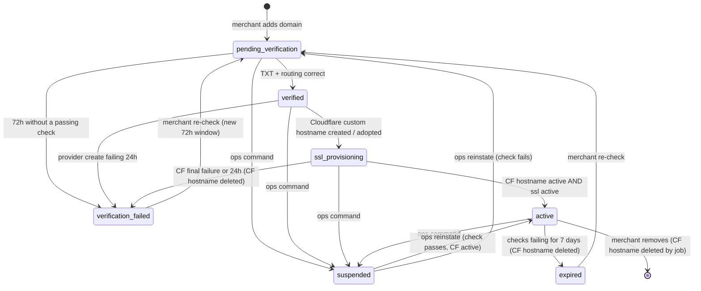

# Domain Infrastructure

Status: Accepted (Phase 0). ADR 0003. **Refined for Phase 6 on 2026-11-22 by `docs/development/PHASE-6-CONTRACT.md`**
(binding for the build; where this file and the contract differ, the contract wins).
Implementation: `apps/api/app/Domain/Domains` (Phase 6), `apps/api/app/Domain/Stores` (host resolution), storefront
`proxy.ts` + `lib/store.ts`.

## 1. Platform subdomains
- DNS (Cloudflare, proxied): `*.storeplix.com` CNAME → `storefront-origin.storeplix.com`. Universal/Advanced
  wildcard certificate on Cloudflare edge; origin uses Cloudflare Origin CA cert (Full (strict)).
- On store creation a `store_domains` row `{hostname: "{slug}.storeplix.com", type: platform, status: active, is_primary: true}`
  is inserted in the same transaction (`StoreProvisioner`). Slug validation: regex in DATABASE-DESIGN.md, reserved
  list in `config/storeplix.php` `reserved_slugs`.
- Platform rows are always `active`, never deletable, never in the state machine (P6-9). When the store's primary is a
  custom domain they stay routable and redirect to it (§5.4).
- Slug change (allowed once per 30 days; new platform row, old row kept as non-primary for 90 days → redirect):
  **not built** — there is no slug-change endpoint yet (Phase 8).

## 2. SSL strategy — decision
**Primary: Cloudflare for SaaS (Custom Hostnames).** Merchant points `shop.acme.com` CNAME →
`customers.storeplix.com` (`DOMAINS_CNAME_TARGET`, our CNAME target in the SaaS zone, pointing at the fallback
origin). After **our own** TXT + CNAME check passes (§3), the API creates a Custom Hostname via the Cloudflare API with
`ssl.method = "http"` (HTTP DCV works because the CNAME is already in place; VERIFY for flattened apex). Cloudflare
issues and auto-renews the cert, terminates TLS at the edge, applies WAF/DDoS/CDN, and forwards to our origin with the
original `Host`. Unproven hostnames never reach Cloudflare, so they are never billed or issued a certificate.

Why: zero cert ops on our side, renewals and rate limits handled, DDoS/WAF included, edge caching for BD
latency, scales to thousands of hostnames; cost ($0.10/hostname/month after the first 100) is small vs plan prices.
Apex domains: supported only via CNAME flattening / ALIAS at the merchant's DNS provider (OPEN-QUESTIONS Q4, Q75);
no anycast IPs are handed out (Apex Proxying is an enterprise add-on, not used). The UI recommends `www` as primary
and adding the apex as a second domain that redirects to it.

Integration is behind `CustomHostnameProvider` (`cloudflare` | `fake`); Phase 6 is **poll-only** (no Cloudflare
notification webhook, Q74). Driver calls and status mapping: PHASE-6-CONTRACT §5.2.

**Self-hosted alternative (documented, not deployed): Caddy on-demand TLS** with
`on_demand_tls { ask https://api.internal/api/v1/internal/domains/allowed?key=… }` (Caddy appends `&domain=`).
The `ask` endpoint is built in Phase 6 (6.5, P6-17): 200 only if the hostname is a custom row in
`verified | ssl_provisioning | active` or an `active` platform row, in a store that is not suspended; anything else
404 `domain_not_allowed`. It is reachable only on the internal network and needs `DOMAINS_ASK_KEY`. Rejected as
primary: we would own ACME rate limits, cert storage across nodes, and DDoS exposure.

## 3. Custom domain verification
Two records shown to the merchant (dashboard Online store → Domains, Figma V3 `2042:47403`):
| Record | Name | Value | Purpose |
|---|---|---|---|
| TXT | `_storeplix-verify.shop.acme.com` | `sp-verify=<verification_token>` (32 random bytes, base32 lowercase, no padding) | Proves ownership |
| CNAME | `shop.acme.com` | `customers.storeplix.com` | Routes traffic |

Both are required to verify **and are kept**: they are re-checked daily while `active` (Q72). Ownership = TXT match.
Routing = a CNAME in the answer chain equals the target, or, for a flattened apex, the host's A/AAAA sets are
non-empty subsets of the target's (P6-3). A host proxied by the merchant's own Cloudflare (orange cloud) can't pass;
the UI tells them to switch to "DNS only".

**Resolvers:** DNS-over-HTTPS only, two fixed endpoints from config (Cloudflare `cloudflare-dns.com/dns-query` and
Google `dns.google/resolve`, JSON API, 3 s timeout, concurrent). Both must agree for a pass; any resolver error makes
the check *inconclusive* (no state change). The merchant's hostname is only a query parameter — the API never connects
to it (no SSRF surface). `DOMAINS_FAKE=true` (local/CI/e2e) swaps in a fake resolver and a fake provider.

Validation on add (`POST /api/v1/stores/{store}/domains`, PHASE-6-CONTRACT P6-4–P6-7):
- Normalize (`Domains\HostnameInput`): lowercase, trailing dot, IDN → punycode (UTS46), label rules, ≤ 253, ≥ 2 labels,
  no IP literal, no scheme/path/port/wildcard; **Public Suffix List** (`jeremykendall/php-domain-parser`, committed
  snapshot): must have a registrable domain and not be a public suffix.
- Reject: platform domain and its subdomains, `storeplix.com`, the CNAME target (`domain_reserved`); special-use TLDs
  such as `localhost`, `local`, `internal`, `test`, `example`, `invalid`, `onion`, `arpa` (`domain_invalid`; fake mode
  allows `*.localhost` for e2e only); hostnames already in `store_domains` (`domain_taken`, global unique) — **unless**
  the existing row is `verification_failed` or `expired` for more than 7 days, in which case it is released and the
  new requester must still prove TXT (takeover protection: ownership is decided by DNS, not first-come; Q73).
- Plan gate: feature `custom_domain` (402 `feature_not_in_plan`) and limit `custom_domains` (Free 0, Starter 2,
  Growth 5; 402 `plan_limit_reached`; Q70). **Phase 7 (PHASE-7 §2.3, P7-16, Q81 resolving Q71):** when the
  effective plan drops below the shop's custom domains, the excess rows move to `expired` with failure code
  `plan_limit` at `subscriptions.domain_grace_ends_at` (7 days after the drop; immediately after a non-payment expiry);
  primary falls back to the platform subdomain; re-checking a `verification_failed`/`expired` row needs the plan.

## 4. State machine (as built in Phase 6)

Only `active` custom rows and platform rows are routable. Transitions live in `DomainStateMachine` (single place):
conditional `UPDATE … WHERE status = ?` under a per-domain lock, `status_changed_at`, `audit_logs`
`domain.status_changed`, event `DomainStatusChanged` (merchant email, Q76). Any status/primary/hostname change also
forgets the API host cache (`domain:{host}`) and revalidates every storefront host of the store (§5.5). A primary
domain that leaves `active` or is removed hands the primary back to the store's slug platform row automatically (P6-8).
Store suspension is separate: suspended stores never resolve, whatever their domain rows say.

### Background checks (queue `domains`)
One scheduler command, `domains:check` (every minute), finds due rows (`next_check_at <= now()`, discovery on
`pgsql_admin`) and dispatches a tenant-aware `CheckDomainJob` per row. Cadence (PHASE-6-CONTRACT §2.2):
- `pending_verification`: +1 m, +5 m, +15 m, then every 30 m until 72 h.
- `verified`: provider create retries +2/+5/+15/+30 m, then 30 m (24 h cap).
- `ssl_provisioning`: every 2 m for 1 h, then 15 m until 24 h.
- `active`: daily (± 1 h jitter); every 6 h while failing; failing for 7 days → `expired`.
- `verification_failed`, `expired`, `suspended`: not polled.
Plus `domains:reconcile-provider` (daily) deletes Cloudflare custom hostnames that no row references, and
`DeleteProviderHostnameJob` removes the hostname after a delete/expiry/SSL failure. Cloudflare webhooks may later
short-circuit polling (Q74). Ops: `domains:suspend {host}`, `domains:reinstate {host}`, `domains:update-psl`.

## 5. Host header validation and routing
1. **Edge:** only Cloudflare IPs may reach origin (Nginx `allow` list of Cloudflare ranges / Cloudflare Tunnel); Nginx
   `server_name` default server for storefront returns 444 for hosts not matching `*.storeplix.com` unless the request
   comes from Cloudflare (custom hostnames arrive with their original `Host`). RUNBOOK §9.
2. **Storefront:** uses `Host` (not `X-Forwarded-Host`) after Nginx; Nginx sets `proxy_set_header Host $host`
   and strips client-supplied `X-Forwarded-Host`. Normalized host is passed to API as `X-Storefront-Host`.
3. **API:** treats `X-Storefront-Host` as an untrusted claim → accepted only together with valid `X-Storefront-Key`
   and only if it matches a routable `store_domains` row (`sp_resolve_host`, `active` only, store not suspended).
   Laravel `TrustHosts` restricts the API's own Host to `api.storeplix.com`.
4. **Primary redirects (6.4, P6-15):** the API returns `StorefrontConfig.store.redirect_host` (the primary) when the
   request host is another host of the store, the request is not a valid preview, and the primary or the request host
   is a custom domain. The storefront
   permanently redirects GET page requests to the same path + query on the primary (Next.js `permanentRedirect`, 308)
   and `robots.txt`/`sitemap.xml` with 301. Platform hosts never redirect to a platform primary; a non-primary custom
   host always redirects. Unknown or not-yet-active hosts → platform 404 page, `noindex`, no tenant data.
5. **Cache:** any host-derived data is keyed by the normalized host (storefront tag `store:{host}`, API key
   `domain:{host}`). Domain status/primary/hostname changes forget the API key and post every store host to the
   storefront's `/api/revalidate` (existing `RevalidateStorefront` job); bookkeeping-only check updates don't.
   Shopper cookies (`sp_cart`, `sp_order`) are host-only, so a primary switch starts new carts on the new host.

## 6. Local development
`demo.localhost:3010` (browsers resolve `*.localhost` to 127.0.0.1) and `demo.storeplix.test` (add to `/etc/hosts`).
Seeder creates both rows as `active` platform rows (primary `demo.storeplix.test`). `DOMAINS_FAKE=true` (compose,
CI) binds the fake DNS resolver and fake Cloudflare provider; testing-only `/api/v1/dev/domains/{id}/{dns|provider|age}`
endpoints drive them, and custom hosts ending in `.localhost` are accepted so e2e can browse them. The API refuses to
boot with `DOMAINS_FAKE=true` in production.

## 7. Required tests
Full list: PHASE-6-CONTRACT §9–§10 (S40–S52). Minimum:
- Adding `x.storeplix.com`, an IP, a public suffix, or an already-active hostname of another tenant → 422.
- Verification passes only when the TXT token matches this domain's token (token of another domain → fail).
- Storefront request with a host in `pending_verification` / `verified` / `expired` / `suspended` → 404.
- Forged `X-Storefront-Host` without key → 401; with key but unknown host → 404.
- State machine rejects illegal transitions (e.g. `pending_verification → active`).
- Custom primary → platform host redirects; platform primary → no redirects; preview never redirects.
- `ask` endpoint 200 only for allowed statuses; byte-identical 404 otherwise; 401 without the key.
