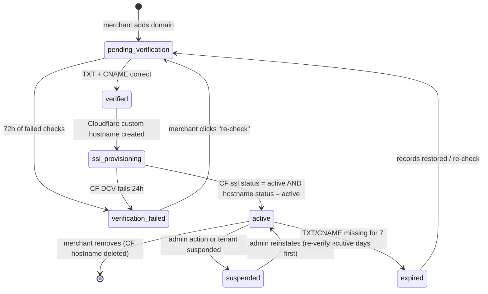

# Domain Infrastructure

Status: Accepted (Phase 0). ADR 0003. Implementation: `apps/api/app/Domain/Domains`, storefront `middleware.ts`.

## 1. Platform subdomains
- DNS (Cloudflare, proxied): `*.storeplix.com` CNAME → `storefront-origin.storeplix.com`. Universal/Advanced
  wildcard certificate on Cloudflare edge; origin uses Cloudflare Origin CA cert (Full (strict)).
- On store creation a `store_domains` row `{hostname: "{slug}.storeplix.com", type: platform, status: active, is_primary: true}`
  is inserted in the same transaction. Slug validation: regex in DATABASE-DESIGN.md, reserved list in SYSTEM-ARCHITECTURE.md §3.
- Slug change (allowed once per 30 days): new platform row, old row kept as non-primary for 90 days → 301 redirect.

## 2. SSL strategy — decision
**Primary: Cloudflare for SaaS (Custom Hostnames).** Merchant points `shop.acme.com` CNAME →
`customers.storeplix.com` (our fallback origin hostname). We create a Custom Hostname via Cloudflare API with
`ssl.method = "http"` (DCV via HTTP when CNAME already in place) or `txt`. Cloudflare issues and auto-renews the cert,
terminates TLS at the edge, applies WAF/DDoS/CDN, and forwards to our origin with the original `Host`.

Why: zero cert ops on our side, renewals and rate limits handled, DDoS/WAF included, edge caching for BD
latency, scales to thousands of hostnames; cost ($0.10/hostname/month after the first 100) is small vs plan prices.
Apex domains: supported via CNAME flattening at merchant's DNS (if their provider supports it) or by pointing A records
to Cloudflare-provided anycast IPs (Apex Proxying, enterprise add-on) — Phase 6 default: recommend `www.` + apex
forwarding, see OPEN-QUESTIONS Q4.

**Self-hosted alternative (documented, not built): Caddy on-demand TLS** with `on_demand_tls { ask https://api.internal/api/v1/internal/domains/allowed }`;
the `ask` endpoint returns 200 only if hostname is in `store_domains` with status `verified|ssl_provisioning|active`.
Used only if we leave Cloudflare; the `ask` endpoint is built anyway (Phase 6) because it doubles as our own
allowlist check. Rejected as primary: we would own ACME rate limits, cert storage across nodes, and DDoS exposure.

## 3. Custom domain verification
Two records shown to the merchant (dashboard Online store → domain, Figma 60:11061):
| Record | Name | Value | Purpose |
|---|---|---|---|
| TXT | `_storeplix-verify.shop.acme.com` | `sp-verify=<verification_token>` (32 random bytes, base32) | Proves ownership |
| CNAME | `shop.acme.com` | `customers.storeplix.com` | Routes traffic |

Ownership = TXT match (required). Routing = CNAME resolves to our target (or A records to Cloudflare IPs for apex).
DNS lookups use a dedicated resolver (Cloudflare 1.1.1.1 + Google 8.8.8.8 via DoH, both must agree) to avoid
cached/poisoned answers; never the merchant's claim.

Validation on add (`POST /merchant/domains`):
- Normalize (HostNormalizer); must be a registrable FQDN (Public Suffix List check, `jeremykendall/php-domain-parser`).
- Reject: platform domain and subdomains (`*.storeplix.com`), IPs, `localhost`, internal TLDs, hostnames already
  in `store_domains` (global unique) — unless the existing row is `verification_failed` for > 7 days and the new
  requester proves TXT (takeover protection: ownership is decided by DNS, not first-come).
- Plan gate: `plans.limits.custom_domain = true`; max domains per plan.

## 4. State machine

Only `active` (and `platform` rows) are routable. Transitions are implemented in `DomainStateMachine` (single place),
each writes `audit_logs` and emits `DomainStatusChanged` (→ email merchant, revalidate `host:{hostname}` tag,
bust `sp:host:{hostname}` cache).

### Background checks (queue `domains`)
- `VerifyDomainJob` for `pending_verification`: backoff schedule 1 m, 5 m, 15 m, then every 30 m until 72 h.
- `PollSslStatusJob` for `ssl_provisioning`: every 2 m for 1 h, then 15 m until 24 h.
- `RecheckActiveDomainsJob` (scheduler, daily): verify TXT+CNAME still present; 7 consecutive failures → `expired`.
- Cloudflare webhook (`ssl.custom_hostname_certificate.*` notifications) short-circuits polling where available.
- All jobs tenant-aware; per-hostname lock to avoid concurrent transitions.

## 5. Host header validation (routing safety)
1. **Edge:** only Cloudflare IPs may reach origin (Nginx `allow` list of Cloudflare ranges / Cloudflare Tunnel); Nginx
   `server_name` default server for storefront returns 444 for hosts not matching `*.storeplix.com` or our CF SaaS
   origin header (Cloudflare adds `CF-Connecting-IP`; custom hostnames arrive with original `Host`).
2. **Storefront:** uses `Host` (not `X-Forwarded-Host`) after Nginx; Nginx sets `proxy_set_header Host $host`
   and strips client-supplied `X-Forwarded-Host`. Normalized host is passed to API as `X-Storefront-Host`.
3. **API:** treats `X-Storefront-Host` as an untrusted claim → accepted only together with valid `X-Storefront-Key`
   and only if it matches a routable `store_domains` row. Laravel `TrustHosts` restricts the API's own Host to `api.storeplix.com`.
4. Non-primary routable hosts 301 to primary; unknown hosts → platform 404 page, `noindex`, no tenant data.
5. Cache key for any host-derived data always includes the normalized host (route segment `[host]`).

## 6. Local development
`demo.localhost:3000` (browsers resolve `*.localhost` to 127.0.0.1) and `demo.storeplix.test` (add to `/etc/hosts`).
Seeder creates both rows as `active`. `DOMAIN_DNS_FAKE=true` in local/CI makes verification read expected
records from a fake resolver table so the state machine is testable without real DNS.

## 7. Required tests
- Adding `x.storeplix.com`, an IP, or an already-active hostname of another tenant → 422.
- Verification passes only when TXT token matches this domain's token (token of another domain → fail).
- Storefront request with host in `pending_verification` → 404.
- Forged `X-Storefront-Host` without key → 401; with key but unknown host → 404.
- State machine rejects illegal transitions (e.g. `pending_verification → active`).
