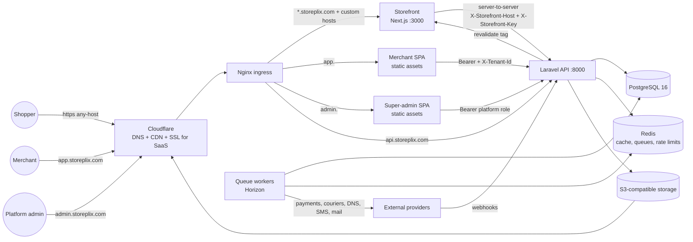

# System Architecture

Status: Accepted (Phase 0). Related ADRs: 0001, 0002, 0003, 0009, 0010.

## 1. Context diagram



## 2. Components and responsibilities

| Component | Responsibility | Never does |
|---|---|---|
| `apps/api` | Single source of truth: auth, tenancy, business logic, persistence, provider integrations, webhooks | Render HTML for shoppers |
| Queue workers | Same codebase as API (`php artisan horizon`); DNS checks, emails, courier sync, webhook processing, image processing, revalidation calls | Run without tenant context for tenant data |
| Scheduler | `php artisan schedule:work` single instance; domain re-checks, subscription renewals, abandoned carts | — |
| `apps/storefront` | One Next.js deployment serving every store; resolves store by `Host`, fetches render data from API, renders theme | Hold secrets beyond `STOREFRONT_API_KEY`; query DB; run merchant JS |
| `apps/merchant-dashboard` | Merchant SPA; all writes through tenant routes and `/api/v1/stores/{store}/*` | Call storefront or admin endpoints |
| `apps/super-admin` | Platform admin SPA; `/api/v1/admin/*` | Use merchant tokens |
| PostgreSQL | Shared DB, shared schema, `tenant_id` column + RLS (phased) | — |
| Redis | Cache (tenant-prefixed), queues, rate limiter, locks, sessions for storefront carts (token lookup) | Be the source of truth |
| S3 storage | Media under `tenants/{tenant_id}/...`; served via CDN | Serve executable content |
| Cloudflare | DNS for platform domain, CDN, WAF, SSL for SaaS custom hostnames | — |

## 3. Hostnames

| Host | Target |
|---|---|
| `storeplix.com`, `www.` | Marketing site (out of scope; storefront app can host later) |
| `app.storeplix.com` | Merchant SPA |
| `admin.storeplix.com` | Super-admin SPA (IP allowlist / Cloudflare Access in prod) |
| `api.storeplix.com` | Laravel API |
| `{slug}.storeplix.com` | Storefront (wildcard) |
| merchant custom hosts | Storefront via Cloudflare custom hostname → fallback origin |
| Dev | `api` localhost:8000, merchant :5173, admin :5174, storefront `demo.localhost:3000`; `PLATFORM_DOMAIN=storeplix.test` |

Reserved slugs (cannot be store slugs): `app, admin, api, www, mail, cdn, static, assets, status, help,
docs, blog, shop, store, storeplix, dashboard, billing, support, ns1, ns2`, any slug < 3 chars.

## 4. Key request flows

### 4.1 Storefront page
1. Shopper requests `https://acme.storeplix.com/products/tee`.
2. Next.js `middleware.ts` normalizes host (lowercase, strip port, strip trailing dot, punycode) and
   rewrites to `/_store/[host]/products/tee` (internal segment; host becomes a cache dimension).
3. Server Component calls `GET /api/v1/storefront/config` and `/storefront/products/{slug}` with
   `X-Storefront-Host: acme.storeplix.com` and `X-Storefront-Key`. Fetches are tagged
   `store:{store_id}` / `product:{id}` for on-demand revalidation (see STOREFRONT-ENGINE.md).
4. API resolves store from `store_domains` (Redis-cached 60 s, busted on domain change); 404 → storefront
   renders platform "store not found" page with `noindex`.

### 4.2 Merchant write
SPA → `POST /api/v1/stores/{store}/products` with Bearer + `X-Tenant-Id` → `auth:sanctum` → `tenant` middleware
(membership check, binds `TenantContext`) → `store` middleware (binds `StoreContext`; foreign store → 404) → Form Request → Policy → Action → Eloquent (scoped) →
domain event → listeners (queue) e.g. `RevalidateStorefront`, `WriteAuditLog`.

### 4.3 Checkout & payment
Storefront → `POST /storefront/checkout` (Idempotency-Key) → order `pending_payment` + stock reservation →
gateway `initiate` → redirect shopper → gateway callback/webhook → server-side `verify` with provider →
order `paid` → stock committed → events. Redirect query params are never trusted (ADR 0006, 0007).

## 5. Laravel internal structure

```
app/
  Domain/<Module>/            Catalog, Orders, Customers, Inventory, Checkout, Payments, Shipping,
                              Stores, Domains, Themes, Billing, Identity, Audit
    Models/ Actions/ Events/ Listeners/ Policies/ Data/ (DTOs) Enums/ Jobs/
  Http/
    Controllers/Api/V1/{Merchant,Storefront,Admin,Auth}/
    Requests/ Resources/ Middleware/
  Support/Tenancy/            TenantContext, TenantScope, BelongsToTenant, middleware, job middleware
  Integrations/{Payments,Couriers,Sms,Dns}/   driver contracts + implementations
```
Modules communicate via Actions and domain events, not by reaching into each other's tables.

## 6. Environments
`local` (Docker Compose: postgres, redis, minio, mailpit) · `ci` (ephemeral Postgres/Redis services) ·
`staging` (prod-like, separate Cloudflare zone `storeplix-staging.com`) · `production`.
Config strictly via env; `packages/config` holds frontend env schemas (Zod) that fail build on missing vars.

## 7. Scaling posture (ADR 0010)
Stateless API and storefront containers behind Nginx/load balancer, horizontally scaled. Horizon workers
scaled per queue (`default`, `webhooks`, `notifications`, `domains`, `media`). Postgres primary + read
replica (Phase 9) with `read`/`write` connections. Redis single primary with persistence; separate
logical DBs for cache vs queues. Storefront HTML cached at Cloudflare edge with short TTL + tag revalidation.

## 8. Observability
Structured JSON logs with `request_id`, `tenant_id`, `user_id` on every line (Laravel log context +
Next.js logger), shipped to centralized logging (Phase 9: Grafana Loki or Better Stack). Sentry for
API/SPAs/storefront errors. Health: `GET /api/v1/health` (liveness) and `/api/v1/health/ready`
(DB + Redis checks, Phase 9).
